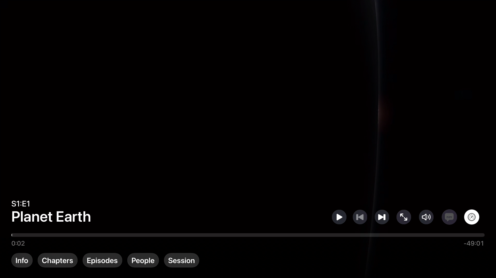
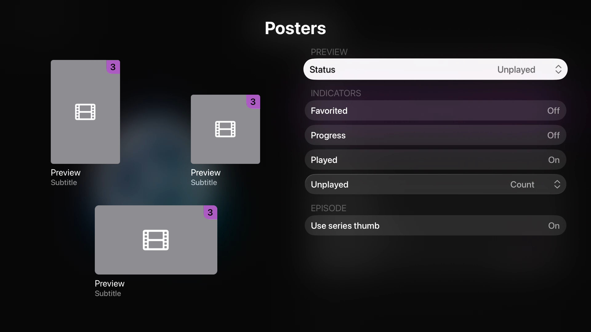
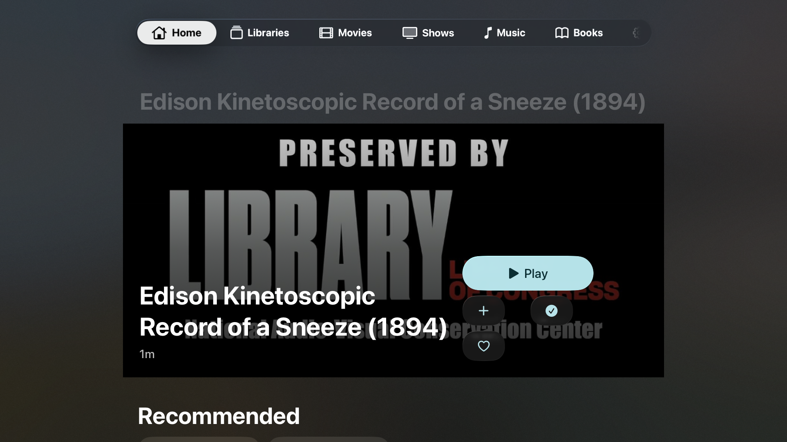

# Gus tvOS: Swiftfin comparison and implementation proposal

Research date: October 13, 2026. Historical investigation and proposal; this research task itself made no production or publication changes.

## Subsequent implementation and acceptance — October 13

The native TV work was subsequently implemented and merged through [PR #22](https://github.com/eslutz/A-Playa-Named-Gus/pull/22). [The integration ledger](../../Reviews/2026-10-13-tvos-redesign/INTEGRATION.md) records cinematic browsing/details, native account/playback presentation, retained-parent focus restoration, title fallback and review fixes. [The runtime ledger](../../Reviews/2026-10-13-tvos-redesign/RUNTIME.md) records the later TV simulator acceptance.

Xcode Cloud Build 17 validated merged commit `a794a7f308c3c4281e6b98a5f2f908f3a684207b`: all iOS, macOS, tvOS and visionOS tests, archives and internal TestFlight actions succeeded, with zero warnings/errors across all 12 action issue lists. See [pipeline acceptance](../../AppStore/pipeline-policy.md#verified-merged-main-acceptance--2026-10-13).

The runtime/destination blocker below describes the earlier research environment and is superseded by that later validation. Physical remote, VoiceOver speech, HDR/audio output, signed multi-device sync and live Swiftfin parity remain separate acceptance limits. Original recommendations and decisions below are historical proposals, not a new implementation backlog or current defect list.

## Recommendation and evidence limits

Give Gus a dedicated television composition over its existing native services: a cinematic, focus-driven **unified Next Up** Home; spacious libraries; an action-led movie/series detail; Swiftfin-style account switching with an optional faster native entry point; and richer **AVKit** playback. Swiftfin is useful as a reference for hierarchy, artwork and remote interaction. Its runtime architecture and custom media controls are not suitable foundations for Gus.

Eric’s “iPad port” concern has a source-supported basis: Gus has TV card sizing and native focus sections, but shares Home/detail composition, a 1,320-point page cap, six-column grid, text/action arrangement and settings forms with other platforms. This is a design recommendation, not a newly reproduced runtime defect. Historical Gus captures show a constrained rectangular detail backdrop, repeated title and fragmented icon actions. Current source has since changed; these images cannot establish current defects.

**At the original research baseline, runtime review was blocked.** `project.yml` targeted tvOS 27.0. Xcode reported 27.0 (27A266a); installed tvOS simulators were 17.5 and 26.5, and the listed physical Apple TV was 26.6. The original build attempt failed destination selection before compilation. Its temporary raw log was deleted when this report was archived; this paragraph preserves the failure summary. No deployment override, runtime installation or signing workaround was attempted. No Gus remote, focus restoration, account switch, playback, VoiceOver speech or contrast acceptance ran in this task. Swiftfin was source-reviewed at exact revisions and official PR demo frames were inspected; Swiftfin itself was not built or played here. This is a comparative research proposal, not a completed live accessibility audit.

## Baseline, scope and provenance

Gus: `feature/unified-next-up-playlists`, `ca5a6e67f348118474e2485a6a49a4148699d7da`. The initial checkout already had a modified App Store pipeline policy, two untracked pipeline evidence images and untracked Plans/Research content. Preserved. Read `CLAUDE.md`, roadmap, account/root/navigation, Home/library/detail/player sources and the [Next Up implementation ledger](../../Reviews/2026-10-12-next-up-playlists/IMPLEMENTATION.md). `.agents/skills` does not exist in this checkout. Used the available iOS UI Review and Product Design audit methodology; its context preflight found no saved Product Design context. No memory edits or communication with the completed dependency session.

Gus is an Apple-first Jellyfin client for iOS/iPadOS, tvOS, visionOS and macOS, plus a focused Watch companion. Core constraints: system frameworks; Observation/MainActor; typed SwiftUI navigation; platform divergence in `Platform/`; Jellyfin provider boundary; AVKit video, native audio, no VLCKit. Readium is an explicitly justified mobile EPUB exception and is not a TV dependency. Retain music, audiobooks, photos, Live TV, books’ appropriate TV behavior, Top Shelf, remote sessions, rating gates and future provider separation. A video-focused comparator must not silently narrow Gus’s product.

The new local feature baseline includes unified Next Up, ordered Jellyfin video playlists with repeated entries and persistent cursor, private CloudKit saved-media/activity sync, and issue #20’s identity-safe reference recovery, committed progress-transfer staging and related-detail reload fixes. Source/test completion is recorded by the ledger; physical sync, signed provisioning and full assistive acceptance remain open. Do not restart those tasks or infer publication from this report.

### Verified official Swiftfin versions

Official upstream is `jellyfin/Swiftfin`, rather than Eric’s reference fork. Release timestamps came from the GitHub releases API, saved in [release metadata](evidence/swiftfin-releases.json); source hashes came from the official clone. App Store lookup is [saved separately](evidence/swiftfin-store.json).

| Baseline | Exact revision | Date and meaning |
|---|---|---|
| 1.5, major tvOS refresh | `7891e2735bca8832ee88225cdaf7637f727052d4` | Commit July 15, 2026 01:57:40 UTC; release published July 15 04:55:11 UTC |
| 1.6 | `24b4fb3ba7abc6552021a7741ef4850f4acc44a8` | Release August 12, 2026 17:45:55 UTC |
| 1.6.1, latest non-prerelease returned | `5b794d2b7d4b54db89b041b8d6355461de7110db` | Commit August 21 22:36:14 UTC; release August 23 00:05:36 UTC; US App Store version 1.6.1 reports August 24 22:43:06 UTC |
| Current official main snapshot | `791fe1249e12ffd066c763f28b4291866a14ac49` | October 12, 2026 12:32:03 UTC; 157 commits after 1.6.1; latest commit is a translation |

Sources: [1.5](https://github.com/jellyfin/Swiftfin/releases/tag/1.5), [1.6](https://github.com/jellyfin/Swiftfin/releases/tag/1.6), [1.6.1](https://github.com/jellyfin/Swiftfin/releases/tag/1.6.1), [pinned main](https://github.com/jellyfin/Swiftfin/tree/791fe1249e12ffd066c763f28b4291866a14ac49), [App Store](https://apps.apple.com/us/app/swiftfin/id1604098728). Release publication, commit dates and storefront dates are different events. Neither main nor a merged PR proves App Store shipment. TestFlight’s precise distributed build was not verified.

### Shipped refresh versus later source

1.5 includes content groups and redesigned headers/Home, new tvOS player UI, playback info, default-track settings, HDR/DV device-profile conditions, generic paging libraries, unified account selection and a tvOS storage repair. [Content groups #2075](https://github.com/jellyfin/Swiftfin/pull/2075) raised tvOS minimum to 26 and introduced layout groups. [Player #1902](https://github.com/jellyfin/Swiftfin/pull/1902) explicitly adapts iOS player controls for TV focus, swipes and buttons. Its demo predates final release. These are shipped provenance, not guarantees that every behavior is bug-free.

1.6 adds system sidebar adaptation, season details, Live TV work, poster previews, recently played, subtitle burn-in and maximum resolution settings. It also fixes initial episode Play focus and other player focus issues. 1.6.1 fixes consecutive TV deep links, search overlap, empty/error libraries, slow scrubbing, unsupported-hardware glass and background playback. These maintenance fixes should inform Gus regression cases as much as the visual refresh does. [1.6 release](https://github.com/jellyfin/Swiftfin/releases/tag/1.6), [1.6.1 release](https://github.com/jellyfin/Swiftfin/releases/tag/1.6.1).

**Unreleased relative to 1.6.1:** main includes [mpv #2274](https://github.com/jellyfin/Swiftfin/pull/2274), September 6; [TV tab-placement setting #2256](https://github.com/jellyfin/Swiftfin/pull/2256), August 31; [TV filters #2321](https://github.com/jellyfin/Swiftfin/pull/2321), September 25; and [NativePlayer replacement #2046](https://github.com/jellyfin/Swiftfin/pull/2046), October 4. Main’s AV proxy adds more integrated track/display handling; do not present it as released native-player parity. The separate [autoplay Home hero proposal #2074](https://github.com/jellyfin/Swiftfin/pull/2074) was closed unmerged July 11. In contrast, the cinematic **selection** group is present in tagged 1.6.1. Do not conflate those two designs.

## Visual references and checked steps

These are inspected reference images, not screenshots of app flows executed by this task. No new Home/library/detail screenshot from Swiftfin’s latest build was obtained. US App Store metadata returns no Apple TV screenshot URLs, and its iPad URLs identify 2022 captures; those were excluded as refresh evidence. Search results containing old TV screenshots or third-party promotional mockups were also excluded.

1. **Swiftfin player reference — inspected, limited.** Frame at 4 seconds in the official [#1902 demo](https://github.com/user-attachments/assets/6c37023f-2a42-4cc9-b7be-8d9747fd2d30), whose PR body says updated June 6, 2026. Large title/episode locator at lower left, grouped transport at right, timeline and Info/Chapters/Episodes/People/Session row. White focused control is distinguishable. This is the custom player demonstration, not proof of Native controls or final 1.6.1 behavior. The frame’s dark video area does not invalidate its visible-control evidence, but offers no picture-quality evidence.

2. **Swiftfin poster-preview reference — inspected, limited.** Frame at 2 seconds in [#2176 TV demo](https://github.com/user-attachments/assets/fe000e0a-d419-4726-a4ab-53376e730a89), included by 1.6. Readable native settings rows, clearly focused Status field, preview title/subtitle and unplayed-count badges; wide artwork gets its own row. This is a settings preview, not the actual library or an artwork quality benchmark.

3. **Gus historical detail — inspected, historical context.** [October 10 capture](../../Reviews/2026-10-10-ui-remediation/evidence/tv-final/tv-detail-full-screen.png). The backdrop occupies a centered panel, the long title is repeated above and within it, and secondary actions split into separate icon placements. Useful evidence of the direction Eric dislikes, not a current-revision defect reproduction. Native tab chrome is already present.

4. **Gus historical return-to-Home — inspected, historical context.** [October 10 capture](../../Reviews/2026-10-10-ui-remediation/evidence/tv-final/tv-detail-return-home.png) contains keyboard/search over Home and recently added books. It illustrates how search can dominate the browsing canvas, but does not establish a current search bug. New unified Next Up is not shown.

5. **Current Gus launch/Home/library/detail/account/playback — blocked.** Destination mismatch above. All live flow steps and accessibility settings are untested in this run. The source comparison below is explicitly independent of historical screenshots.

## Confirmed source findings and design priorities

| ID / priority | Classification | Finding, impact and evidence | Proposed response and acceptance |
|---|---|---|---|
| TV-01 / P1 | Source-supported design recommendation | Shared `HomeView.content`, `LibraryGridView.content`, `ItemDetailView.detailContent` and `PageContentMetrics.maxWidth = 1320`; TV grid is six flexible columns. TV already uses 240-point rail posters/420-point landscape cards and 40-point grid gaps, so it is not wholly unadapted. Within a 1,320-point grid, six cards minus five 40-point gaps leave about 187 points each before padding; declared 220–260 grid bounds do not constrain those flexible columns. | TV-specific composition and measured layout budget. Confirm card/label legibility, realized grid widths and unclipped focus enlargement at 1080p and 4K. Do not merely increase every font or remove all whitespace. |
| TV-02 / P1 | Source-supported risk, not reproduced | `RootNavigationState` retains paths/scroll anchors, while rail/grid source uses focus sections without explicit item-level focus bookmarks. Retained scroll does not prove restoration of the selected card after playback, refresh or modal dismissal. | Stable TV focus identity per account/route/section/item or playlist-entry UUID. Test exact return card and nearest surviving fallback after deletion/reorder. |
| TV-03 / P1 | Confirmed existing functionality, presentation opportunity | `AppModel.switchToStoredUser` and Settings account rows already switch saved users using server+user credentials. This is not a missing backend feature. | Accept Swiftfin’s current TV switching UX as the baseline. Optionally expose a native account menu near root navigation for fewer remote steps; retain server labels and Settings management. Repeated/cancelled switching must not expose another account’s data. |
| TV-04 / P1 | Confirmed existing functionality | `TVPlayerSurface` embeds `AVPlayerViewController`, with custom native transport menus for audio, subtitles and chapters. `PlaybackStore` uses media selection with rebuild fallback and cancellation generations. | Keep and improve this foundation. Validate default/forced tracks, repeated changes, playback position and paused state through fallback; no custom transport rewrite. |
| TV-05 / P2 | Source-supported design recommendation | `CinematicDetailHero` has 620-point TV minimum height, a black title panel, title/action HStack with fallback VStack and inherited max page width. It is a cross-platform hero rather than an independently composed TV detail. | Full-canvas art with safe-area content, one title, compact metadata, obvious Resume/Play and consistently grouped secondary actions; preserve contrast over arbitrary art. |
| TV-06 / P2 | Source-supported risk | `TVPlayerSurface` does not explicitly configure preferred display criteria, while the visionOS surface does. No TV `scenePhase` pause handling was found in the reviewed video view/store. Framework defaults may help, so neither is a proven bug. | Make TV display-matching and background policy explicit, verify SDK defaults and real output; include Now Playing ownership review because TV leaves AVKit automatic publishing enabled while Gus also has its controller. Measure before changing. |
| TV-07 / P2 | Confirmed existing boundary, decision needed | Rating settings are device-wide `@AppStorage`; tokens, saved references and playlists use account scope. | Preserve existing rating behavior and account isolation. A new profile lock/PIN is not required by this redesign; any later proposal needs a separate rating-policy decision. Never imply a UI PIN overrides Jellyfin authorization. |

Local evidence: [Home](../../../Sources/Features/Home/HomeView.swift), [library](../../../Sources/Features/Home/LibraryGridView.swift), [detail](../../../Sources/Features/Item/ItemDetailView.swift), [hero](../../../Sources/SharedUI/CinematicDetailHero.swift), [metrics](../../../Sources/SharedUI/LayoutMetrics.swift), [platform modifiers](../../../Sources/Platform/PlatformModifiers.swift), [navigation state](../../../Sources/Platform/RootNavigationState.swift), [account model](../../../Sources/Stores/AppModel.swift), [TV player](../../../Sources/Platform/PlayerSurface.swift), [playback store](../../../Sources/Stores/PlaybackStore.swift). Paths in this artifact point to the inspected checkout; the exact baseline hash above identifies source provenance.

## Screen-by-screen redesign proposal

### Root and navigation

Use native `TabView` sidebar adaptation for TV, with Home, Movies, Shows, Libraries, Playlists, Search, plus capability-driven Music/Live TV/Photos/Books and Settings. Keep navigation customization and ensure a long destination list remains accessible. Prefer concise visible labels and SF Symbols. Swiftfin 1.6 supplies shipped evidence for a sidebar; its later tab-placement setting is optional inspiration, not a required port. Preserve Gus’s per-section `NavigationStack` paths and root player host.

Swiftfin’s current tvOS switching experience is an acceptable baseline per Eric’s clarification. Optionally expose an Account button in the native root/sidebar or Settings entry point that opens a compact native menu of saved accounts without signing out. Avoid a decorative header on every pushed detail; one clear screen title is enough. Back/Menu unwinds native stacks/modals before exiting the root. It must never switch users, discard saved data or act as a global custom shortcut. Search belongs to a dedicated destination or deliberate invocation, so automatic keyboard focus does not obscure Home.

### Home

First viewport: full-canvas backdrop with a reliable dark scrim, a constrained title/logo and two-line metadata for the **focused Next Up entry**, followed by a landscape Next Up rail. Selection stays in the rail; artwork is atmosphere, not another focus stop. Use the exact existing builder output and identifiers; do not split Continue Watching and saved intent into new competing rails. Show a clear subtype: Resume with time remaining, next episode locator, saved movie, or playlist name and position/count. A playlist’s preview can use its cursor item; activating it opens playlist detail with an obvious Resume action. Never quietly play another item because artwork is unresolved.

Default focus should land on the first available Next Up entry after an initial load, or restore the prior entry on return. With empty Next Up, use recently added as the cinematic fallback and keep a clear empty-state explanation/action. Lower sections retain shared items where supported, latest libraries and progress-transfer/recovery messages. Missing references remain present with Retry/Choose Replacement/Remove; moving errors below the fold or silently filtering them would weaken the just-finished feature.

Debounce focus-driven art changes; cancel stale image work and keep a dark fallback on failures. No autoplay trailers or timed rotation in the first phase. Reduce Motion disables animated transitions. Refresh changes data without stealing focus; retain a removed focused entry’s nearest valid neighbor. Top Shelf continues deriving from the same account-filtered Next Up snapshot, with no credentials in the extension. A cinematic top section trades visible row density for identity and readability; test whether enough of the next section remains discoverable from the couch.

### Libraries, Movies and Shows

Libraries means server-defined collections; Movies/Shows means media-type aggregation. Label those scopes explicitly, avoiding Swiftfin’s documented library-name confusion. Top area: section title and native Sort/Filter controls with visible selected state. Grid below: approximately five to six readable posters in a full-width TV content region, tuned by actual viewport/focus safe area rather than fixed cross-platform width. Provisional 1080p design targets are roughly 220–260-point portrait widths, 32–48-point clear gaps and 60–90-point outer breathing room; these are starting budgets to validate, not Apple-mandated numbers or copied Swiftfin metrics.

Use portrait art for films/series, landscape thumbnails for episodes/Next Up, square art for albums and type-appropriate library tiles. Thumb/backdrop fallback should preserve aspect ratio rather than stretching a portrait. Add watched/favorite/unplayed indicators and resume progress with accessible values; do not use color alone. Titles may wrap to two lines or get a readable focused summary, without making focus resize the grid. Reserve space for the native focus effect to avoid edge clipping.

Keep paging incremental with stable item identity. Provide explicit empty-filter reset, page retry and offline/server failure states; a paging error must not throw away loaded items. Native filter sheets can add genre/year/rating/language after existing sort/watched status works well. Letter jumping is valuable for large libraries but must have a reachable entry/exit and return to the right grid item. Main-only Swiftfin TV filters are useful research, not a shipped feature claim.

### Movie, series, season and episode detail

Full-width canvas with artwork continuing behind the TV chrome, contrasted foreground and one title/logo (text fallback when no logo). Align the primary action and metadata in a stable lower-left zone; do not bury Resume among favorite/watched controls. Primary label distinguishes Resume and Play; offer Play from Beginning separately when meaningful. Start on the primary action for an ordinary opened movie/episode; returning from playback restores the original action/episode card.

Secondary native controls: Add/Remove Next Up, Add to Playlist, Favorite, Watched and More. Text labels or a readable focused label must explain state changes; icon-only symbols need accessible labels. Keep destructive/admin actions under More with their existing authorization, rather than giving them equal visual weight. Synopsis can open a focusable, scrollable full-description surface; no unreachable static-text region.

Series detail: clear next-unwatched/resume episode action, season selector, horizontal landscape episode cards with S/E, title, duration/progress and watched status; include Specials without assuming numeric season order. Selected season and episode identity restore on Back. Season detail retains a parent-series action. Below: cast, extras and recommendations, then technical/about details. Recommendations may be user-hideable. Current ID recovery must reload related content and reject late old-ID results as issue #20 now requires; visual state cannot become a cache of obsolete siblings.

### Playlists and Next Up full list

Dedicated playlist detail with name, entry count, cursor position and Resume/Play from Start. Each row is a distinct playlist **entry UUID**, even when media IDs repeat. Show unavailable entries inline; support Retry, explicit replacement and removal. Play from a chosen entry, move up/down or a native reorder mode, rename/add/remove via remote-friendly menus and native name forms. No drag-only gesture or bulk editor requiring touch. Preserve ordered Jellyfin writes and explicit playlist sequencing regardless of normal episode-autoplay preference. Cloud merge/recovery must not silently skip duplicates, reset cursors or reorder the rail merely because metadata refreshed.

Next Up Show All uses the same ordering/IDs as Home, with activity date semantics and load-more behavior intact. Recovery selections stage progress transfer only after committed version-checked replacement. Keep private-sync status legible in Settings and failure recovery available; a sync error is not a reason to sign out the Jellyfin account.

### Search, accounts and other media

Search opens native text entry deliberately, with results below/outside keyboard occlusion, distinct movie/show/episode/music scopes and empty/error feedback. Cancel returns focus to the invoking control. Preserve query per section/account; no leaked history from the previous user.

Account switching: retain Swiftfin’s current TV experience as an acceptable baseline. A lightweight optional accelerator is an Account button in the native sidebar/root that opens a native menu listing saved users, with current-account checkmark and server labels when needed. Selecting a valid saved user switches directly; Add/Manage Accounts stays available through Settings. This uses ordinary remote focus and Select, without reserving Menu/Back, Play/Pause or a hidden long-press gesture. No new full-screen household chooser, chooser-on-launch policy or PIN/security flow is required. Same-name users across servers must remain distinguishable. Missing/revoked credentials require re-authentication or Quick Connect where supported; cancelling leaves the current session usable.

Music/audiobooks retain queue, speed/chapters, Repeat/Shuffle and persistent Now Playing; Done closes presentation without stopping prepared audio, Stop remains explicit. Photos deserve a TV slideshow, not a video-grid-only design. Live TV deserves channel/program art, Now/Next information and a clear live-edge action; DVR additions require provider capability checks. Books may show metadata/library and supported handoff actions, but do not introduce mobile EPUB runtime dependencies to TV. Downloads remain excluded on TV. Remote/Watch control stays session-authorized and independent of local visual navigation.

## Swiftfin-to-Gus functionality mapping

| Swiftfin reference | Verified status | Gus adaptation / priority |
|---|---|---|
| Cinematic focused Home and background | Tagged 1.6.1 source | P1: adapt composition using unified Next Up, not Swiftfin’s separate Resume/Next Up grouping |
| Native sidebar | 1.6 release | P1: system TV sidebar, retain customizable Gus destinations |
| Enhanced/simple detail, bounded logo, parent navigation | Tagged source; 1.6 logo/focus fixes | P1: TV detail composition with text/logo fallback and deliberate primary focus |
| Stored users across servers, local access policy/PIN | Tagged source | Accept current Swiftfin-style switching; optional native fast-access menu. No required new chooser, lock/PIN flow or auth/storage stack |
| Native AVPlayer option | Shipped 1.6.1, limited integration | Keep Gus AVKit; Gus already supplies track/chapter menus. Do not copy outdated Native limitations into Gus |
| Integrated AV proxy / mpv | Main after latest tag | Study negotiation/lifecycle failure cases; no engine import |
| Track defaults, playback info, burn-in and resolution limits | 1.5/1.6 | P2: default/forced language policy, concise playback diagnostics, optional resolution ceiling alongside bitrate |
| Trickplay/episode/supplement custom player UI | 1.5 custom-player demo/source | P2/P3: use AVKit extension points for Skip/Next/info first; trickplay only after native support/API feasibility spike |
| Thumb preference, watched/unplayed counts, progress, recently played | Shipped releases/source | P2: suitable artwork and readable state; do not create a redundant recently-played priority above Next Up |
| Library error fixes and deep-link/focus regressions | 1.6/1.6.1 | P1 acceptance tests; source is a test-case catalog |
| TV filters | Main September 25 | P2 optional after existing filters and restoration; identify as unreleased reference |
| Server administration/backups/custom profiles | Shipped app has such surfaces | Low priority; avoid making Gus a TV admin dashboard or exposing arbitrary profile edits as routine playback |

## Native playback proposal and tradeoffs

Swiftfin 1.6.1 recommends its VLCKit-backed player for broader format/features; its native option is AVPlayer/AVPlayerViewController. Tagged [player documentation](https://github.com/jellyfin/Swiftfin/blob/5b794d2b7d4b54db89b041b8d6355461de7110db/Documentation/players.md) describes limited native track controls, while tagged native source has progress/lifecycle handling. Current main’s [AV proxy](https://github.com/jellyfin/Swiftfin/blob/791fe1249e12ffd066c763f28b4291866a14ac49/Shared/Objects/MediaPlayerManager/MediaPlayerProxy/MediaPlayerProxy%2BAVPlayer.swift) is materially different. Documentation on main still contains native limitations, so reconcile code and documentation rather than assuming they are synchronized.

Gus already negotiates playback information with device capabilities, native direct play when supported, HEVC-preferred fMP4 HLS fallback, media selection matching and server-side track rebuild. Preserve this. More formats without transcoding are not a sufficient reason to adopt VLC/mpv/KSPlayer: that conflicts with Gus’s explicit dependency/native-player mandate and would bring new controls, licensing, device-profile and lifecycle burdens.

Recommended sequence:

1. **Reliability and visibility:** retain native TV transport and existing Audio/Subtitles/Chapters menus. Avoid redundant native and custom track menus when both expose the same track. Label language, codec/channel count, default/forced/commentary flags accurately. Show selected state only after actual selection succeeds. Add a small Playback Info surface: Direct Play/Remux/Transcode, codec/resolution, bitrate, selected streams and server reason where available. Keep tokens/stream URLs out of visible diagnostics and logs.
2. **Display/output policy:** investigate automatic preferred display criteria on AVPlayerViewController for frame-rate/dynamic-range matching, preserve system user settings and restore output on exit. Do not declare HDR/Dolby Vision/Atmos from a codec badge alone. AVPlayer capability checks and server profiles are necessary but do not prove TV output. Test actual display/receiver paths, compatible DV profiles, SDR fallback and tone mapping; never promise lossless/bitstream Atmos from eight-channel audio configuration alone.
3. **Resume, end and queue:** native contextual actions for Next Episode/Next Playlist Entry and Play from Beginning. Explicit playlists retain their cursor and ordering; normal episode autoplay stays separate. A cancellable next-item prompt is preferable to an irreversible countdown. Where server media segments are exposed by Gus’s provider, prototype native Skip Intro/Credits via AVKit actions; unavailable data means no fabricated skip buttons. Confirm endpoint/version capability first.
4. **Selection/rebuild safety:** preserve time and paused/rate state on server-side track changes; serial/generation guards prevent old requests from replacing a new item. Cancel during preparation, dismissal or account switch must stop the stream and reject late completions. Detect failed negotiation and give useful retry/quality actions; avoid infinite automatic transcoding loops.
5. **Optional later enhancements:** native info/custom tabs, chapters artwork or AVKit-compatible thumbnail previews. Swiftfin’s custom trickplay timeline cannot simply be transplanted into AVKit. If native API support proves insufficient, document the narrow limitation rather than writing a replacement scrubber in phase one.

Apple reference: [Customizing tvOS playback](https://developer.apple.com/documentation/avkit/customizing-the-tvos-playback-experience), [WWDC playback session](https://developer.apple.com/videos/play/wwdc2021/10191/). These support investigating AVKit extension points, not a claim that every desired overlay or external trickplay feed works without further SDK testing.

Tradeoff: Apple-native controls and hardware paths provide system behavior and lower maintenance; some containers, image subtitles and unsupported audio need server remux/transcode/burn-in, with startup latency, server load and possible HDR loss. Validate that Jellyfin transcode permissions and capacity exist and explain failure when they do not. Compare actual negotiated output with original metadata. Do not weaken compatibility by advertising direct play for a container/codec/HDR combination on the strength of one hardware-decoder Boolean.

## Safe account switching and privacy boundaries

Eric accepts Swiftfin’s current TV account-switching UX as the baseline. Faster access is an optional presentation enhancement over existing `AppModel`, not a required new chooser or identity system. A Jellyfin account is `(serverID, userID)`; an Apple TV system user, iCloud identity and household PIN are distinct identities. Swiftfin’s tagged [SelectUserView](https://github.com/jellyfin/Swiftfin/blob/5b794d2b7d4b54db89b041b8d6355461de7110db/Shared/Views/SelectUserView/SelectUserView.swift) supports server-filtered saved accounts; its [session manager](https://github.com/jellyfin/Swiftfin/blob/5b794d2b7d4b54db89b041b8d6355461de7110db/Shared/Services/UserSession/UserSessionManager.swift) includes local authentication and active-playback stopping for cross-account deep links. Gus should adopt the user-visible pattern, not Factory/Combine/KeychainSwift machinery.

**Friction policy:** choosing a saved account is authorization to switch. Do not add “Are you sure?” confirmation, a second confirmation of playback stop, or a new PIN prompt for an ordinary valid saved-account switch. Necessary protective work is automatic: stop/cancel old playback and requests, preserve correctly scoped progress, clear sensitive surfaces and validate credentials. Prompt only when credentials actually need re-authentication, an already-enabled access policy requires authentication, or a separately requested destructive operation requires a decision. A short neutral loading state may be needed; it must not add a user acknowledgement. Failure should offer recovery and leave the old session intact where possible. Prototype the native menu’s reachability and action count before claiming it is faster or seamless.

Treat switch as an atomic session transition:

1. Resolve target server/token and optional local policy without destroying the active session. Mark a cancellable switch attempt; disable repeated commits while allowing cancellation. Missing token opens re-auth, not a blank signed-in Home. Do not erase a token solely on a temporary network failure.
2. Before committing a different account, pause/stop video and audio, cancel preparation, auto-next/playlist coordinator, provider requests and pending writes. Report final progress using the **old** authenticated session; queued retry records remain scoped to the old account. Never rebind an in-flight old request to the new client.
3. Publish the new session only once; invalidate old generations. Root identity replacement already recreates the signed-in tree, and RootView already stops audio/deactivates playlist transport on account change. Verify video teardown rather than assuming view disappearance completes before new content arrives.
4. Drop old navigation paths, focus bookmarks, search queries, remote socket state, shared-link state and private artwork/response cache access. Clear Top Shelf before replacement. Existing account cleanup clears Top Shelf/search and URLCache and preserves downloads on switch; maintain per-account saved-media persistence instead of deleting intentions during a switch.
5. Activate target scope and its private-sync transport, read only matching records, apply rating policy before first frame and publish a filtered Top Shelf snapshot. A spinner over the old person’s artwork is still an information leak; use neutral transitioning UI. On failure before commit, retain active account; after invalid credentials, provide explicit re-auth/recovery.

Tokens remain in Keychain under server+user; server/user metadata stay token-free. Private CloudKit uses a private database and saved record scopes; excluded payloads include tokens, server URLs, signed artwork URLs and downloaded files. Never sync “active user” as a command that silently changes another device’s Jellyfin identity. Devices authenticate independently. iCloud sign-out/account replacement must stop sync, isolate local envelope identity and prevent uploading old Apple-account records into a new private database. Local fallback is not proof of cross-device sync acceptance.

Top Shelf/Now Playing/remote session state deserve explicit cross-account tests: clear stale titles/images and controls, reject old deep links from another account unless the normal account-selection/authentication path is followed, and enforce rating filters both while browsing and when resolving/playback starts. A local PIN is convenience protection, not server authorization. Apple TV system-user integration can be explored through [Apple user management](https://developer.apple.com/documentation/tvservices/supporting-multiple-users-in-your-tvos-app), but require opt-in mapping, no guessed Jellyfin account association and no assumption that it changes CloudKit identity. Defer it until manual account-switch isolation is proven; no new PIN/security flow is required here.

## Proposed architecture

Keep `AppModel`, `SessionStore`, `RootNavigationState`, provider/domain models, `HomeStore`/`NextUpBuilder`, playlist/saved-sync stores and `PlaybackStore`. Compose TV views in a focused `Platform/TV/` layer (or the repository’s established equivalent); shared feature entry points select a platform presentation through narrow adapters. Do not scatter new `#if os(tvOS)` branches across stores or clone the full shared feature backend.

Suggested components: TV root container, TV Home, TV detail, TV library layout, an optional native TV account menu and a small session-owned focus bookmark value model. Focus identity includes account scope, section and route; playlist positions use entry IDs. SwiftUI `@FocusState`, `@FocusedValue`, focus sections/scopes and native focus effects should handle normal behavior. Add a narrow UIKit bridge only if a documented native focus limitation is reproduced. No general custom router or imperative focus manager copied from Swiftfin.

A presentation-only focused-item state drives background/title without changing domain selection or playback. Use AsyncImage and the existing tuned URLCache, cancel/debounce focused artwork, constrain image requests to viewport needs and omit decoration from accessibility. Keep sensitive artwork cleared on switch. Build measured TV layout metrics independently of the shared max width; keep dynamic/semantic text styles and system materials rather than a custom theme engine. Preserve Gus’s Winter Chill accent and G/play identity.

Playlist/Next Up changes enter existing store methods; the TV layer must not manufacture identity, sort by display refresh time or write CloudKit directly. Capability flags select unsupported media actions. Account transition guards belong at the session boundary, not individual avatar buttons. Playback remains one native player host per session; dialogs/menus cannot create competing players or Now Playing writers.

## Phased work and acceptance gates

| Phase | Scope and dependencies | Required evidence to accept |
|---|---|---|
| 0 / P0 | Obtain compatible tvOS runtime/device; capture current Gus at ca5a6e6 and Swiftfin shipped version; preserve pending publication/provisioning boundaries | Named OS/device/build/account fixture, accepted Home/library/movie/series/player/chooser screenshots; no fabricated or historical screenshots presented as current; baseline remote and VoiceOver checks |
| 1 / P1 | TV shell, focus model, Home unified Next Up, library layout, movie/series detail; no domain rewrites | 1080p/4K screenshots; remote-only browse/play/back; exact card/action focus restoration; long/translated titles and missing art; first-load/empty/error/paging; Next Up ordering matches existing builder |
| 2 / P1 | Verify existing switch lifecycle and scoped surfaces; optionally add faster native account access; no required PIN work | Two users on one server and same-name users across servers; cancelled/repeated switch/re-auth; neutral transitions; no old Top Shelf/search/artwork/progress/playlist/socket leaks; old async completions rejected |
| 3 / P2 | Native playback hardening, display policy, default tracks/info and queue actions | Direct/remux/transcode matrix, native/rebuild track selection, seek/resume/end/cancel, server stop/progress events, physical HDR/frame-rate/audio-output evidence; no custom transport regression |
| 4 / P2 | Remote playlist editing/recovery, richer filters/art badges, capability-driven Music/Photos/Live TV polish | Duplicate-entry identity and cursor persist across relaunch/reorder; explicit playlist sequencing independent of episode preference; missing-reference replacements preserve #20 guarantees; keyboard/modal cancellation restores focus |
| 5 / separate signed gate | Private iCloud/device sync and release acceptance after original session’s prerequisites | Provisioned physical iPhone → Apple TV sync, offline/reconnect, Apple-account change, concurrent edit/delete/cursor merge, privacy inspection and manual accessibility; no simulator-only claim of signed acceptance |

Production implementation is a new authorization step. No phase here authorizes push, PR, merge, signing/account modification or bypassing the completed dependency session’s publication block. Later implementation must regenerate XcodeGen for source additions, validate project/pins and localizations, run appropriate tests/builds on all supported destinations and update wiki/website when user-visible behavior changes. This report itself changes no user-visible product behavior.

### tvOS acceptance matrix

Use rights-cleared, reproducible fixtures with movies, series/Specials, long titles, no art, library paging, two accounts, restricted/unrated media, missing references, duplicate playlists, music and Live TV capability absence. Use real compatible hardware for output and assistive behavior. Record steps, expected/actual result, build, fixture and screenshot/log per failure; avoid private credentials in artifacts.

| Journey | Cases and pass condition |
|---|---|
| Launch/Home | Last user or chooser policy obeyed; focus reaches Next Up or fallback; incomplete fetch does not show another user; Home refresh preserves focus and activity order |
| Directional navigation | D-pad and touch/swipe remote, rapid movement, diagonal row transitions, edge/wrap behavior, focused enlargement, sidebar entry/exit; no trap, clipped label or unpredictable jump |
| Restoration | Home rail → detail → player → Back; grid scrolled several pages → detail → Back; season/episode → modal → cancel; same item restored, nearest survivor if removed |
| Back/Menu | Dismiss keyboard/menu/dialog first, return one stack level, exit playback with stop/progress reporting, root exits normally; no double-pop or forced account switch |
| Repeated/cancelled flows | Double Play, cancel while loading, retry failure, rapid audio/subtitle choices, dismiss during rebuild, repeated deep links A/B/A, switch during preparation/autoplay, open/close account selection ten times; at most one effective player/session transition |
| Playlists | A/B/A duplicate media, start middle, complete naturally, Back before completion, reorder/delete current entry, relaunch, missing/replaced ID, concurrent sync; entry cursor identifies occurrence, not media ID |
| Track/output | H.264/AAC MP4; HEVC/HDR compatible original; incompatible container remux/transcode; unsupported audio; text/forced/image subtitles; denied transcode; slow network; preserve pause/time through rebuild; no unsupported HDR/Atmos claim |
| Lifecycle | Background/foreground, remote pause/resume, network loss, server restart, app terminate/relaunch; TV video policy explicit, audio policy intentional, final events scoped correctly |
| Account/privacy | Two servers with identical user/item IDs, target expired token, unavailable server, user removal, old response finishing after switch, Top Shelf activation, iCloud unavailable/switch; no data/control leak |
| Accessibility | Real VoiceOver reading order, primary-action labels/states, rail grouping and heading navigation, error announcements, full synopsis scrolling, menu return focus; captions/subtitles; Reduce Motion, increased contrast/reduced transparency, large TV text and localization; no color-only progress/status |
| Performance | Measure launch-to-focusable-content, focus frame stalls and image memory/network bursts on actual older supported Apple TV and 4K hardware; benchmark baseline and phase result rather than claim improvement from source |

Apple’s [focus guidance](https://developer.apple.com/design/human-interface-guidelines/focus-and-selection) is the platform reference. An accessibility tree or screenshot cannot prove VoiceOver speech, rotor/navigation behavior or focus announcements. No such proof is claimed here.

## Licensing and reuse policy

Official Swiftfin is MPL-2.0: [pinned license](https://github.com/jellyfin/Swiftfin/blob/5b794d2b7d4b54db89b041b8d6355461de7110db/LICENSE.md). Mozilla describes MPL as file-level copyleft; distributed covered source/modifications carry source-availability and notice obligations. [Mozilla FAQ](https://www.mozilla.org/en-US/MPL/2.0/FAQ/). This is license identification, not a determination of every possible reuse scenario.

The stricter and decisive Gus rule is `CLAUDE.md`: Swiftfin is reference only, patterns/SDK call shapes may be studied, **never copy code**. Therefore all proposals here require independently written SwiftUI/AVKit code, original Gus assets and existing Gus dependencies. Do not copy Swiftfin source, macros, icons, app branding, cinematic container implementation, player controls or third-party movie art into Gus. PR demo frames are cited research references only, not bundled assets or an endorsement. MPL does not establish rights to depicted third-party media artwork or trademarks. Any future exception would need a deliberate project-policy and license review; none is proposed or authorized here.

## Decisions for Eric, separate from confirmed findings

1. **Home emphasis:** recommended focus-driven unified Next Up hero, no timed carousel/trailer autoplay initially. Decide whether cinematic backdrop remains enabled by default or is an appearance option.
2. **TV navigation:** recommended native sidebar; confirm preferred always-visible destinations and whether Playlists has its own entry versus Libraries. Retain customization and all applicable media types.
3. **Account switching:** settled baseline: Eric accepts Swiftfin’s current TV UX. Optional decision: add a native Account menu in the root/sidebar for faster direct selection of saved users. Retain last-user restore; no elaborate chooser, launch prompt or PIN/security flow is required. Household/per-user rating changes and Apple-system-user mapping are separate future scope.
4. **Playback:** recommended AVKit-only and explicit server fallback. Decide appetite for advanced output diagnostics/resolution limits and whether skip segments/thumbnail previews justify later feasibility work.
5. **Visual approval:** review fresh compatible-runtime captures before approving exact layout metrics. Historical images and source cannot settle final couch readability or focus polish.

No decision blocks completion of this report. They gate later implementation choices. The priority is TV composition and focus correctness, then account-switch isolation and native playback validation, followed by incremental library/playlist enhancements. Existing Next Up/playlists/private sync remain product constraints throughout.

## Original research coverage and limits

Checked: Gus instructions/product/platform architecture and exact local revision; current Home/library/detail/navigation/account/player and new saved-media source; official Swiftfin release timestamps, latest main hash and tagged 1.6.1 source; shipped/main distinctions; license; inspected official player/poster-preview frames and historical Gus context. Failed: current Gus destination selection. Blocked: compatible-runtime live Gus capture and remote/accessibility acceptance. Not checked: live Swiftfin Home/library/detail/account switching, App Store binary behavior, current TestFlight build, real HDR/DV/Atmos output, measured performance, VoiceOver and physical CloudKit. No production mutation or publication occurred.

The report is actionable for implementation planning, but does not establish runtime parity, full accessibility compliance or release readiness. Provisioning and publication remain with their original authorized workflow. Source clone and large demo videos remain temporary under `/tmp`; this durable artifact retains inspected PNG frames and metadata. The obsolete build-attempt log was deleted; subsequent implementation/acceptance is linked above.

## Pinned source index

- [Home group selection](https://github.com/jellyfin/Swiftfin/blob/5b794d2b7d4b54db89b041b8d6355461de7110db/Shared/ViewModels/ContentGroupViewModel/DefaultContentGroupProvider.swift) — tagged 1.6.1, inspected source.
- [Cinematic selection and resume fallback](https://github.com/jellyfin/Swiftfin/blob/5b794d2b7d4b54db89b041b8d6355461de7110db/Swiftfin%20tvOS/Objects/CinematicSelectionContentGroup.swift) — tagged 1.6.1, inspected source.
- [Focus-driven cinematic selector](https://github.com/jellyfin/Swiftfin/blob/5b794d2b7d4b54db89b041b8d6355461de7110db/Swiftfin%20tvOS/Components/CinematicItemSelector.swift) — tagged 1.6.1, inspected source.
- [Focused library background and debounce](https://github.com/jellyfin/Swiftfin/blob/5b794d2b7d4b54db89b041b8d6355461de7110db/Shared/Components/FocusedPosterCinematicBackgroundView.swift) — tagged 1.6.1, inspected source.
- [Enhanced detail header](https://github.com/jellyfin/Swiftfin/blob/5b794d2b7d4b54db89b041b8d6355461de7110db/Shared/Views/ItemView/Components/Headers/RegularEnhancedHeaderContentGroup.swift) — tagged 1.6.1, inspected source.
- [TV sidebar root](https://github.com/jellyfin/Swiftfin/blob/5b794d2b7d4b54db89b041b8d6355461de7110db/Shared/Coordinators/Tabs/MainTabView.swift) — tagged 1.6.1, inspected source.
- [Account grid](https://github.com/jellyfin/Swiftfin/blob/5b794d2b7d4b54db89b041b8d6355461de7110db/Shared/Views/SelectUserView/Components/SelectUserView%2BGridView.swift) — tagged 1.6.1, inspected source.
- [Focus coordination](https://github.com/jellyfin/Swiftfin/blob/5b794d2b7d4b54db89b041b8d6355461de7110db/Shared/Objects/FocusCoordinator.swift) — tagged 1.6.1, inspected source.
- [Shipped native AVKit surface](https://github.com/jellyfin/Swiftfin/blob/5b794d2b7d4b54db89b041b8d6355461de7110db/Shared/Components/NativeVideoPlayer.swift) — tagged 1.6.1, inspected source.
- [Shipped native proxy](https://github.com/jellyfin/Swiftfin/blob/5b794d2b7d4b54db89b041b8d6355461de7110db/Shared/Objects/MediaPlayerManager/MediaPlayerProxy/MediaPlayerProxy%2BAVPlayer.swift) — tagged 1.6.1, inspected source.
- [Native device profile](https://github.com/jellyfin/Swiftfin/blob/5b794d2b7d4b54db89b041b8d6355461de7110db/Shared/Objects/VideoPlayerType/VideoPlayerType%2BNative.swift) — tagged 1.6.1, inspected source.
