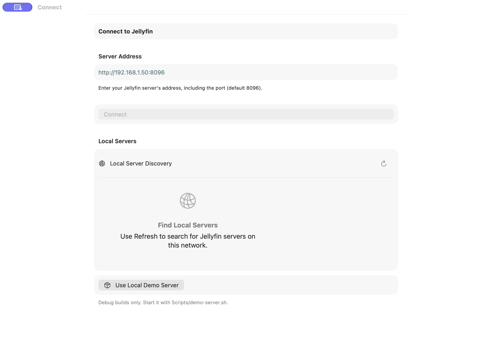
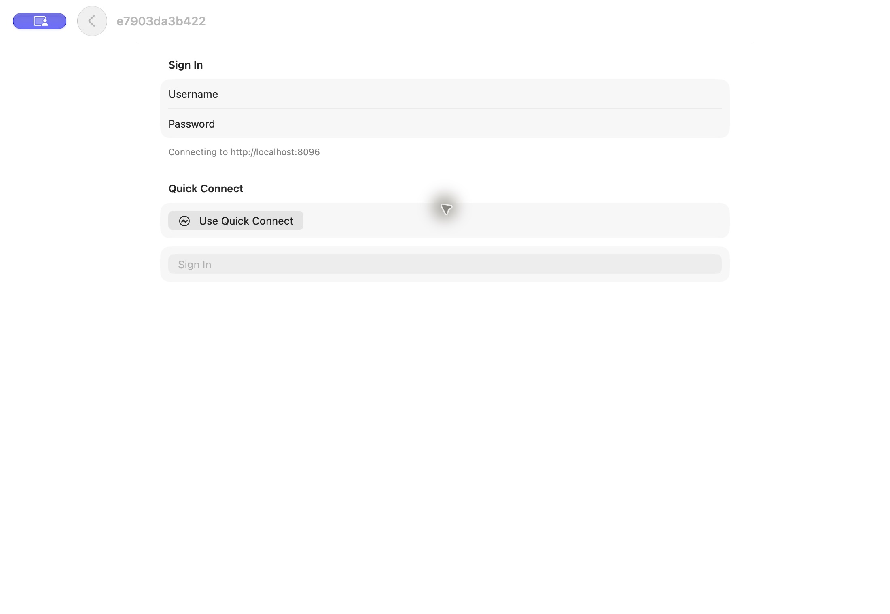
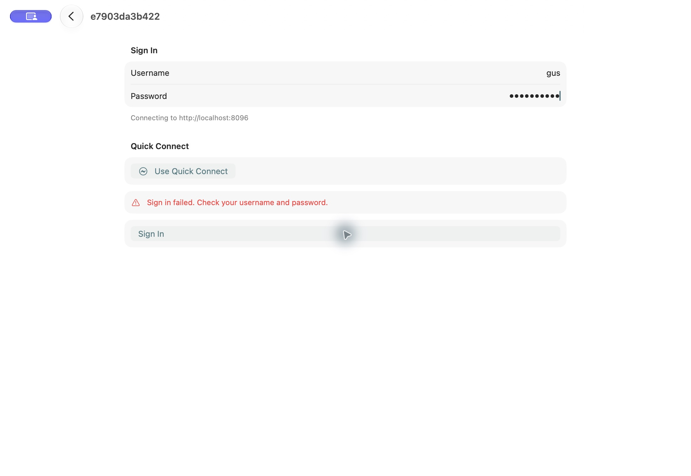

# Mac UI follow-up — October 11, 2026

**Verdict: signed-in Mac review is blocked by a reproduced authentication defect (GUS-UI-025).** Unlocking restored native screen access. Connect and Sign In were captured and inspected, but valid demo credentials could not establish an app session. No app fixes were made. The historical October 9–10 findings are not revalidated or closed by this pass.

## Baseline and evidence

- Revision `423bfa021ac1b05146ae660b611585f99c5cd556` (`Complete offline playback, UI remediation, and release validation`), initially clean checkout. This is newer than the original audit baseline.
- Native Apple-silicon Mac, macOS 27.0.1; Xcode 27.0 (27A266a). macOS has no simulator destination.
- Scheme `A Playa Named Gus`, Debug, version 1.0.0 (1); [build succeeded](evidence/mac-2026-10-11/build.log). Exact app: `build/DerivedData/Build/Products/Debug/A Playa Named Gus.app`.
- Repository `Scripts/demo-server.sh start`, existing local Jellyfin and sample media, documented demo account. Direct API authentication succeeded. No production account/server used.
- Native Computer Use captured 2200×1520 images; all three saved images were reopened and inspected. Light appearance, default window. [Sanitized diagnostics](evidence/mac-2026-10-11/diagnostics.txt).

## Actual flow

1. **Connect — visually checked.** Address label, explanation, disabled empty-address Connect, discovery and debug demo action fit the captured window. Clicking Use Local Demo Server repeatedly leaves this screen without a visible error; logs confirm failed authentication.

   

2. **Server connection — passed.** Enter `http://localhost:8096`, click Connect. The app retrieves the server and opens Sign In. Username/password labels, Quick Connect, and disabled empty-form submission fit the captured window. Quick Connect itself was not exercised.

   

3. **Account sign-in — failed.** Enter the repository demo account and submit. The app displays “Sign in failed. Check your username and password.” Retry also fails; direct authentication with the same account returns HTTP 200. Error text and retry action remain readable/reachable.

   

4. **Independent diagnosis — reproduced.** A temporary [Foundation URLSession harness](evidence/mac-2026-10-11/header-check.swift) uses the SDK's header format and the same demo account, changing only `Device`: `Audit Mac` returns HTTP 200; `Audit’s Mac` returns HTTP 400. No response token was printed or retained. This host's computer name contains U+2019. The app requests produce a server exception identifying missing `request.App`.

## GUS-UI-025 — Mac sign-in fails with a Unicode computer name and misidentifies the failure

**High; verified defect on this native Mac and local Jellyfin.** Affects Connect → Sign In and the debug demo shortcut. Root-cause attribution is strongly supported by the isolated header comparison and source path; an app build with corrected header handling has not been tested.

**Expected:** valid credentials sign in regardless of a normal localized computer name. Transport/server failures should not claim incorrect credentials. The debug shortcut should expose failure feedback.

**Observed:** the Mac's localized name contains a curly apostrophe (U+2019). `DeviceIdentity.deviceName` passes it through; the Jellyfin SDK interpolates it directly into the Authorization header. The app cannot sign in; the server reports `ArgumentNullException` for `request.App`. ASCII-versus-Unicode reproduction yields HTTP 200 versus 400. The standard form incorrectly blames username/password; the debug shortcut logs the error but appears inert. Signed-in browsing and playback are inaccessible in this test environment.

**Source at this revision:** [DeviceIdentity.swift:52](../../../Sources/Services/DeviceIdentity.swift#L52), `deviceName`; [JellyfinClientFactory.swift:47](../../../Sources/Services/JellyfinClientFactory.swift#L47), `makeClient`; [AppModel.swift:342](../../../Sources/Stores/AppModel.swift#L342), `signIn` converts non-cancellation SDK errors to authenticationFailed; [AppModel.swift:256](../../../Sources/Stores/AppModel.swift#L256), `connectToLocalDemoServer` only logs failure. Resolved dependency `jellyfin-sdk-swift/Sources/PassthroughAPIClientDelegate.swift:48` constructs unescaped `key=value` header fields from configuration values.

**Reproduction actually run:** start the repo demo server; launch this Debug Mac app on the existing Unicode-named host; try the demo shortcut, then normal localhost connection and documented demo credentials. Compare with the isolated harness. Do not reset credentials in response to this message; the account itself authenticated successfully.

**Recommendation and retest:** provide protocol-compatible header serialization/device identity while preserving a useful display name where possible; correctly distinguish invalid credentials from transport/server errors, and surface demo shortcut failures. An ASCII fallback is simpler but loses some display-name fidelity. Test spaces, U+2019, accented/non-Latin names, quotes and commas against Jellyfin; verify both UI sign-in paths, session restoration, then complete signed-in Mac flows. No computer-name change or app workaround was applied during this audit.

## Automation and coverage limits

| Surface/check | Status | Evidence or remaining work |
|---|---|---|
| Native build and launch | Checked | Current build succeeded; Connect rendered |
| Connect, server resolution, sign-in form/error | Checked / failed | Three inspected captures; GUS-UI-025 |
| Home, sidebar, libraries, search, settings | Blocked | App session cannot be established |
| Movie/music/photo/book detail and playback | Blocked | App session cannot be established |
| Narrow/wide resizing, keyboard focus/shortcuts, close/reopen | Not checked | No successful signed-in session; no layout-state preservation claim |
| VoiceOver, contrast measurement, alternate appearance, large text | Not checked | Screenshots/AX metadata do not establish accessibility behavior |
| Vision Pro / Watch | Not rerun | Prior simulator evidence remains in the October 10 addendum; no current-revision acceptance claimed |

The external XCTest runner first failed before bootstrap with an invalid local signature ([initial log](evidence/mac-2026-10-11/runner-initial.log)). Rebuilding only the temporary harness with ad-hoc signing removed that failure but ended with “Timed out while enabling automation mode” ([signed-runner log](evidence/mac-2026-10-11/runner-signed.log)). No XCTest screenshot or passing test is claimed. Native Computer Use initially timed out, then recovered and produced the three screenshots above. These automation failures are separate from the reproduced app sign-in defect.

Prioritize GUS-UI-025, then complete native signed-in window/keyboard review before Mac acceptance. The local demo server was stopped after this pass; the audit-launched app was terminated. No app source, committed tests, project settings, system computer name, or production data was changed.

## Repair follow-up

GUS-UI-025 and the subsequently discovered Mac presentation defects are repaired in the working tree. See the [October 11 repair and verification report](../2026-10-11-auth-device-repair/REPORT.md) for current evidence and the still-pending physical test gate. The observations above remain historical.
