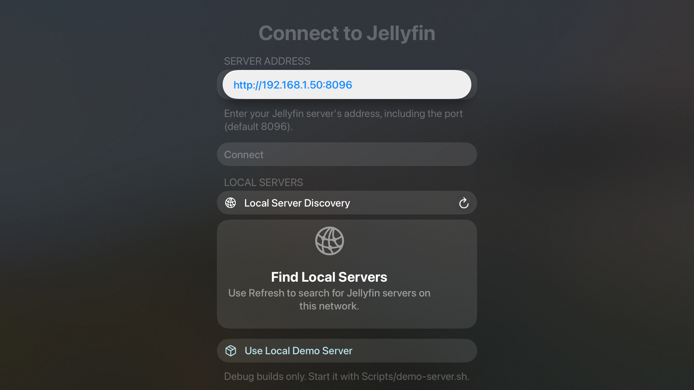
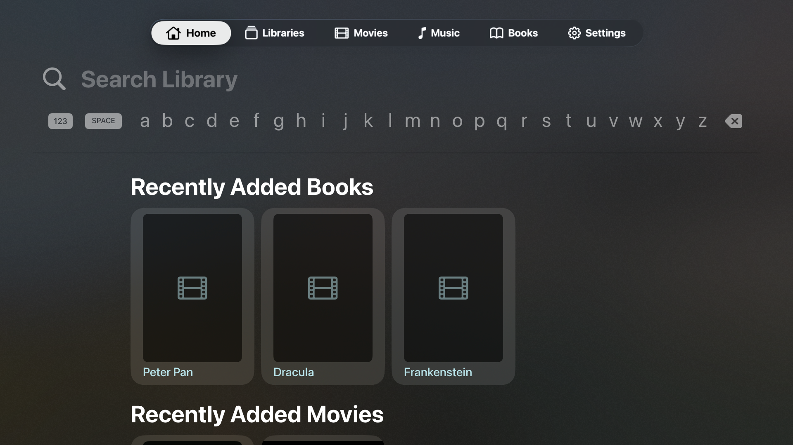
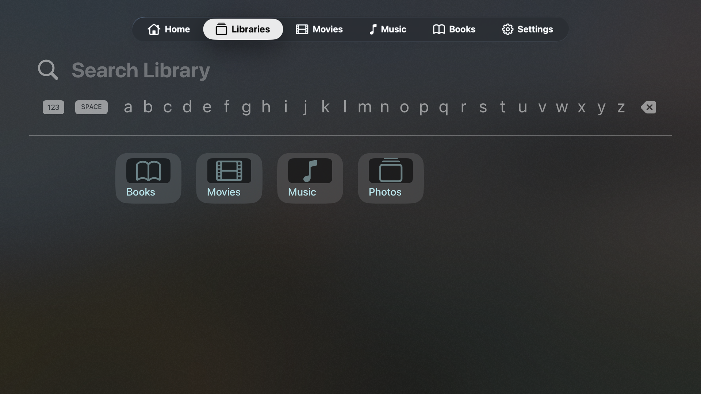
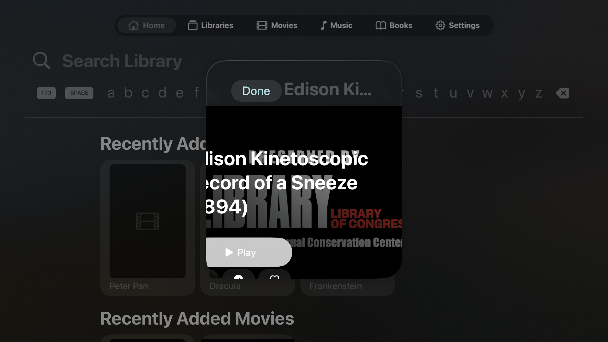
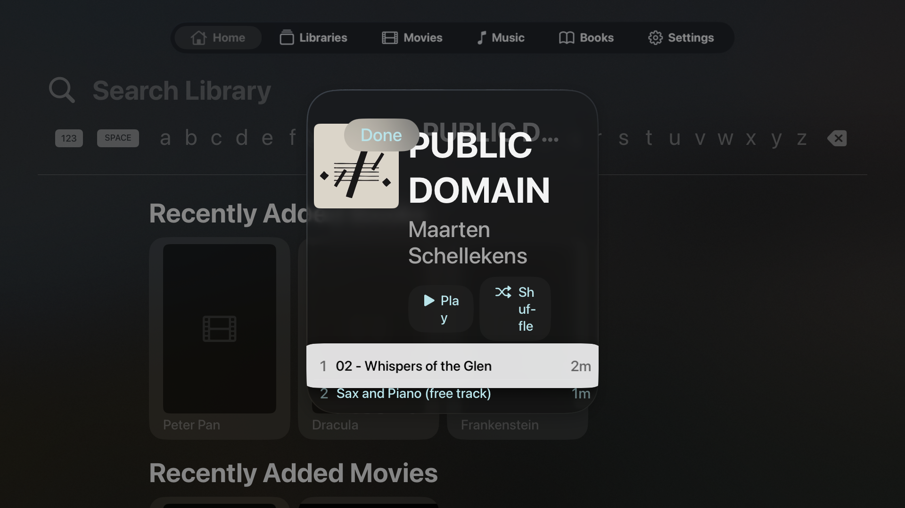
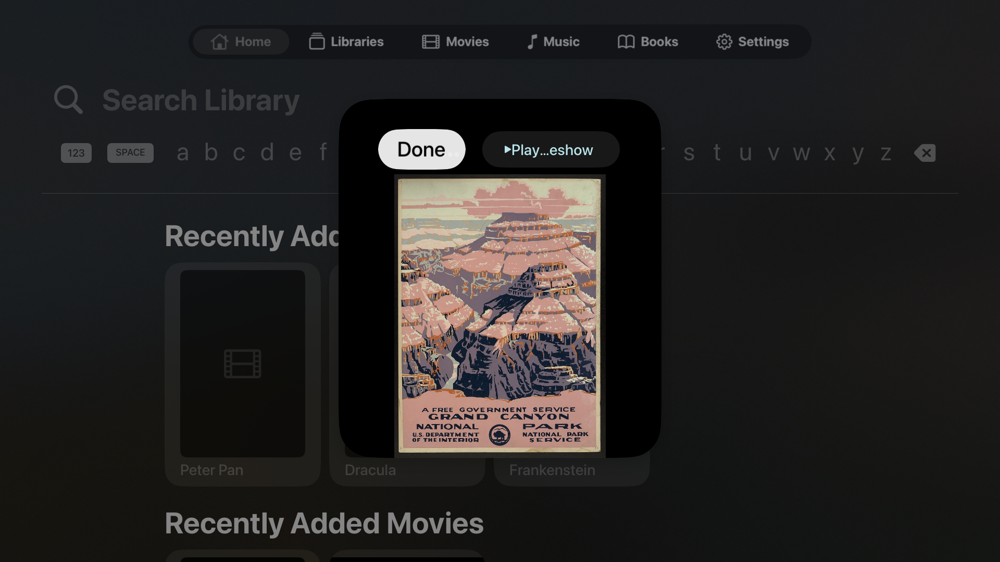

# Multiplatform automated UI review — 2026-10-10

This continuation uses the real local demo Jellyfin server and the current dirty checkout, without app fixes. Platform order: Apple TV → iPad → Vision Pro → Mac → Watch. Findings below supplement the original report and physical-phone addendum; source risks and observed defects remain distinct. **Verdict: significant shared layout defects remain.** This pass adds one finding (024), upgrades two existing risks with runtime evidence (001 and 009), and broadens existing 020/021 evidence. Mac runtime review remains blocked by the locked desktop; all platform builds succeeded. No clean UI or release-readiness sign-off is supported.

## Baseline and data

- Revision `b21d63179debba3feca923566b3013175197e45f`, with pre-existing uncommitted work. [Source hashes](evidence/multiplatform-2026-10-10/source-sha256.json) and [initial status](evidence/multiplatform-2026-10-10/git-status-before.txt) identify this checkout; it is not assumed identical to the installed phone build.
- Xcode 27.0 (27A266a), freshly built Debug version 1.0.0 (1) on all five platforms, scheme `A Playa Named Gus`; Watch uses `Gus watchOS`.
- Started OrbStack and `Scripts/demo-server.sh start`. The sample library was present at `../sample_media`, so a git-ignored `sample_media` symlink supplies the path expected by the script. No media copied or changed. Existing demo config volumes were reused. Jellyfin reports 10.11.11; local demo authentication verified. No personal server credentials or production account were used.
- Four configured libraries: Movies, Music, Photos, Books. After the Apple TV pass, the existing Shows folder was added as a fifth library through the local demo API to enable series/episode follow-up. The documented script initially configures only four libraries. No Live TV tuner is configured.
- Automated launch routes use the repository's `--gus-demo-server`, `--gus-route` and content-link handling, with actual API/media responses. They exercise cold-launch route presentation, not normal in-app navigation; remote/tap tests are identified separately.
- Xcode DeviceInteraction rejected tvOS as ineligible. Simulator CLI capture and an external XCTest runner supply evidence instead. Sandboxed `simctl` failed; the authorized external invocation succeeded. These are tooling limits, not Gus defects.
- There is no macOS Simulator destination: the native macOS app is tested on this Mac, separately labeled. Simulator success does not establish hardware playback, gaze/hand tracking, physical remote feel or watch connectivity.

## Apple TV — initial flow

Apple TV 4K (3rd generation), 1080p, tvOS 26.5, 1920×1080. Build succeeded.

1. **Connect — checked.** Address field, Connect, discovery and demo entry are present. Manual text entry not yet exercised.
2. **Demo sign-in → Home — checked with layout concern.** Signed-in content loads. Global search keyboard occupies the top portion of Home, Libraries and Settings even on initial non-search routes; remote behavior is assessed separately below.
3. **Libraries / Settings — checked.** Four demo library tiles and the expected local account appear. These captures cover the initial viewport, not every setting.
4. **Content link → movie / album / book / photo — failed layout.** The default narrow modal severely compresses content. Movie title is clipped left, album Play/Shuffle wrap within words, and photo toolbar labels truncate. Photo pixels and book metadata do load.
5. **Movie playback — checked.** The sample video produces frames and an advancing timeline in a full-screen native player. No long-running playback claim.

| Connect | Home | Libraries |
|---|---|---|
|  |  |  |

| Movie link | Album link | Photo link |
|---|---|---|
|  |  |  |

**Remote interaction follow-up:** an external XCTest launch followed by three Down presses, Select and Menu successfully reaches a movie through Home and returns to the same row. Search scrolls out of the way; it is not a focus trap. [Focused movie row](evidence/multiplatform-2026-10-10/tv/interaction-remote-down.png), [pushed detail](evidence/multiplatform-2026-10-10/tv/interaction-remote-select.png), [Menu returns](evidence/multiplatform-2026-10-10/tv/interaction-remote-back.png). The loaded movie artwork/title overflows the fixed cards in both Home and Recommended, extending finding 020 to tvOS movie shelves. The deep-link modal compression is substantially worse than this normal pushed detail. The root search UI's persistent space consumption is recorded as a design observation, not a navigation failure.

### GUS-UI-024 — tvOS content links use a cramped detail modal

**Medium · verified defect · Apple TV 4K 1080p / tvOS 26.5.** Open `gus://item/<demo item ID>` (the audit uses the equivalent debug launch route) after demo sign-in. A roughly 620-pixel-wide sheet compresses movie, album and photo content on a 1920-pixel display: Play becomes “Pla / y,” Shuffle wraps across three lines, and the slideshow action truncates. Expected: readable, operable detail content with a television-appropriate presentation. The movie's left clipping is also evidence for existing 021; the album's fixed header contributes existing 008. This finding covers the shared presentation constraint, not duplicate root-cause claims for those child layouts.

Source: `Sources/Platform/ContentLinkHandler.swift:33–44`, `ContentLinkHandler.body`, presents an unconstrained `.sheet` containing every item destination. Album header: `Sources/Features/Music/AlbumDetailView.swift:49–91`, fixed 180-point artwork beside text/actions. Evidence: steps 4 and the movie/album/photo screenshots above. Reproduction ran on the simulator; ordinary remote navigation uses a wider pushed screen.

Recommendation: route television content links into the normal navigation destination or provide a suitably sized platform presentation, while preserving Done/Menu dismissal and account checks. Retest movie, album, book and photo links, long titles, focus movement, action labels and Back/Menu. A larger sheet alone does not fix the independent loaded-image/card sizing problems.

## iPad — Pro 13-inch (M5) and mini (A17 Pro), iPadOS 27.0

The external XCTest runs completed without runner failures. This is collection success, not a visual pass. Pro captures cover Connect, Home, Libraries, Settings, empty Downloads, movie, album, photo, book, audio and video; mini follow-up covers series, episode, EPUB reader, audio dismissal and a requested AX5 launch override. Both runs rotate portrait to landscape. The AX5 override did not visibly enlarge text, so that capture is not accepted as a largest-text test.

1. **Connect → demo Home — checked, failed card layout.** Actual demo content loads. Movie artwork and labels overlap adjacent cards on both iPad sizes, and music artwork overflows its card. This extends **020 (High)** beyond Continue Watching. [Pro Home](evidence/multiplatform-2026-10-10/ipad/pad-home-portrait.png), [mini Home](evidence/multiplatform-2026-10-10/ipad-mini/home-AX5.png).
2. **Libraries / Settings / empty Downloads — checked initial portrait viewport.** Sidebar navigation and empty-state content are readable. No populated-download, full-settings or keyboard-navigation acceptance claimed.
3. **Movie / album / photo detail — checked portrait.** The short movie title, album actions and photo are readable at Pro width. The mini's **series** hero clips the beginning of its title, metadata, synopsis and Play button at the sheet's left edge, extending **021 (High)** to iPad. Episode detail with placeholder art stays within the sheet. [Series](evidence/multiplatform-2026-10-10/ipad-mini/series-portrait.png), [episode](evidence/multiplatform-2026-10-10/ipad-mini/episode-portrait.png). “No Seasons” is not filed as an app defect: the demo library's series grouping was not independently validated.
4. **Book detail → reader — failed detail actions; reader checked.** Pro book actions stretch vertically and collide with the title, upgrading **009 (Medium)** from source risk to reproduced defect. [Book detail](evidence/multiplatform-2026-10-10/ipad/pad-book-portrait.png). The mini opens the Dracula cover in the EPUB reader and its Done button returns to Home. [Reader](evidence/multiplatform-2026-10-10/ipad-mini/reader-portrait.png). Page turning and table of contents were not exercised.
5. **Audio playback → attempt dismissal — failed.** Audio advances, but there is no visible or accessible Close/Done button in the full-screen player. A downward swipe leaves the player open; the harness must terminate the app to leave. This upgrades **001 (High)** to runtime-verified on iPad. [Portrait player](evidence/multiplatform-2026-10-10/ipad/pad-audio-portrait.png), [post-swipe hierarchy](evidence/multiplatform-2026-10-10/ipad-mini/audio-after-dismiss-swipe-tree.txt). Reproduce with demo Home → audio playback (tested equivalent `play/<audio ID>` route), attempt Done/Back/swipe dismissal. Expected: a persistent exit that returns to the invoking screen. Retest explicit dismissal while loading, playing, paused and after rotation.
6. **Rotation — exercised; screenshot artifact resolved in follow-up.** AX window geometry changes to landscape and detail/reader Done remains operable. Both XCTest screenshot APIs produce displaced/cropped landscape images with a black band; those original images are rejected, not filed as Gus defects. A subsequent iPad mini run using direct `simctl io screenshot` produces correctly framed landscape images. Home movie cards still overlap (020), Libraries and the initial Settings viewport fit, book actions still overlap the title and distort (009), and audio transport fits but still has no exit (001). [Home landscape](evidence/multiplatform-2026-10-10/ipad-direct/home-landscape.png), [Libraries landscape](evidence/multiplatform-2026-10-10/ipad-direct/libraries-landscape.png), [Settings landscape](evidence/multiplatform-2026-10-10/ipad-direct/settings-landscape.png), [book landscape](evidence/multiplatform-2026-10-10/ipad-direct/book-landscape.png), [audio landscape](evidence/multiplatform-2026-10-10/ipad-direct/audio-landscape.png). The replacement images use cold launch in landscape; the earlier run supplies the rotation interaction evidence. Pro landscape visual coverage remains unaccepted rather than extrapolated from mini.

**Remaining direct-landscape follow-up:** Connect and empty Downloads fit; the tested movie, album and photo sheets fit their main content. Series remains clipped on the left (021), while the episode placeholder hero fits. Dracula renders its cover and reader toolbar. Video produces real full-screen frames, but native transport was hidden at capture, so control operation is still not accepted. [Connect](evidence/multiplatform-2026-10-10/ipad-direct/connect-landscape.png), [Downloads](evidence/multiplatform-2026-10-10/ipad-direct/downloaded-landscape.png), [movie](evidence/multiplatform-2026-10-10/ipad-direct/movie-landscape.png), [album](evidence/multiplatform-2026-10-10/ipad-direct/album-landscape.png), [photo](evidence/multiplatform-2026-10-10/ipad-direct/photo-landscape.png), [series](evidence/multiplatform-2026-10-10/ipad-direct/series-landscape.png), [episode](evidence/multiplatform-2026-10-10/ipad-direct/episode-landscape.png), [reader](evidence/multiplatform-2026-10-10/ipad-direct/reader-landscape.png), [video](evidence/multiplatform-2026-10-10/ipad-direct/video-landscape.png).

Source and fix/retest guidance for 001, 009, 020 and 021 remain in the original report/phone addendum. The important additional acceptance cases are regular-width iPad sheets, narrow iPad mini sheets, loaded wide artwork, and an explicit audio exit independent of swipe behavior. Good placeholder-art layouts do not establish that loaded-image layouts are correct.

## Vision Pro — visionOS 26.5 simulator

Build/install/launch succeeded. XCTest failed at its first screenshot with “remote interface does not have this capability.” Direct `simctl io screenshot` then captured all ten routes successfully in the simulated room. This is a fixed default-window visual review, not gaze, hand, spatial comfort or resized-window acceptance. Portrait/landscape device rotation is not applicable to this platform.

1. **Connect → demo Home — checked; failed movie-card layout.** Authentication and actual demo library content load. The same overlapping movie artwork/title problem appears in Home, extending **020 (High)** to visionOS. [Home](evidence/multiplatform-2026-10-10/vision/02-home.png).
2. **Libraries / Settings — checked initial viewport.** All five library tiles fit; the active account/address identify the local demo server. A previously saved personal account is listed but was not selected. The search launch route remains Home with its search field; no query/result interaction was tested.
3. **Movie / album / book / photo links — mixed.** Movie title and leftmost action clip at the sheet edge, extending **021 (High)**. Album art, Play/Shuffle and two tracks fit. The book's Share control becomes an unusually tall narrow pill, corroborating **009 (Medium)**. The absence of a Read action on visionOS is platform-gated in `BookActions.swift` (`canImport(ReadiumNavigator)`), not treated as accidental disappearance. Photo and its toolbar fit. [Movie](evidence/multiplatform-2026-10-10/vision/06-movie.png), [album](evidence/multiplatform-2026-10-10/vision/07-album.png), [book](evidence/multiplatform-2026-10-10/vision/08-book.png), [photo](evidence/multiplatform-2026-10-10/vision/09-photo.png).
4. **Video playback — checked short start.** The native player shows real video, pause/skip controls and progress within the window. [Player](evidence/multiplatform-2026-10-10/vision/10-player.png). Playback was stopped by terminating the audit-launched app. Immersive/full-screen switching, control interaction, audio output and long playback were not checked.

Movie Play also appears white on pale cyan as in 023; no additional visionOS contrast measurement was taken, so this is corroborating visual evidence rather than a new measured finding. No separate new root-cause ID is added for the shared layout failures.

## Mac — native macOS 27.0.1 (26A434), Apple silicon

**Build checked; UI review blocked.** macOS has no simulator destination. The native app and an external macOS XCTest runner both build. The runner targets the exact app under this checkout's `build/DerivedData/Build/Products/Debug` by file URL to avoid launching a different installed copy. The test runner started but did not begin a test or produce any app screenshot before it was stopped. Computer Use independently reports that the Mac is locked and automatic unlock failed; manual unlock was requested earlier and remained unavailable. Only the audit-owned runner processes were stopped.

No Mac screen is counted as visually checked, and no product defect is inferred from this environment blocker. Required follow-up after unlocking: Connect/demo sign-in, sidebar browsing/search/settings, detail sheets, audio/video/book handling, narrow and wide window resizing, keyboard focus/shortcuts and window close/reopen. [Build log](evidence/multiplatform-2026-10-10/mac-build.log), [attempt log](evidence/multiplatform-2026-10-10/mac-screens.log).

## Apple Watch — Ultra 3, 49 mm, watchOS 26.5 simulator

Build/install and both XCTest runs succeeded. The rendered app viewport is 211×257 pt (422×514 pixels). Device rotation is not applicable. This pass found no additional verified Watch defect in the exercised flows; it is not acceptance for the smaller watch sizes or the entire companion feature set.

1. **Connect → demo sign-in — checked.** The fresh simulator's standalone Connect screen fits its scrollable content. The existing debug demo argument authenticates with the actual local server. Keyboard entry, Quick Connect approval and iPhone credential handoff were not exercised. [Connect](evidence/multiplatform-2026-10-10/watch/watch-connect.png).
2. **Remote → Resume → Browse — checked.** Empty Remote and Resume states are explicit and readable. Vertical swipes move between pages; Browse scrolls through all five libraries. [Remote](evidence/multiplatform-2026-10-10/watch/watch-remote.png), [Resume](evidence/multiplatform-2026-10-10/watch/watch-page-1.png), [Browse](evidence/multiplatform-2026-10-10/watch-more/browse-top.png). No active remote player was available, so transport commands were not tested.
3. **Browse → Movies → item → Play on Watch — checked short playback.** Movie posters remain confined to their rows, unlike the larger-platform shelves. Long titles truncate within the small rows; accessibility exposes the full tested title. Item actions scroll into view, and Play on Watch presents actual video with a system Close control. [Movies](evidence/multiplatform-2026-10-10/watch-more/movies.png), [actions](evidence/multiplatform-2026-10-10/watch-more/movie-actions-lower.png), [video](evidence/multiplatform-2026-10-10/watch-more/watch-video.png). The runner terminated playback afterward; system Close was visible but not tapped. The dark frame is source video content, not a measured UI contrast defect.
4. **Downloads → Settings — checked including scrolling.** Used/limit rows and the complete empty-download explanation are reachable. Settings shows the demo account online and the expected 1.0.0 version. [Empty downloads](evidence/multiplatform-2026-10-10/watch-more/more-page-5.png), [Settings](evidence/multiplatform-2026-10-10/watch-more/more-page-6.png), [About](evidence/multiplatform-2026-10-10/watch-more/more-page-7.png). Sign Out was not activated.

Watch audio/album navigation, offline downloading/playback, remote target selection, disconnected states, background behavior, Digital Crown, VoiceOver and smaller watch sizes remain not checked. XCTest sometimes spent substantial time waiting for app idleness; the successful screenshots/navigation do not establish whether those waits reflect product responsiveness or automation quiescence. No latency defect is claimed without an independent timing check.

## Coverage and evidence acceptance

“Checked” means the stated screen/state was inspected, not that every action or accessibility criterion passed. The runners primarily collect screenshots/hierarchies and exercise navigation; they do not contain comprehensive visual assertions. Their passing results cannot overrule the observed failures.

| Scope | Result | Limits / finding IDs |
|---|---|---|
| Apple TV, tvOS 26.5 | Checked; layout failed | Home/Recommended overlap 020; content-link sheets 024 and detail clipping 021; remote Down/Select/Menu exercised; short video renders |
| iPad Pro 13-inch, portrait | Checked; layout failed | Home/media overlap 020, book actions 009, missing audio exit 001 |
| iPad Pro 13-inch, landscape | Rotation exercised; visual coverage blocked | Original XCTest image transform rejected; no direct Pro replacement |
| iPad mini, portrait | Checked; layout failed | Series clipping 021, media overlap 020, missing audio exit 001; reader opens/dismisses |
| iPad mini, landscape | Checked via direct replacement captures; layout failed | Home 020, series 021, book 009, audio exit 001; library/album/photo/episode/reader layouts fit tested viewport |
| Vision Pro, visionOS 26.5 | Checked default window; layout failed | Home 020, movie 021, book action 009; native short video renders; resized/spatial interaction not checked |
| Mac, native macOS 27.0.1 | Build checked; UI blocked | Locked host; runner interrupted before test execution; no macOS simulator exists |
| Watch Ultra 3, watchOS 26.5 | Checked stated flows; no new verified defect | All five main pages, movie browse/actions/short video; smaller sizes and audio/offline/remote control not checked |
| Portrait rotation on TV / Vision / Mac / Watch | Not applicable | Fixed TV display, spatial windows, Mac window resizing and Watch layout require their platform-specific checks |
| Manual sign-in / Quick Connect / account switching | Not checked | Real demo authentication exercised through existing debug entry; credential-entry UI flow not automated |
| Live TV / real remote player | Blocked by test data | No configured tuner or active controllable demo player |
| VoiceOver / keyboard / gaze / Crown / large text | Not checked this continuation | AX5 launch override did not visibly apply; no accessibility conformance claim |
| Dark/light variants, localization, minimum OS, offline downloads, long playback | Not checked this continuation | Earlier phone evidence remains separately scoped; no extrapolation to these platforms |

Evidence is under [multiplatform-2026-10-10](evidence/multiplatform-2026-10-10/). [External harness sources and capture scripts](evidence/multiplatform-2026-10-10/harness/) are saved for reproduction; no harness was added to app test targets. The raw XCTest result bundles remain under `/tmp/gus-multiplatform-audit/` and are temporary. Build logs are named by platform; run logs accompany exported screenshots. Original malformed landscape captures are retained for traceability and rejected as visual evidence; `ipad-direct/*-landscape.png` are the accepted mini replacements. The Pro's initial black video capture is also excluded from successful playback evidence.

## Priorities and remaining acceptance

1. Fix shared loaded-image/card containment (020) and oversized detail content (021), then retest actual wide artwork on phone, iPad sheets, TV pushed/modal navigation and Vision windows. Placeholder-only previews miss these defects.
2. Add persistent audio dismissal/recovery (001/002) and fix book/action fallback sizing (009). Retest every action and return destination in both iPad orientations, alongside phone rotation state preservation (005).
3. Give television content links appropriate width/navigation (024), retaining remote focus and Menu dismissal. Recheck 008 album labels and 023 Play contrast where applicable.
4. Unlock the Mac and complete its native window/keyboard review. Complete Pro landscape capture, smaller Watch sizes, accessibility, alternate appearances and full playback/download/remote flows before claiming cross-platform readiness.

No application fixes, project regeneration in the repository, production-server operations, commits or PRs were made in this continuation. The review ran against the existing dirty checkout; [final source-hash verification](evidence/multiplatform-2026-10-10/source-verification.json) confirms all 257 fingerprinted files are unchanged. All 89 captured screenshots were inspected; rejected captures are identified above.

After capture, all audit-launched players and simulators were stopped, and `Scripts/demo-server.sh stop` stopped the demo container while preserving its configuration/media. The ignored `sample_media` symlink remains available for a future `Scripts/demo-server.sh start`; the added demo Shows library also remains in that test configuration. OrbStack remains running. The user’s phone was not used or changed during this simulator continuation.
