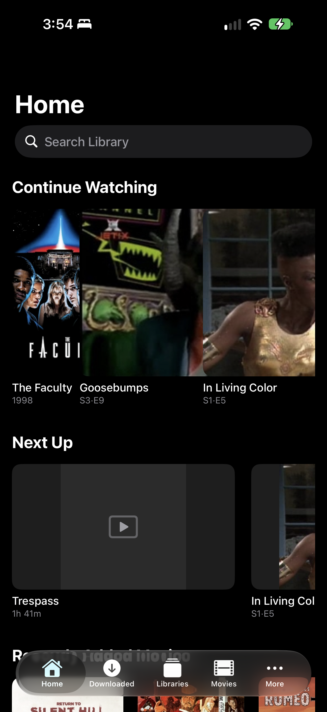
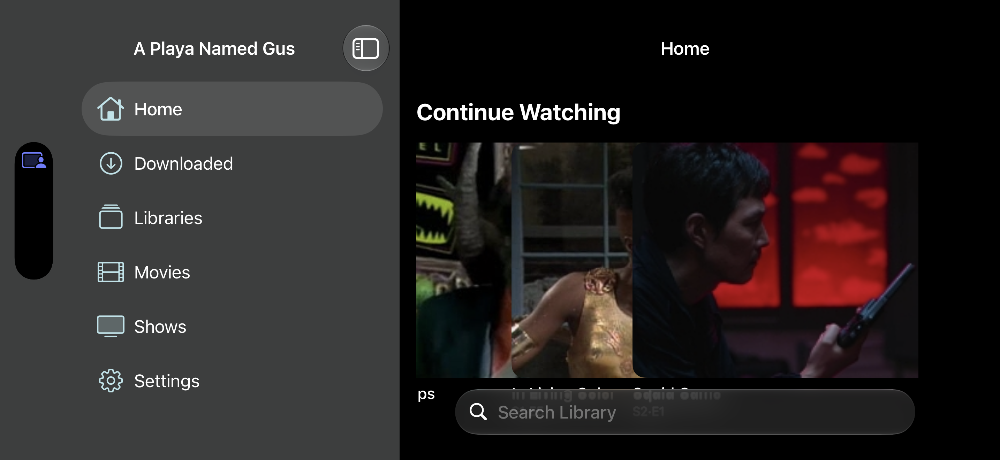
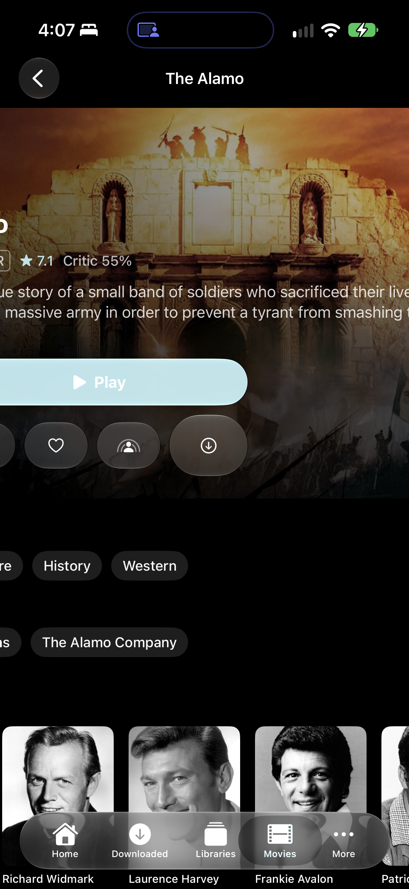
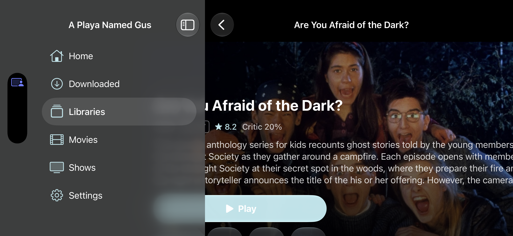
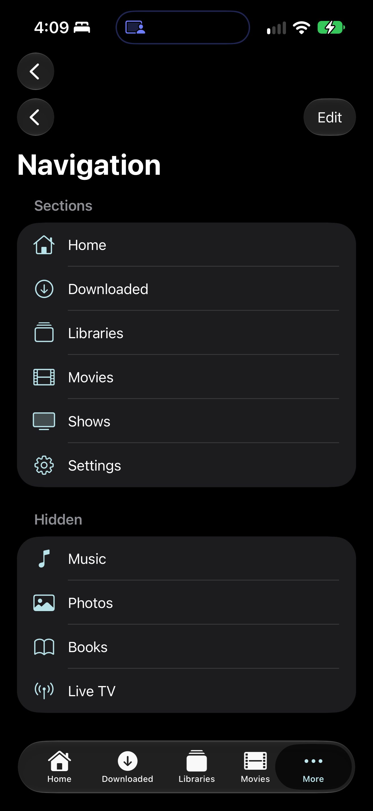
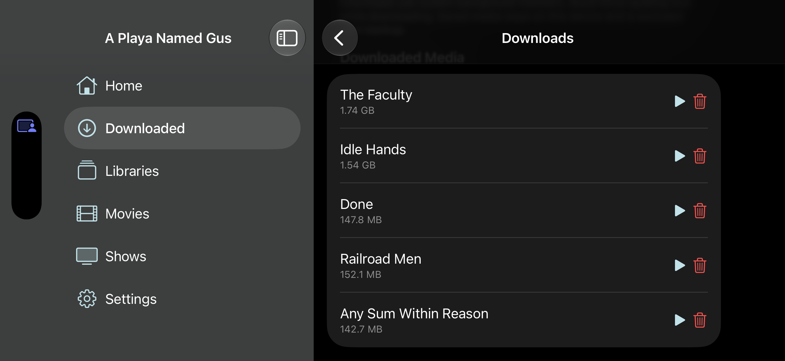
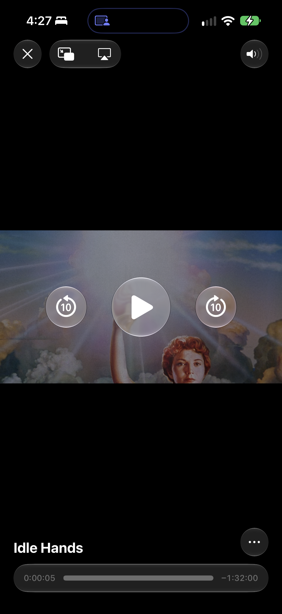
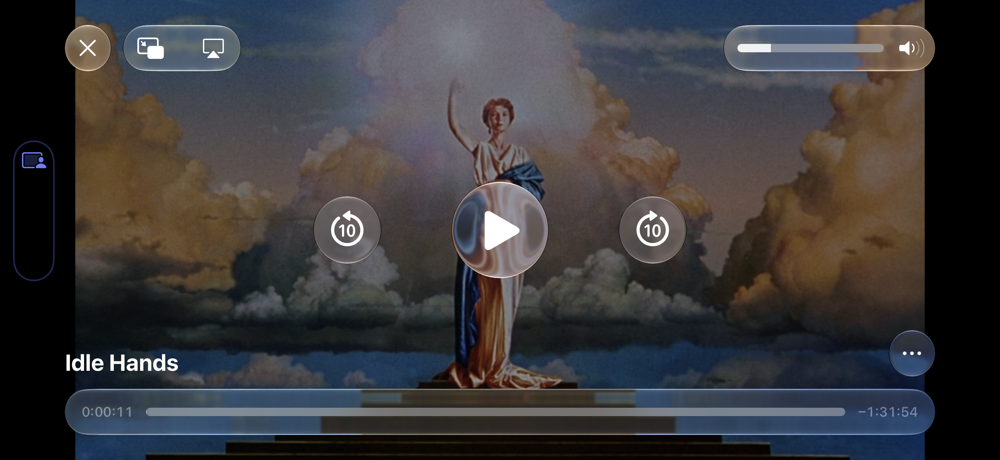
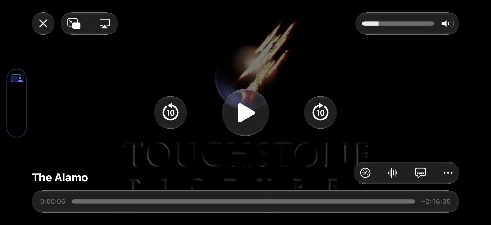
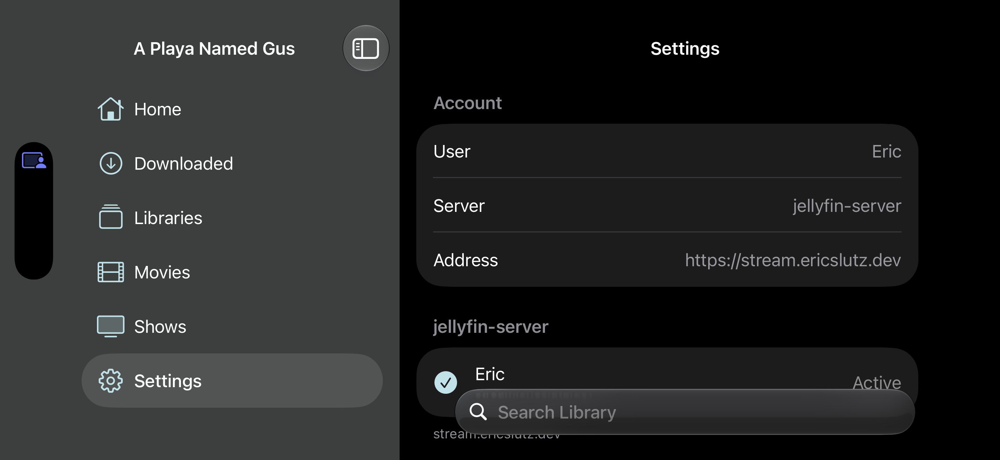

# Signed-in physical-device UI review — October 10, 2026

This supplements the [October 9 audit](REPORT.md). The user identified an already-signed-in app on the connected phone, removing the account prerequisite for this device. The installed app is **Gus 1.0.0, build 3**, on **iPhone 18 Pro Max / iOS 27.0**, with dark appearance. The earlier simulator audit used build 1. The installed binary's exact source revision is not established; older source-supported findings must not automatically be treated as reproduced build-3 defects.

The existing app was opened without reinstalling it, signing out, extracting credentials, or changing server configuration. Direct device captures and orientation control succeeded even though Xcode's DeviceInteraction session tool listed only simulators. Opening Home uses the app's `gus://home` route. Initial launch-animation frames are excluded; the screenshots below show settled UI.

## GUS-UI-020 — Continue Watching artwork overlaps adjacent media cards

**Severity: High. Classification: verified visual defect.** Reproduced on the signed-in physical iPhone in **portrait and landscape**, after artwork loaded. The user independently identified the same behavior.

**Expected:** each item's artwork stays inside its own card; adjacent cards retain a visible gap; a title/subtitle unambiguously belongs to its artwork. Mixed movie posters and wide episode images should crop or letterbox inside a consistently bounded card.

**Observed:** wide episode artwork expands across neighboring card positions. In portrait, the Goosebumps and In Living Color images obscure adjacent artwork; their visible image bounds do not match the nominal title/card columns. Landscape reproduces this with Goosebumps, In Living Color and Squid Game. Loading placeholders are separately bounded with visible gaps, but those boundaries disappear as successful images render. This makes a core Home browsing row visually ambiguous. Tap-target misrouting has not been demonstrated and is not assumed.

**Reproduction performed:**

1. Open the existing signed-in build 3 on the connected phone and navigate to Home.
2. Wait for Continue Watching artwork to finish loading; inspect the mixed movie/episode row in portrait.
3. Rotate to landscape; inspect initial placeholders and then loaded images.
4. Compare image edges with the titles, allocated card columns and inter-card gaps.

**Evidence:** [portrait](evidence/physical-2026-10-10/home-portrait.png), [landscape placeholders](evidence/physical-2026-10-10/home-landscape-loading.png), [landscape loaded](evidence/physical-2026-10-10/home-landscape-loaded.png).

| Portrait, loaded | Landscape, loaded |
|---|---|
|  |  |

**Measured accessibility geometry:** the physical-device tree reports Goosebumps and In Living Color artwork at **300 × 225 pt**, and Squid Game at **400.7 × 225 pt**, although the poster rail allocates **150-pt cards with 16-pt gaps**. Portrait-poster movie artwork elsewhere in Home reports 150 × 225 pt. This confirms that wide-image success states escape the intended card width. See [portrait tree](evidence/physical-2026-10-10/physical-home-portrait-tree.txt) and [landscape tree](evidence/physical-2026-10-10/physical-home-landscape-tree.txt). The outer accessibility button bounds overlap too; actual destination selection still requires a tap check.

**Likely implementation cause, inferred from the current checkout:** `HomeView` creates Continue Watching with the default poster-style `MediaRail` ([HomeView.swift:78](../../../Sources/Features/Home/HomeView.swift#L78)). `MediaRail.body` applies the 150-pt width to the outer card ([HomeView.swift:119](../../../Sources/Features/Home/HomeView.swift#L119)). `PosterCard.body` combines an outer 2:3 fit aspect ratio and flexible image frame with a rounded clip ([PosterCard.swift:15](../../../Sources/SharedUI/PosterCard.swift#L15)), while `AsyncPoster` renders successful images using intrinsic-ratio aspect fill ([AsyncPoster.swift:18](../../../Sources/SharedUI/AsyncPoster.swift#L18)). The explicit card bounds and the loaded image's sizing are not enforced at the same level. The existing `clipShape` is insufficient in the observed layout; recommending only “add clipping” would miss that it is already present. [Source fingerprint](evidence/physical-2026-10-10/source-sha256.json).

**Recommended fix:** establish a bounded 2:3 artwork container independently of the loaded image's intrinsic size, fill that container through an overlay/background or equivalent explicit layout, and clip at that container's bounds. Alternatively, intentionally use consistent landscape cards for Continue Watching and an appropriate image source; that changes information density and should be reviewed as a product choice. Avoid a global image-loader sizing change without checking every consumer.

**Acceptance:** on physical phone and iPad, with mixed portrait/wide/square/missing artwork, all image phases retain the same card geometry and spacing; no neighboring image occlusion occurs. Repeat portrait/landscape, horizontal scrolling, rotation during loading, dark/light and accessibility text. Tap each card and verify its destination matches its title. Check other `PosterCard` consumers for the same root cause. No code fix was made in this review.

## Scope of the continued review

The continuation uses a separate temporary XCTest runner to launch the existing installed app and navigate its signed-in screens. It does not rebuild/install Gus. The earlier attempt to tap a Continue Watching card was inconclusive; later direct Movies and Libraries navigation succeeded. Files named `physical-episode-detail-*` are still excluded because they did not reach the intended screen. Failed/interrupted harness runs are not product-crash evidence. The final coverage matrix below supersedes the initial Home-only scope.

## Continued signed-in review: GUS-UI-005 now reproduced

**High — verified navigation state loss on rotation.** On this physical iPhone 18 Pro Max/build 3, open Downloaded, then Manage Downloads in portrait. Rotating to landscape replaces the Downloads management screen with the parent Downloaded library. This upgrades the earlier source-supported GUS-UI-005 risk to a verified defect on this device; the smaller simulator and iPad checks did not cross the same compact/regular root transition.

**Expected:** the same management screen, scroll position and task context survive rotation. **Observed:** the screen title changes from Downloads to Downloaded and the management controls disappear; the user must navigate again. No deletion or download mutation was performed. A second transition from the Movies grid in portrait to landscape selected the previously used Settings section instead of preserving Movies. See [Movies before rotation](evidence/physical-2026-10-10/movies-grid-portrait.png) and [Settings after rotation](evidence/physical-2026-10-10/movies-grid-landscape.png).

**Evidence:** [Downloads before rotation](evidence/physical-2026-10-10/download-manager-portrait.png), [parent list after rotation](evidence/physical-2026-10-10/download-manager-landscape.png). The landscape filename denotes the attempted step, not a successfully retained manager screen.

**Source path:** `AdaptiveRootView.body` chooses different roots at [RootContainer.swift:38](../../../Sources/Platform/RootContainer.swift#L38); their distinct navigation stacks are created at [line 172](../../../Sources/Platform/RootContainer.swift#L172) and [line 339](../../../Sources/Platform/RootContainer.swift#L339). The current checkout remains supporting evidence rather than a verified mapping to the installed binary.

**Fix/retest recommendation:** own the selected section and typed navigation path above the adaptive root or preserve one navigation owner through layout changes. Verify Downloads, movie/series detail, Navigation settings and search across both rotation directions, including while loading and with a keyboard open. Keep this under 005 rather than creating duplicate findings for each affected destination.

## GUS-UI-021 — Detail content expands beyond the phone viewport

**High — verified visual defect**, installed build 3, physical iPhone 18 Pro Max, normal text/dark appearance. Movies → The Alamo → wait for artwork, without rotating: the detail title/body/actions extend outside both horizontal edges. Vertical scrolling retains the same horizontal cropping in genre/company rows, Cast, Special Features, Recommended and About. The navigation bar and tab bar remain correctly screen-sized, isolating this to content layout rather than a cropped device capture.

**Expected:** a vertically scrolling detail page fits the viewport; only explicit horizontal rails scroll sideways. **Observed impact:** the hero title is mostly outside the screen, the synopsis starts mid-sentence, the leftmost action is cut off, and section headings lose their beginning. This impairs reading and action discovery at ordinary text size, independently of the earlier large-text/hero-height risk in 009.

**Reproduction performed:** relaunch the signed-in app, select Movies, tap The Alamo (1960), capture the top, then swipe upward twice and inspect lower sections. [Top](evidence/physical-2026-10-10/fixed-movie-detail-top-portrait.png), [middle](evidence/physical-2026-10-10/fixed-movie-detail-middle-portrait.png), [lower](evidence/physical-2026-10-10/fixed-movie-detail-bottom-portrait.png).

**Current source path and hypothesis:** `ItemDetailView.detailContent` embeds `CinematicDetailHero` and lower sections in a vertical ScrollView/VStack ([ItemDetailView.swift:65](../../../Sources/Features/Item/ItemDetailView.swift#L65)); the hero's fill image and wide/compact sizing proposals can make the content wider than its viewport ([CinematicDetailHero.swift:18](../../../Sources/SharedUI/CinematicDetailHero.swift#L18), [wide overlay:55](../../../Sources/SharedUI/CinematicDetailHero.swift#L55)). The shared image-sizing behavior also warrants comparison with 020, but the installed binary's exact source revision is unknown. The broad negative horizontal placement is verified; which child supplies the oversized ideal width is not instrumented here. The separately reached episode detail, The Tale of Laughing in the Dark, has a placeholder backdrop and fits its landscape pane ([screenshot](evidence/physical-2026-10-10/extra-episode-detail-landscape.png)). This narrows the observed failure to the tested movie/series pages with loaded backdrop artwork; it does not prove every detail type fails.

**Recommended fix/retest:** constrain the detail content and backdrop to the actual available container width, let title/action layout choose against that finite width, and clip artwork inside its assigned bounds. Do not mask the problem by clipping the entire page, which would retain inaccessible text/actions. Verify long and short titles, wide and absent backdrops, all action combinations, portrait/landscape, iPad split widths, and AX5. Confirm the title, first metadata/action, and every section heading are visible; verify horizontal rails still scroll independently.

**Landscape confirmation:** both [The Alamo](evidence/physical-2026-10-10/fixed-movie-detail-top-landscape.png) and [Are You Afraid of the Dark?](evidence/physical-2026-10-10/fixed-series-detail-top-landscape.png) extend under the sidebar and beyond the right edge. A correctly targeted vertical drag reaches [lower movie content](evidence/physical-2026-10-10/targeted-movie-detail-middle-landscape.png), where genre/company labels and section headings remain clipped. Initial `fixed-*-middle-landscape` captures did not scroll and are not lower-page coverage.

### GUS-UI-010 runtime update

The Alamo's About synopsis visibly ends with an ellipsis in the lower screenshot. The current implementation has `lineLimit(5)` and no expansion interaction on that text ([AboutCardsView.swift:21](../../../Sources/SharedUI/AboutCardsView.swift#L21)). This corroborates the truncation portion of 010; no claim is made that every About-card sizing failure was reproduced.

**021 additional measured evidence:** The Alamo's portrait accessibility tree reports its vertical ScrollView at **x = −153.7 pt, width = 747.3 pt**, on a **440-pt-wide screen**. The hero title starts at x = −129.7 and Play at x = −53.7. This is an actual oversized content frame, not merely an incorrectly scaled screenshot. [Tree](evidence/physical-2026-10-10/fixed-movie-detail-top-portrait-tree.txt).

The same defect reproduces on **Are You Afraid of the Dark?**: [series top](evidence/physical-2026-10-10/fixed-series-detail-top-portrait.png), [series lower content](evidence/physical-2026-10-10/fixed-series-detail-middle-portrait.png). Its Season 1 picker begins at **x = 482 pt**, beyond the 440-pt viewport, so switching seasons is not visibly available in this portrait layout. This is part of 021, not a separate season-selector defect. [Series tree](evidence/physical-2026-10-10/fixed-series-detail-top-portrait-tree.txt).

## GUS-UI-022 — More → Settings → Navigation produces stacked navigation bars

**Medium — verified presentation/navigation anomaly**, build 3, iPhone portrait, standard text/dark appearance.

**Reproduction performed:** open More → Settings, scroll to Navigation, then open Navigation. **Expected:** one coherent navigation header with one obvious Back action. **Observed:** two separate Back buttons appear vertically stacked above the Navigation title. The outer header returns to More; the inner returns to Settings. Settings itself also has an extra outer navigation-bar region. This wastes vertical space and makes the back hierarchy ambiguous.

**Evidence:** [Navigation screenshot](evidence/physical-2026-10-10/fixed-navigation-settings-portrait.png), [Settings screenshot](evidence/physical-2026-10-10/fixed-settings-middle-portrait.png), [Navigation tree](evidence/physical-2026-10-10/fixed-navigation-settings-portrait-tree.txt). The tree contains a More navigation bar at y = 62, height 54 pt, and a separate Navigation bar at y = 116, height 106 pt, each with a BackButton.

**Likely source path:** `TabRootView` provides each tab a `NavigationStack` ([RootContainer.swift:172](../../../Sources/Platform/RootContainer.swift#L172)); the system's overflow More navigation supplies another navigation context. `SettingsView` pushes `NavigationSettingsView` ([SettingsView.swift:110](../../../Sources/Features/Settings/SettingsView.swift#L110)). The current checkout has additional back-button handling and is not established as the exact installed source, so this remains a build-3 runtime finding rather than a claim that the current source has not addressed it.

**Landscape comparison:** direct navigation to the same page shows a single Back action and a correctly bounded list; [accepted landscape screenshot](evidence/physical-2026-10-10/extra-navigation-settings-landscape.png). Thus the stacked header is confirmed for portrait/More, not a universal property of the Navigation screen.

**Recommended fix/retest:** ensure one navigation owner for overflow destinations and their child pages. Preserve the system More behavior or adopt the appropriate native adaptable tab/sidebar arrangement, without stacking independent navigation bars. Test Settings both as a visible tab and inside More, Navigation/Edit/Done/Back, and portrait/landscape transitions. No section order or visibility was changed during this review.

## GUS-UI-023 — White Play label has very low contrast on the dark-mode accent

**Medium — verified visual/accessibility defect.** In the movie and series hero, the white Play label/icon sits on a pale cyan filled button. It is difficult to distinguish despite being the principal action. Reproduced on the physical device in normal-text dark appearance; see [series landscape](evidence/physical-2026-10-10/fixed-series-detail-top-landscape.png) and the movie/series portrait evidence under 021. This is independent of the oversized content layout.

**Evidence/measurement:** an sRGB sample from the series landscape screenshot's Play area (pixels x1190–1669, y1130–1189) contains white label pixels and predominant fill colors around `#CBE7EC`–`#CCE8ED`. These yield approximately **1.29:1** white/fill luminance contrast. The current dark accent asset is `#B8E3E9`, which yields **1.38:1** against white before the glass rendering changes the fill. [Measurement data](evidence/physical-2026-10-10/play-contrast-measurement.json). Pixel sampling measures this capture, not every appearance/background or a full accessibility conformance audit.

**Likely source:** `CinematicDetailHero.body` forces `.foregroundStyle(.white)` around its overlays; `playButton` uses the prominent glass style and `.tint(.accentColor)` ([CinematicDetailHero.swift](../../../Sources/SharedUI/CinematicDetailHero.swift)). The dark accent is defined in [AccentColor](../../../Resources/Assets.xcassets/AccentColor.colorset/Contents.json). Exact installed-source provenance remains unverified.

**Recommendation/acceptance:** give prominent actions a contrasting foreground appropriate to the actual tint, preferably letting the system style choose its label color without an inherited white override. Verify the enabled Play label/icon across dark/light appearance, backdrop changes, Increase Contrast and transparency settings; measure the final rendered pair. Keep white hero text separate from button foreground styling. No fix applied.

## Continued review — accepted flow evidence

These are representative screenshots of the actual signed-in build, in navigation order. A successful harness assertion proves an interaction/checkpoint ran; it does not mean the visual check passed.

1. **Library → grid — checked.** Libraries exposes four movie/show libraries. Movies and Family Shows grids have distinct poster columns in both orientations. Normal ellipsis on long card titles is not itself treated as a new defect. [Movies portrait](evidence/physical-2026-10-10/fixed-movies-grid-portrait.png), [Movies landscape](evidence/physical-2026-10-10/targeted-movies-grid-landscape.png), [Family Shows portrait](evidence/physical-2026-10-10/fixed-shows-grid-portrait.png), [Family Shows landscape](evidence/physical-2026-10-10/fixed-shows-grid-landscape.png).
2. **Grid → movie/series detail → vertical scroll — failed layout.** Selection reaches the correct title. Both detail types overflow in both orientations (021); Play contrast fails the visual check (023). Lower portrait synopsis truncation corroborates 010. Landscape lower captures reach movie Cast/Special Features and the series episode/genre content; they do not prove every bottom section was traversed in landscape.
3. **Home → search → software keyboard → results — checked.** Searching Goosebumps produces a matching result in both orientations. The keyboard and search field remain reachable. Landscape leaves a short result viewport while typing, with the result label below the keyboard until it is dismissed; the dismissed result is readable. [Portrait keyboard](evidence/physical-2026-10-10/fixed-search-keyboard-portrait.png), [portrait result](evidence/physical-2026-10-10/fixed-search-results-portrait.png), [landscape keyboard](evidence/physical-2026-10-10/fixed-search-keyboard-landscape.png), [landscape result](evidence/physical-2026-10-10/fixed-search-results-landscape.png). This single query does not clear the asynchronous pagination risk in 014.
4. **Downloaded → Manage Downloads → lower list — checked layout, failed rotation continuity.** Existing movie/episode downloads and storage totals are readable. All five existing entries appear in the management list; no play/delete action was invoked during that non-playback pass. Root-list artwork uses stable placeholders; this alone does not prove failed caching. Direct landscape navigation works, while rotation from portrait loses the child destination (005). [Portrait management list](evidence/physical-2026-10-10/fixed-download-manager-bottom-portrait.png), [landscape summary](evidence/physical-2026-10-10/targeted-download-manager-top-landscape.png), [landscape list](evidence/physical-2026-10-10/targeted-download-manager-bottom-landscape.png).
5. **Settings → scroll → Navigation — portrait failed header check.** Account, download, playback and appearance sections are readable in the sampled settings views. Portrait Navigation has stacked Back controls (022). No account, restriction, playback preference, navigation order or visibility was changed. Initial `targeted-navigation-settings-landscape` still shows Settings and is excluded as Navigation coverage. The final [landscape Navigation capture](evidence/physical-2026-10-10/extra-navigation-settings-landscape.png) succeeds and has one Back control. The [landscape About section](evidence/physical-2026-10-10/extra-settings-navigation-row-landscape-excluded.png) also fits; its filename reflects an unsuccessful earlier Navigation attempt, but the displayed About content is accepted as About evidence.

| Movie detail, portrait — failed (021) | Series detail, landscape — failed (021/023) |
|---|---|
|  |  |

| Navigation, portrait — failed (022) | Downloads, landscape — checked |
|---|---|
|  |  |

6. **Movie filter menu — portrait and landscape checked.** Name/Recently Added/Release Date/Rating/Random and All/Unplayed/Played menu rows are readable and bounded ([capture](evidence/physical-2026-10-10/extra-filter-menu-landscape.png)). [Portrait capture](evidence/physical-2026-10-10/extra-filter-menu-portrait.png) also shows In Progress. That final row is below the initial landscape menu viewport; menu scrolling was not exercised. No sort/filter selection was changed; this does not test pagination (006).
7. **Search → unmatched query — portrait and landscape checked.** A query without a match displays an explicit No Results state with an accessible search field and clear/cancel controls ([landscape](evidence/physical-2026-10-10/extra-empty-search-landscape.png), [portrait](evidence/physical-2026-10-10/extra-empty-search-portrait.png)).
8. **Series → episode detail — portrait and landscape checked.** The Tale of Laughing in the Dark opens as the expected episode. Its title, metadata and synopsis fit the available pane ([capture](evidence/physical-2026-10-10/extra-episode-detail-landscape.png)); Play retains the low-contrast styling (023). The [portrait episode](evidence/physical-2026-10-10/extra-episode-detail-portrait.png) also fits horizontally, with a wrapping title and reachable actions; its hero synopsis uses an ellipsis at the normal preview limit. The placeholder backdrop symbol remains visible behind the synopsis; this is recorded as a minor visual-polish observation, not an additional functional defect. Earlier `*-excluded` captures still showed the series and do not count as episode detail evidence.

### Test and preservation notes

The fixed-orientation portrait run reached five flows. The first landscape run failed two harness lookups, and its generic swipes did not scroll the intended right-hand pane. Corrected coordinate targeting reached the download manager and scrolled both detail pages. Its four tests completed, but screenshot review rejected the Navigation checkpoint because the app was still on Settings. A final screenshot-grounded run then reached both episode detail and Navigation in landscape. These harness problems are documented as coverage limits, not Gus crash/scroll failures. Accepted screenshots and accessibility trees take precedence over test names or pass counts.

The audit uses the existing server/account and existing library/download content. Gus was not rebuilt or reinstalled. No app source, project settings or committed tests were edited by this continuation. A temporary separate runner, logs and artifacts were created for the audit. The checkout already contained unrelated changes, recorded in the local baseline; the installed binary's exact commit remains unknown. The [continuation source fingerprint](evidence/physical-2026-10-10/continuation-source-sha256.json) records source inspected during this review, not installed-binary provenance.

### Remaining limits and manual follow-through

- **Playback authorization received after the initial continuation.** The user explicitly authorized brief playback and its possible resume/history updates. The authorized follow-up is documented below; the earlier non-playback-only limitation is superseded for the tested titles. The invoked [ios-ui-review skill](/Users/ericslutz/.codex/skills/ios-ui-review/SKILL.md) says “Do not … mutate production data merely to exercise a flow.” Untested audio/subtitle selection, Picture in Picture, long-running playback and error recovery remain separate limits.
- **Music/audio, books, photos and Live TV:** hidden in the configured navigation, with only four movie/show libraries exposed in the signed-in library picker. No suitable data was reached. Their previous source-supported risks remain open; do not infer runtime health from movie/show screens.
- **Account/recovery/destructive states:** sign-out, account switching, parental-control changes, favorites/watched/Up Next mutations, download start/delete, network interruption and error injection were not performed. The existing account and downloads were preserved.
- **Accessibility/device matrix:** this continuation checked normal text in dark appearance on this phone. Earlier simulator light/AX-size findings remain separately scoped. VoiceOver speech/focus/rotor, Reduce Motion/Transparency, Increase Contrast, physical touch accuracy and signed-in iPad layouts remain unverified. For manual follow-through, navigate Home → detail → Back and Settings → Navigation with VoiceOver, confirm each action's name/value and focus restoration, then repeat with AX5 and accessibility escape from sheets.
- **Not exhaustive:** sample movie/series titles, selected scroll positions and a short search are evidence for those states. They do not establish correctness across every media item, long library, season or loading/error transition.

## Final coverage matrix for the signed-in phone

| Screen/state | Portrait | Landscape | Result/limit |
|---|---|---|---|
| Home / Continue Watching | Checked | Checked | Failed 020; mixed loaded artwork overlaps |
| Libraries picker | Checked | Checked | Four movie/show libraries; tiles fit |
| Movies / Family Shows grids | Checked | Checked | Sample populated grids fit; long-card-title ellipsis observed |
| Movie and series detail | Checked, including lower sections | Checked, top and selected lower sections | Failed 021/023; 010 corroborated in portrait |
| Episode detail with placeholder backdrop | Checked | Checked | Fits horizontally; low Play contrast 023 remains |
| Search keyboard/results | Checked | Checked | Software keyboard and result states captured |
| Empty search | Checked | Checked | Explicit No Results state |
| Movie filter menu | Checked | Checked | Menu fits; landscape lower-menu scrolling not exercised |
| Downloaded library / management list | Checked | Checked directly | Layout fits; rotating into landscape loses management destination (005) |
| Settings account/playback/appearance | Checked | Checked | Sample sections fit; portrait extra outer header |
| Settings About | Not separately captured | Checked | Landscape version/client/device rows fit |
| Navigation settings | Checked | Checked directly | Failed stacked headers only in portrait (022); no edit/reorder performed |
| Season selection | Off-screen in affected series layout | Partially off right edge | Consequence of 021; season-switch behavior not exercised |
| Streaming/offline player | Brief playback/paused controls checked | Direct presentation, controls and Close checked; streamed menus checked | Rotation dismisses both paused players (005); local playback was not tested without network |
| Music/book/photo/Live TV | Not reached | Not reached | No suitable exposed data in this session |
| VoiceOver / AX5 / alternate appearances | Not repeated on phone | Not repeated on phone | Earlier simulator coverage remains separate |

**Disposition:** three new findings in this continuation (021–023), plus runtime upgrades for 005 and the truncation portion of 010. Together with the earlier Home finding 020, the combined report has 23 numbered entries, including source-supported risks and an explicitly unconfirmed contrast candidate from the original audit; this is not a count of 23 physically reproduced bugs. All fixes remain deferred. The final portrait extra run completed three tests and the final landscape correction run completed two; screenshots were inspected individually. The phone was returned to portrait; the existing signed-in app was relaunched after the final menu capture. Before the authorized playback follow-up, no playback, downloads, favorites, watched state or account/preferences were intentionally changed. Brief playback was subsequently authorized and may update resume/history.

## Authorized playback follow-up

The user subsequently authorized brief playback, including possible Jellyfin resume/history changes. Installed version/build was rechecked: **1.0.0 (3)**. Tests used the existing downloaded **Idle Hands** and streamed **The Alamo**; no new download or media deletion was performed. A disk-space error initially blocked writing the external harness; removing only the obsolete temporary simulator-runner build allowed the separate physical runner to build. This was a Mac tooling constraint, not a Gus defect.

### GUS-UI-005 — Player also disappears on rotation

**High — additional verified impact of 005.** Start either title in portrait, allow a few seconds of video, pause, then rotate the phone to landscape. The full-screen player disappears without tapping Close. Idle Hands returns to the Downloaded library; The Alamo switches to the previously selected landscape Settings section. Returning to portrait does not restore the player. The run's `after-close` filenames are misleading for this sequence: there was no player left to close after rotation, so those captures do not prove the Close button worked.

**Evidence:** [downloaded player, portrait at 5 seconds](evidence/physical-2026-10-10/playback-downloaded-player-portrait.png) → [Downloaded list after rotation](evidence/physical-2026-10-10/playback-downloaded-rotated-landscape.png); [streamed player, portrait at 6 seconds](evidence/physical-2026-10-10/playback-streamed-player-portrait.png) → [Settings after rotation](evidence/physical-2026-10-10/playback-streamed-rotated-landscape.png). The native transport shows Play in the pre-rotation captures, confirming the displayed state is paused. Both videos produced frames and elapsed time, so these are successful short playback starts, not loading-only screens. No claim is made about audible output quality or uninterrupted long playback.

This remains **005**, not a duplicate new finding. The adaptive root replacement can remove the view owning the full-screen player presentation; that ownership explanation is consistent with the current `RootContainer` and `playerPresentation` source, but exact installed-source provenance is still unknown. **Acceptance expands to:** preserve the same player, title, paused/playing state and position across both rotation directions, from both Downloaded and streamed detail; do not return to an unrelated section. Repeat while buffering and with controls/menu visible.

The portrait player controls fit the viewport: Close, PiP, AirPlay, volume, transport, title, More Controls and timeline are present. The large black bars around landscape video in portrait are normal aspect-ratio preservation, not a clipping finding. PiP and AirPlay were not invoked.

### Direct landscape player check

Opening the player after first setting landscape succeeds for both tested titles. The [streamed paused player](evidence/physical-2026-10-10/playback-direct-streamed-player-landscape.png) has bounded title/transport/timeline and native audio/subtitle/speed controls. Its [More Controls menu](evidence/physical-2026-10-10/playback-direct-streamed-menu-landscape.png) fits, and [Close returns to The Alamo detail](evidence/physical-2026-10-10/playback-direct-streamed-closed-landscape.png). The cropped detail page after Close is the already reported 021, not a player layout defect.

The first direct-landscape download run captured actual video with controls hidden, and its checkpoint named `closed` still showed video. It does **not** prove successful pause, menu access or Close for the download; the runner terminated the app afterward. This input/auto-hide timing limitation is not classified as a product inability to close. A targeted control check follows below.

**Downloaded controls recheck — passed for the sampled state:** the [verified Idle Hands landscape player](evidence/physical-2026-10-10/playback-verified-downloaded-player-landscape.png) is paused at 11 seconds, with bounded title/transport/timeline and visible Close. [Tapping Close returns to Downloaded](evidence/physical-2026-10-10/playback-verified-downloaded-closed-landscape.png). This resolves the earlier auto-hide/harness ambiguity; no separate Close defect is filed. Download playback was tested from the local library while the phone remained connected to the network, not in airplane mode.

| Downloaded player, portrait | Downloaded player, direct landscape |
|---|---|
|  |  |

| Streamed player, direct landscape | Failed rotation from portrait |
|---|---|
|  |  |

**Streamed native menus — sampled landscape layouts fit:** [audio adjustments](evidence/physical-2026-10-10/playback-verified-streamed-audio-landscape.png), [subtitles](evidence/physical-2026-10-10/playback-verified-streamed-subtitles-landscape.png) and [playback speed](evidence/physical-2026-10-10/playback-verified-streamed-speed-landscape.png) remain within the viewport. No menu option was changed. [Close again returns to the movie detail](evidence/physical-2026-10-10/playback-verified-streamed-closed-landscape.png). The downloaded item did not expose these separate shortcut buttons in the sampled state; equivalent download menus and portrait menu layouts remain unverified. Subtitle rendering, language/speed switching, audio quality, PiP, AirPlay and long-running playback were not exercised.

The targeted two-test run completed successfully; its [log](evidence/physical-2026-10-10/playback-verified-run.log), matching accessibility trees and [external harness snapshot](evidence/physical-2026-10-10/PlaybackVerified.swift) are retained. Test completion is separate from product acceptance: the earlier rotation failure remains open. This follow-up expands finding 005 and adds no duplicate numbered finding; the combined total remains 23 entries. Playback was stopped, and the phone was restored to portrait Home. No fixes were made.
