# Gus UI review — October 9–10, 2026

**Multiplatform update (October 10):** The [simulator addendum](MULTIPLATFORM-SIMULATOR-ADDENDUM-2026-10-10.md) records the Apple TV → iPad → Vision Pro → Mac → Watch continuation using the real local demo Jellyfin server. It adds tvOS detail-sheet compression (024), reproduces audio exit and book action defects (001, 009), and expands the device coverage of overlapping media cards and clipped detail content (020, 021). There are now **24 deduplicated findings**, including the original source risks and validation candidates. Consult the addendum's coverage matrix for actual visual coverage and tooling blockers; this is not a clean UI sign-off. No app fixes were made.

**Earlier October 10 phone update:** The [signed-in physical-device addendum](PHYSICAL-DEVICE-ADDENDUM-2026-10-10.md) records Continue Watching overlap (020), off-screen movie/series detail content (021), stacked Navigation settings headers (022), and low-contrast Play labels (023) on installed build 3. It also reproduces rotation state loss, including dismissal of paused streamed/downloaded players (005) and corroborates synopsis truncation (010). That stage contained **23 findings across the report and phone addendum**; original entries retain their original build/evidence scope unless explicitly upgraded in the addendum.

## Original October 9 verdict and evidence limits

**This is a completed audit report with partial runtime coverage, not a clean UI sign-off.** The app builds and launches, and the accessible local flows were exercised in portrait and landscape. Important source-supported problems remain in playback dismissal/recovery, compact audio layouts, content paging, and asynchronous state handling. Media browsing and playback still require a real test Jellyfin server before their visual quality can be accepted.

At the original October 9 audit, the documented Docker demo server was unavailable on this Mac and the expected `sample_media/` path was absent. The October 10 simulator continuation resolved that environment blocker using the existing parent-directory media and the repo startup script. No test-server configuration was supplied during the audit. The app's existing `--gus-debug-preview-session` was used only to inspect real Settings and empty-download UI with its explicitly fake, in-memory account. It uses `preview.jellyfin.invalid`; it does **not** prove authentication, populated libraries, streaming, downloads, or server-side actions. No screenshots were fabricated, no production data was changed, and no app fixes were made.

### Baseline

| Item | Recorded value |
|---|---|
| Source revision | `b21d63179debba3feca923566b3013175197e45f`, plus existing dirty/untracked work |
| Dirty state | [Baseline status](evidence/baseline-status.txt); existing downloads/playback changes included in review |
| Source fingerprint | [SHA-256 manifest](evidence/source-sha256.json) |
| Xcode / SDK | Xcode 27.0, build 27A266a; iOS Simulator 27.0 SDK |
| Scheme / configuration | A Playa Named Gus / Debug |
| App | `dev.ericslutz.gus`, marketing version 1.0.0, build 1 |
| Minimum iOS | 18.0 in project.yml; minimum-OS runtime not tested |
| Runtime devices | iPhone 18 Pro, iOS 27.0; iPad Pro 11-inch (M5), iPadOS 27.0 |
| iPhone viewport | 402 × 874 pt portrait; 874 × 402 pt landscape |
| Standard settings | English, light appearance, Large text, Increase Contrast off |
| Accessibility settings | iPhone largest accessibility text, dark appearance, Increase Contrast on; separate standard pass |
| Build evidence | [Full successful app build log](evidence/build.log) |
| Account states | Signed out; existing debug preview account with no downloaded files |
| Methods | ios-ui-review, Product Design audit, Build iOS Apps debugger guidance; Xcode build, CoreSimulator capture, native Device Hub interaction, external XCTest harness, source inspection |

The XCTest harness lives outside committed app/test sources. Its issue handler intentionally logs and accepts every accessibility issue so the run can collect all results. **A passing harness result does not mean an accessibility pass.** Only inspected, correctly framed images are accepted below. Malformed XCTest landscape images were rejected and replaced with direct simulator captures.

## Findings

**19 entries: 6 high, 11 medium, and 2 polish/validation candidates.** Three entries include reproduced UI behavior (007, 017, 018); fifteen are source-supported risks; one is an unconfirmed automated accessibility candidate (019). These counts do not imply nineteen visually reproduced defects.

Each source-supported risk below has a concrete path but was not reproduced with actual server media. Its severity describes the consequence if that path is exercised, not a claim that a visual failure was measured. Source links refer to the dirty checkout reviewed here; the fingerprint records the reviewed contents.

### High

#### GUS-UI-001 — Full-screen audio player has no exit control

**October 10 upgrade:** Reproduced on iPad Pro and mini with actual demo audio; the mini swipe-dismiss attempt also fails. See [simulator evidence, step 5](MULTIPLATFORM-SIMULATOR-ADDENDUM-2026-10-10.md#ipad--pro-13-inch-m5-and-mini-a17-pro-ipados-270). The original source analysis follows.

**Classification:** source-supported risk. **Surface:** individual song/audiobook playback from detail, search, downloaded media, or a content link; iPhone/iPad, either orientation.

`playerPresentation` presents `PresentedPlayer` using `fullScreenCover`; the audio branch installs `AudioPlayerScreen` directly. `AudioPlayerView` reads `dismiss` but never calls it or renders Done/Close. Unlike the photo/book branch, there is no navigation container with a cancellation action. Expected: return to browsing without force-quitting. Actual source path: an audio screen with only playback controls; the ordinary sheet-dismiss gesture is not an explicit exit for this full-screen presentation. Album playback uses a separate sheet and must be tested independently.

**Evidence:** [PlayerPresentation.swift:16](../../../Sources/Features/Player/PlayerPresentation.swift#L16), [audio branch:129](../../../Sources/Features/Player/PlayerPresentation.swift#L129), [AudioPlayerView.swift:19](../../../Sources/Features/Music/AudioPlayerView.swift#L19). **Reproduce, not run:** sign in, open one song directly, tap Play, attempt to return using visible controls, accessibility escape, and swipe. **Fix/retest:** provide a persistent accessible Done/Close control, preserving intentional playback behavior on dismissal. Verify all entry routes, both orientations, and large text; do not rely solely on a gesture.

#### GUS-UI-002 — Video loading/error and book preparation lack cancellation

**Classification:** source-supported risk. **Surface:** video full-screen presentation before `AVPlayer` exists, and the book-fetch phase; both orientations.

Video displays only a spinner or “Can't Play This” when preparation fails, with no close/retry action. Book preparation similarly displays only “Preparing Book…” until completion/error. The video view calls `dismiss` on natural playback completion, which does not cover these states. Expected: cancel a slow fetch or leave a failed player. Impact: a failed/slow core task can trap the user in a presentation until external recovery.

**Evidence:** [VideoPlayerView.swift:28](../../../Sources/Features/Player/VideoPlayerView.swift#L28), [completion-only dismissal:95](../../../Sources/Features/Player/VideoPlayerView.swift#L95), [BookActions.swift:161](../../../Sources/Features/Books/BookActions.swift#L161). **Reproduce, not run:** initiate playback/book reading with a slow or unavailable test server; attempt to cancel while preparing and after video failure. **Fix/retest:** keep Close available in every phase, cancel preparation work, and offer retry where safe. Test dismissal before, during, and after failure; native AVKit controls after successful playback are a separate check.

#### GUS-UI-003 — Audio player cannot reliably fit landscape or large text

**Classification:** source-supported risk. **Surface:** AudioPlayerView, compact iPhone landscape, small portrait widths, accessibility text.

The entire surface is a non-scrolling `VStack`, with 24-pt spacing, 32-pt padding, square artwork up to 320 pt, title/progress/transport/secondary controls, and no height-class adaptation. Five transport controls use four fixed 36-pt gaps; the central 56-pt symbol scales with Dynamic Type. The available landscape height is only 402 pt before safe areas. Expected: reachable transport, scrubber, AirPlay, speed/chapters, and dismissal. Risk: squeezed artwork, clipped/overflowing controls and no way to scroll to them.

**Evidence:** [AudioPlayerView.swift:10](../../../Sources/Features/Music/AudioPlayerView.swift#L10), [body:20](../../../Sources/Features/Music/AudioPlayerView.swift#L20), [transport:94](../../../Sources/Features/Music/AudioPlayerView.swift#L94). **Reproduce, not run:** play a long-title audiobook, rotate, then select AX5 text. **Fix/retest:** adapt to available height (for example artwork beside controls), permit vertical scrolling, and use flexible button spacing with minimum hit targets. Preserve artwork where space allows rather than shrinking all text.

#### GUS-UI-004 — Audio failures are not represented in the player UI

**Classification:** source-supported risk. **Surface:** audio startup and track transitions; all tested-target sizes/orientations potentially affected.

`AudioPlayerStore` publishes `.loading` and `.failed`, including missing local files and failed audio URL resolution. `AudioPlayerScreen` switches only on whether the store exists, and `AudioPlayerView` never reads `store.state`. A failed start therefore leaves normal-looking controls without the error or a retry action. `playPause()` does nothing when no player exists. Expected: loading feedback followed by an actionable error, not apparently inert Play.

**Evidence:** [AudioPlayerView.swift:228](../../../Sources/Features/Music/AudioPlayerView.swift#L228), [AudioPlayerStore.swift:168](../../../Sources/Stores/AudioPlayerStore.swift#L168), [failure publication:336](../../../Sources/Stores/AudioPlayerStore.swift#L336). **Reproduce, not run:** play audio against an unavailable test server, or a missing completed download. **Fix/retest:** render loading/error/retry states while keeping Close available. Also verify post-resolution AVPlayer failures; prepare success alone does not establish audible playback.

#### GUS-UI-005 — Size-class changes replace navigation ownership

**Classification:** source-supported risk; **not reproduced on the tested iPhone 18 Pro Settings → Downloads rotation**. **Surface:** large iPhones that cross horizontal size class, and iPad window resizing between compact/regular.

`AdaptiveRootView` replaces `TabRootView` with `SplitRootView`. They own separate Home stores, selections, search state, and unbound navigation stacks. Dynamic category selection is not written to the shared route. Expected: rotating/resizing preserves the current item, category, query, and scroll location. Risk: the old view tree is destroyed, resetting a pushed destination or category and refetching Home. A rotation that stays within one size class does not exercise this problem.

**Evidence:** [RootContainer.swift:34](../../../Sources/Platform/RootContainer.swift#L34), [TabRootView:153](../../../Sources/Platform/RootContainer.swift#L153), [SplitRootView:309](../../../Sources/Platform/RootContainer.swift#L309). **Reproduce, still required:** on a device/window that actually changes size class, push an item from a dynamic category, enter search, then cross compact/regular in both directions. **Fix/retest:** keep shared navigation/state above the conditional root or use an adaptive container that preserves ownership. Preserve per-section stacks rather than just the top-level tab.

#### GUS-UI-006 — Content filtering can strand later permitted results

**Classification:** source-supported risk. **Surface:** library/search with local content restrictions; independent of orientation.

The stores page server results, then locally filter them. Loading another page is triggered only by a visible result cell's `.task`. If the first page consists entirely of restricted items, the view shows “Empty Library”/“No Results” even when later pages contain permitted media. No visible cell remains to trigger the next page. Expected: find allowed items or establish that all pages are exhausted.

**Evidence:** [LibraryStore.swift:263](../../../Sources/Stores/LibraryStore.swift#L263), [LibraryGridView.swift:44](../../../Sources/Features/Home/LibraryGridView.swift#L44), [SearchStore.swift:65](../../../Sources/Stores/SearchStore.swift#L65), [SearchResultsView.swift:17](../../../Sources/Features/Search/SearchResultsView.swift#L17). **Reproduce, not run:** test library with more than 60 items (search: 50); restrict all first-page results but allow later items. **Fix/retest:** continue bounded paging until an admitted result or end-of-data, or apply compatible filtering server-side. Bound work and cancellation so long restricted libraries do not create uncontrolled requests.

### Medium

#### GUS-UI-007 — Touch targets are undersized on Connect and empty Downloaded

**Classification:** verified accessibility defect for the exposed small controls; exact finger hit tolerance still needs device validation. **Surface/settings:** iPhone 18 Pro/iOS 27, standard text, light; portrait/landscape Connect and landscape Downloaded preview.

The Connect hierarchy exposes Refresh at approximately **17 × 21 pt**. Empty Downloaded exposes the text “Manage Downloads” at approximately **135 × 18 pt**; the landscape toolbar alternative is 36 × 36 pt. XCTest reports small hit areas on Connect and explicitly names Manage Downloads on Downloaded. Expected: comfortably reachable controls around 44 × 44 pt, including for users with motor impairments. The tappable action should not be restricted to the glyph/text bounds.

**Evidence:** [Connect hierarchy](evidence/01-connect-landscape.txt), [Downloaded hierarchy](evidence/preview/preview-downloaded-landscape-tree.txt), [standard audit log](evidence/accessibility-standard.log), [preview audit log](evidence/preview.log). Source: [ConnectServerView.swift:99](../../../Sources/Features/Connect/ConnectServerView.swift#L99), [DownloadedLibraryView.swift:36](../../../Sources/Features/Downloads/DownloadedLibraryView.swift#L36). **Reproduction ran:** open these screens and audit `.hitRegion`; no server required for Connect, existing debug session for Downloaded. **Fix/retest:** add layout/hit-area padding without excessively enlarging the icon; re-run targeted audits and tap near every edge in both orientations. A separate text-field hit-area warning remains unconfirmed because native field/row hit handling may exceed the reported text bounds.

#### GUS-UI-008 — Album header reserves most compact width for artwork

**Classification:** source-supported risk. **Surface:** album/playlist detail, narrow portrait and large Dynamic Type.

The header always uses an HStack with 180-pt artwork, 20-pt spacing, outer padding, a text/action column and Spacer. At 402 pt, roughly 170 pt remains before accommodating the Spacer; narrower phones leave less. Play and Shuffle are also in an unadapted HStack. Expected: readable title/artist and complete actions. Risk: excessive word wrapping, squeezed buttons, or horizontal overflow.

**Evidence:** [AlbumDetailView.swift:49](../../../Sources/Features/Music/AlbumDetailView.swift#L49). **Reproduce, not run:** open a long-title album on a 375-pt or smaller device at default and AX5 sizes. **Fix/retest:** stack artwork and text when the horizontal composition does not fit; allow actions to wrap. Check portrait, landscape, translated titles and long artist names.

#### GUS-UI-009 — Detail action fallback still has a fixed-width overflow path

**October 10 upgrade:** Book action distortion/overlap is reproduced on iPad Pro, with a tall narrow Share action also observed on visionOS. See the [simulator addendum](MULTIPLATFORM-SIMULATOR-ADDENDUM-2026-10-10.md). The original source analysis follows.

**Classification:** source-supported risk. **Surface:** movie/book/series hero; compact portrait and accessibility text.

The wide layout constrains actions to 180 pt. Its fallback moves Play above another HStack, but that row still includes Up Next, watched, favorite, SharePlay, and download where eligible. Multiple 44-pt action frames plus gaps already exceed 180 pt; book Read/Share add wider labels. `ViewThatFits` cannot make its final fallback fit if that fallback is itself oversized. The fixed hero height is also capped at 1.5× while text can grow further.

**Evidence:** [CinematicDetailHero.swift:60](../../../Sources/SharedUI/CinematicDetailHero.swift#L60), [actionStack:92](../../../Sources/SharedUI/CinematicDetailHero.swift#L92), [height cap:151](../../../Sources/SharedUI/CinematicDetailHero.swift#L151), [accessory composition](../../../Sources/Features/Item/ItemDetailView.swift#L78). **Reproduce, not run:** eligible movie/book with all actions, long metadata, AX5 text, both orientations. **Fix/retest:** wrap secondary actions or move less common actions into a labeled menu; make hero content height-driven. Verify every action remains visible, separately tappable, and accessible.

#### GUS-UI-010 — About cards impose an undersized fixed height and truncate the full synopsis

**Classification:** source-supported risk. **Surface:** item detail About section, especially large text.

Cards are fixed to 260 × 150 pt. A 110-pt poster plus a headline, 10-pt spacing, and 32-pt vertical padding already needs more than 150 pt. Growing text worsens the constraint. The synopsis is capped at five lines here and four in the hero, with no expansion control. Expected: content stays within its material card and the full description remains available. Risk: overflow/truncation and inaccessible synopsis content for sighted large-text users.

**Evidence:** [LayoutMetrics.swift:7](../../../Sources/SharedUI/LayoutMetrics.swift#L7), [AboutCardsView.swift:18](../../../Sources/SharedUI/AboutCardsView.swift#L18), [card frame:74](../../../Sources/SharedUI/AboutCardsView.swift#L74). **Reproduce, not run:** item with poster, multi-line title, and a long description; scroll to About at default/AX5 text. **Fix/retest:** prefer minimum/intrinsic height and an explicit Show More/full-detail action. Uniform rail height is optional; it must not hide content.

#### GUS-UI-011 — Detail, seasons and Navigation errors have no local retry

**Classification:** source-supported risk. **Surface:** item detail, series seasons/episodes, Settings → Navigation.

These surfaces either omit `LoadingStateView.retryAction` or render a plain error section. The item detail `.task` runs its load only when the store is nil. Expected: retry the current failed request without leaving the screen. Actual path: a recoverable network error requires navigation away/back; some selected-season retries are suppressed by the same-ID guard.

**Evidence:** [ItemDetailView.swift:26](../../../Sources/Features/Item/ItemDetailView.swift#L26), [SeriesEpisodesView.swift:17](../../../Sources/Features/Item/SeriesEpisodesView.swift#L17), [NavigationSettingsView.swift:30](../../../Sources/Features/Settings/NavigationSettingsView.swift#L30), [LoadingStateView.swift:25](../../../Sources/SharedUI/LoadingStateView.swift#L25). **Reproduce, not run with a real server:** fail each initial request, restore connectivity and attempt retry in place. **Fix/retest:** wire explicit retry actions with clear loading state and cancellation. Retain content already fetched when only a secondary request fails.

#### GUS-UI-012 — Favorite/watched failures are silent

**Classification:** source-supported risk. **Surface:** detail secondary actions.

Toggle failures are logged but never published to the view. Buttons have no in-flight state/serialization, so repeated taps can issue conflicting operations while the old state remains visible. Expected: feedback, a stable result, and an actionable failure. Impact: users cannot tell whether server state changed or whether another tap is necessary.

**Evidence:** [ItemDetailStore.swift:53](../../../Sources/Stores/ItemDetailStore.swift#L53), [ItemDetailView.swift:78](../../../Sources/Features/Item/ItemDetailView.swift#L78). **Reproduce, not run:** disconnect the test server immediately before toggling, and test rapid repeated taps with latency. **Fix/retest:** serialize each operation, expose progress/error and restore the previous state on failure; confirm server and displayed state after recovery. Avoid production-account mutation for this test.

#### GUS-UI-013 — A stale season response can overwrite the current selection

**Classification:** source-supported risk. **Surface:** series season picker.

Each picker change starts an independent Task. `selectSeason` changes the selected ID before awaiting the request; `loadEpisodes` assigns returned episodes without a request-generation or selected-season check. If A completes after B, the picker can say B while showing A's episodes. Expected: the list always matches the selected season.

**Evidence:** [SeriesEpisodesView.swift:78](../../../Sources/Features/Item/SeriesEpisodesView.swift#L78), [ItemDetailStore.swift:155](../../../Sources/Stores/ItemDetailStore.swift#L155). **Reproduce, not run:** delay season A longer than B, then switch A → B quickly. **Fix/retest:** cancel superseded work and guard results by generation/season ID, including error results. Retest deliberately reversed response order.

#### GUS-UI-014 — Search pagination can append results from an obsolete query

**Classification:** source-supported risk. **Surface:** global search with enough results to paginate.

Search has no request-generation guard. The initial search task is debounced/cancellable, but pagination is triggered from a different cell task. A late page for query A can append into the reset result array for query B if cancellation is late or not propagated. Expected: all visible results correspond to the current query.

**Evidence:** [SearchStore.swift:35](../../../Sources/Stores/SearchStore.swift#L35), [loadPage:65](../../../Sources/Stores/SearchStore.swift#L65), [cell task](../../../Sources/Features/Search/SearchResultsView.swift#L25). **Reproduce, not run:** delay A's second page, type B, then release A. **Fix/retest:** use an immutable query/generation for each request and discard stale success/error responses. LibraryStore already demonstrates a generation guard in this repository.

#### GUS-UI-015 — Missing artwork is rendered as perpetual loading

**Classification:** source-supported risk. **Surface:** every AsyncPoster consumer with a nil image URL.

The `.empty` phase always overlays a spinner. Providers legitimately return nil when artwork is missing; no fetch can finish in that case. Expected: a stable placeholder for unavailable artwork, and a spinner only for a pending image request. Impact: media grids and player artwork appear indefinitely busy.

**Evidence:** [AsyncPoster.swift:16](../../../Sources/SharedUI/AsyncPoster.swift#L16). **Reproduce, not run with media:** item/user/channel without an image tag; leave the screen open. **Fix/retest:** distinguish nil URLs from an active load; keep a non-spinning fallback. Test nil, valid, slow, failed and cancelled image loads in light/dark and Reduce Motion modes.

#### GUS-UI-016 — Photo viewer may omit the photo the user opened

**Classification:** source-supported risk. **Surface:** photo viewer in large folders.

The sibling query fetches at most the first 500 entries, filters photos, and replaces the gallery with that nonempty set. It then selects the originally opened photo ID even when that photo is outside the fetched page. Expected: the selected/opened photo always exists in the pager. Risk: blank/wrong initial page and the intended photo cannot be reached.

**Evidence:** [PhotoViewerView.swift:74](../../../Sources/Features/Photos/PhotoViewerView.swift#L74). **Reproduce, not run:** open a photo beyond the first 500 sorted folder items. **Fix/retest:** fetch a page/window containing the selected photo, or at least include the selected item explicitly while paging siblings. Verify next/previous, slideshow and rotation preserve identity.

#### GUS-UI-017 — Connection attempts provide no cancellation

**Classification:** verified behavior with source-supported recovery risk. **Surface:** Connect, iPhone 18 Pro/iOS 27, portrait; applies to both orientations in source.

Submitting `http://127.0.0.1:1` left Connect and the demo action disabled with an inline spinner over successive captures. There is no Cancel action, despite a stored `connectTask`. The request configuration waits for connectivity and allows a 90-second resource timeout. Expected: change/cancel a mistaken or stalled request promptly. The eventual failure timeout was not timed to completion because the next audit launch interrupted it; this is not reported as an infinite hang.

**Evidence:** [captured pending state](evidence/04-connect-loading.png), [ConnectServerView.swift:74](../../../Sources/Features/Connect/ConnectServerView.swift#L74), [connect task](../../../Sources/Features/Connect/ConnectServerView.swift#L170), [JellyfinClientFactory.swift:34](../../../Sources/Services/JellyfinClientFactory.swift#L34). **Reproduction ran:** submit the loopback endpoint, inspect pending controls, try to find cancellation. **Fix/retest:** expose Cancel while pending and cancel/reset the task; test timeout, cancellation, retry and URL editing. Keep the progress indicator but make the recovery explicit.

### Polish and validation candidates

#### GUS-UI-018 — Connect title truncates at largest accessibility text

**Classification:** verified presentation defect, low impact because the field and validation explain the task. **Surface/settings:** iPhone portrait, AX5, dark, increased contrast.

The title becomes “Connect to…” instead of identifying Jellyfin. Expected: preserve essential screen identity while reflowing. **Evidence:** [accepted AX5 portrait](evidence/large-dark/portrait.png), [ConnectServerView.swift:34](../../../Sources/Features/Connect/ConnectServerView.swift#L34). **Reproduction ran:** choose largest accessibility text and relaunch Connect. **Fix/retest:** consider a short navigation title (“Connect”) with an accessible in-content heading identifying Jellyfin. Avoid reducing the user's chosen font size globally. Validate both orientations and localization.

#### GUS-UI-019 — Contrast audit flags Connect labels/helper text; confirmation needed

**Classification:** source-supported accessibility risk / automated candidate, not a measured contrast-ratio defect. **Surface:** Connect, standard light and AX5 dark/increased-contrast passes.

XCTest flagged Server Address, Local Servers, helper text, and several unnamed elements. No authoritative pixel contrast ratios were measured. Disabled Connect, placeholders, system-managed headings and malformed capture output can create misleading reports, so anonymous and text-field-clipping results are not promoted to separate bugs. The input is a horizontally scrolling URL field; truncation alone does not prove it is unusable.

**Evidence:** [standard log](evidence/accessibility-standard.log), [large/dark log](evidence/accessibility-large-dark.log). **Reproduction ran:** targeted `.contrast`, `.hitRegion`, `.sufficientElementDescription`, `.textClipped` audits, collecting rather than failing on each issue. **Fix/retest:** reproduce each named label in Accessibility Inspector, measure foreground/background and font size in settled screenshots, and change only confirmed failures. Retest normal and Increase Contrast settings; do not override system styling indiscriminately.

## Implementation and accessibility assessment

The app generally uses appropriate native building blocks: SwiftUI Forms, typed navigation, semantic text styles, AVKit for video, and explicit labels for many icon actions. `@Observable @MainActor` stores make ownership and UI updates understandable. Downloaded switches its segmented media picker to a menu at accessibility sizes. Posters combine title/subtitle for accessibility; photo slideshow code respects Reduce Motion and posts an announcement. These are source strengths, not proof of spoken VoiceOver behavior.

The most consequential implementation issue is state ownership across replaced roots and concurrent requests, not code style. This review does not recommend a framework rewrite. No measured frame-rate, memory, launch-time or rendering-performance claims are made. Album/artist hard fetch limits and eager track stacks deserve a large-library follow-up, but were not promoted into measured performance defects.

**VoiceOver was not exercised.** Accessibility trees and XCTest audits do not establish spoken output, rotor order, announcements, focus restoration or accessibility escape. Reduce Motion, Reduce Transparency, Differentiate Without Color, keyboard-only operation, software-keyboard avoidance, and physical touch accuracy remain manual/runtime checks. Hardware-keyboard entry succeeded; it does not establish the software-keyboard layout.

## Flow walkthrough and inspected screenshots

1. **Launch → Connect — usable with issues.** Standard portrait and both landscape directions render the form. Invalid input produces an inline error. The refresh target is small; pending connection has no cancellation; AX5 truncates the title. Successful connection and login are blocked by the unavailable test server.
2. **Preview session → Settings — locally usable.** The real Settings form renders in phone tab navigation and iPad sidebar navigation, portrait and landscape. Account values are explicitly fake preview data. This checks layout, not server identity or account operations.
3. **Settings → Downloaded Media → rotate — checked, no path loss reproduced.** The Downloads screen remained present after rotation on both tested devices (`ROTATION_DOWNLOADS_STILL_PRESENT true`). This does not cover a transition across compact/regular size classes; GUS-UI-005 remains a source risk rather than a reproduced rotation bug.
4. **Downloaded tab → empty state — usable with target-size issue.** Search, category controls and the empty state render in both orientations. The Manage Downloads action is small. Populated, active, paused, failed and deleted download states were not exercised.
5. **Home/library/search → details — runtime blocked, source risks found.** Paging/filtering, late search responses, detail recovery, hero/album layout and synopsis constraints need media-backed testing.
6. **Play/read/view → dismiss/recover — runtime blocked, high risks found.** Missing dismissal/recovery and compact audio sizing should be addressed first, then validated with actual audio, video, books and photos.

### iPhone standard text: portrait / landscape

| Screen | Portrait | Landscape |
|---|---|---|
| Connect | 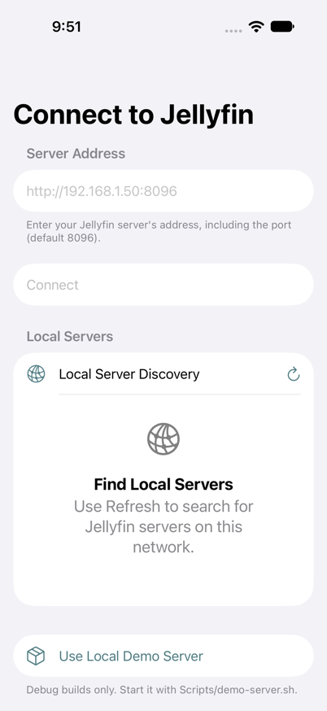 | 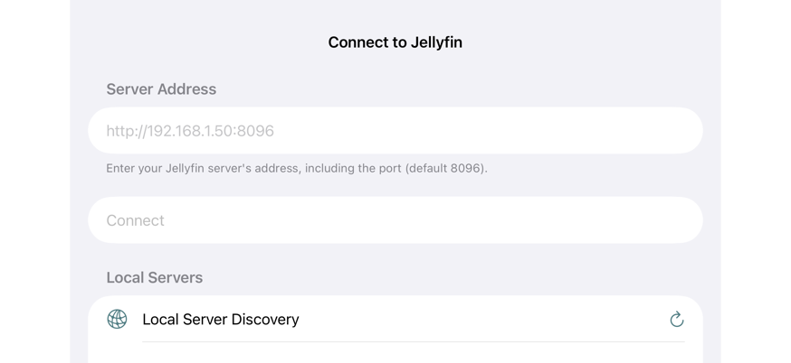 |
| Settings | 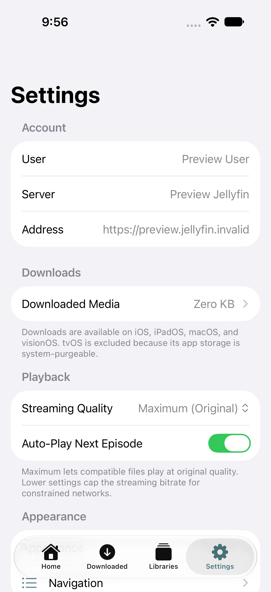 | 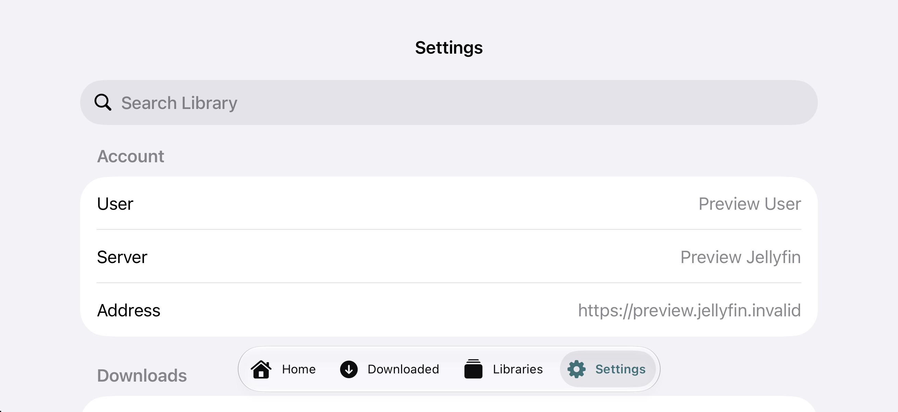 |
| Download management | 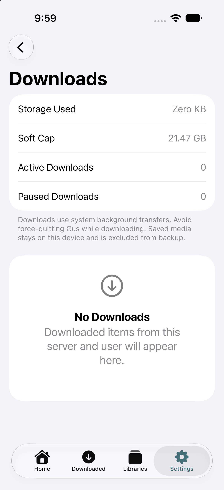 | 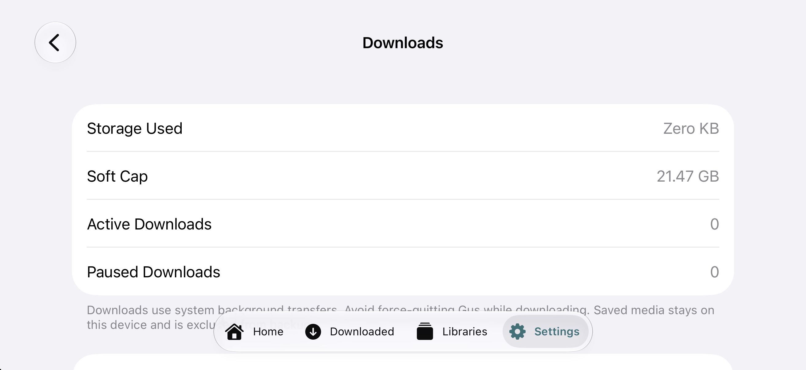 |
| Downloaded empty state | 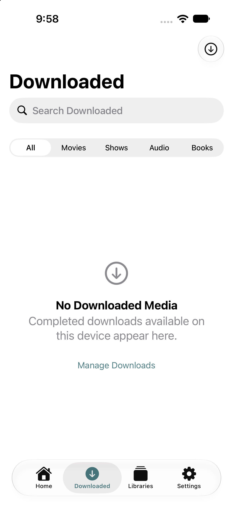 | 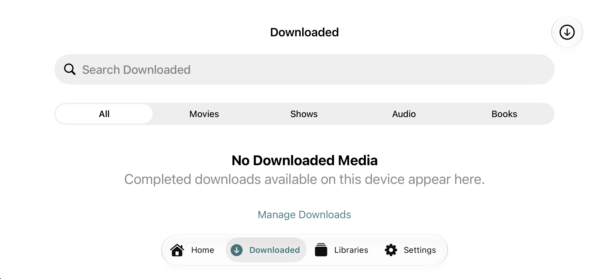 |

The phone landscape Settings/Downloads forms scroll. Content extending beneath the translucent system tab bar in a static frame is not, by itself, evidence of unreachable content.

### iPhone largest accessibility text, dark, increased contrast

| Portrait | Landscape |
|---|---|
| 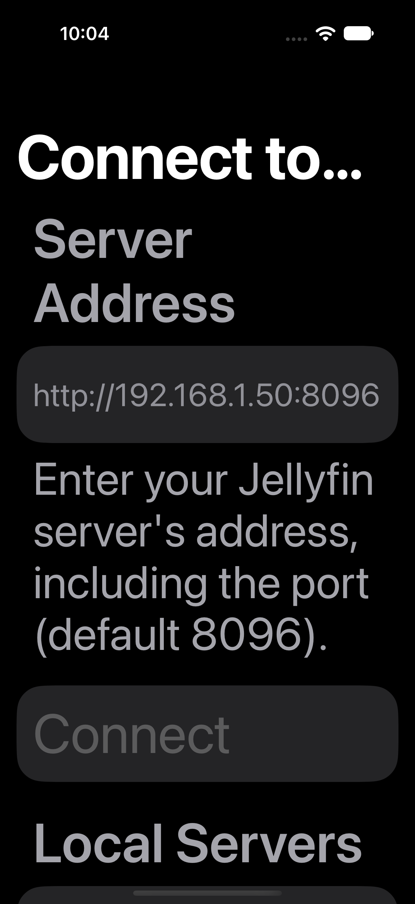 | 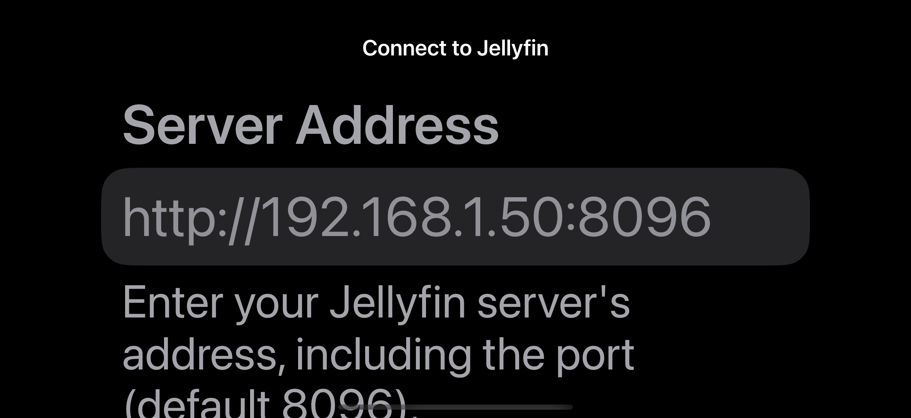 |

The form requires scrolling at this size. The portrait title truncation is verified; the smaller inline landscape title remains readable. These settled simulator captures replace rejected XCTest landscape attachments.

### iPad standard text: portrait / landscape

| Screen | Portrait | Landscape |
|---|---|---|
| Connect | 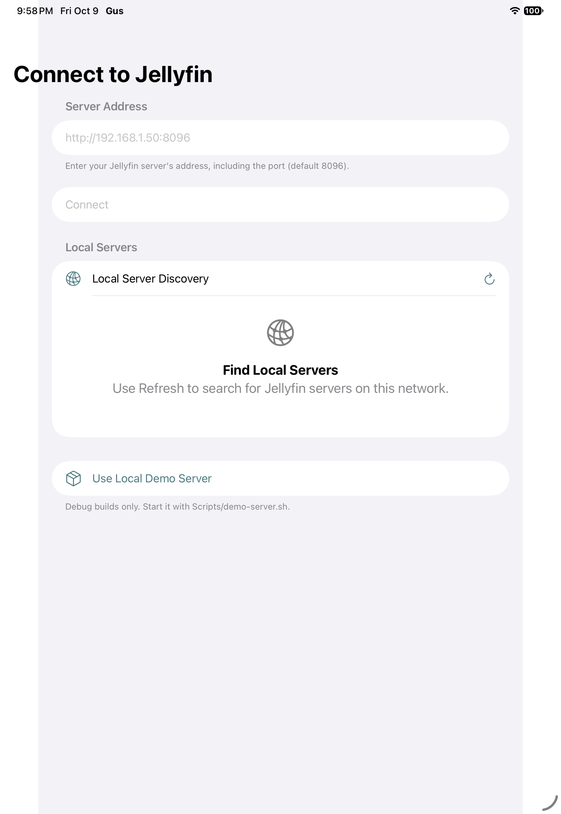 | 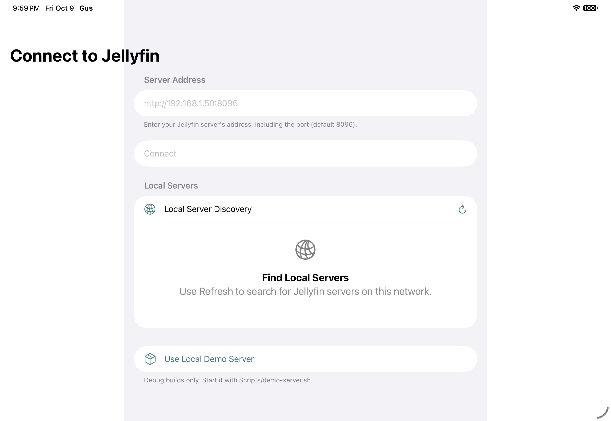 |
| Settings | 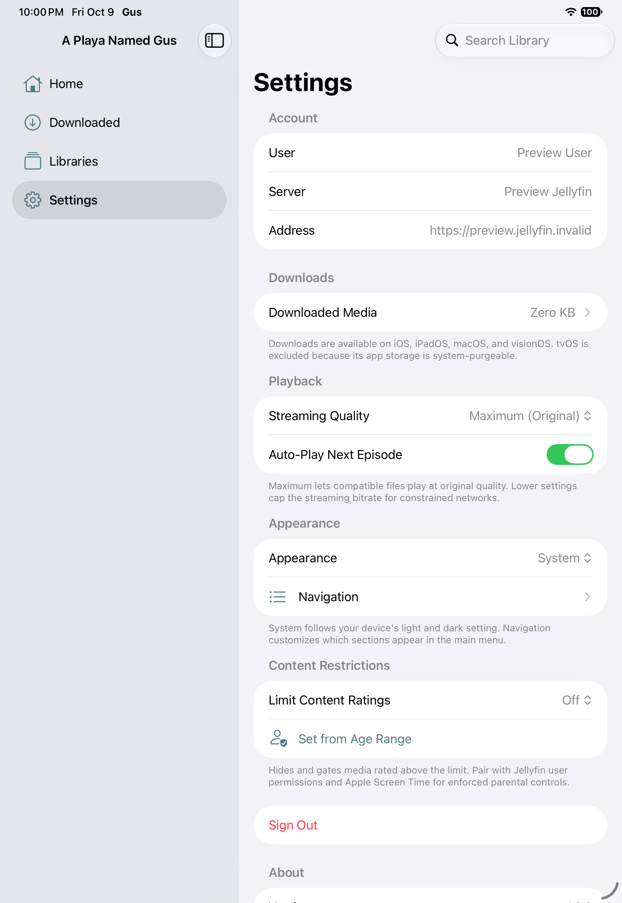 | 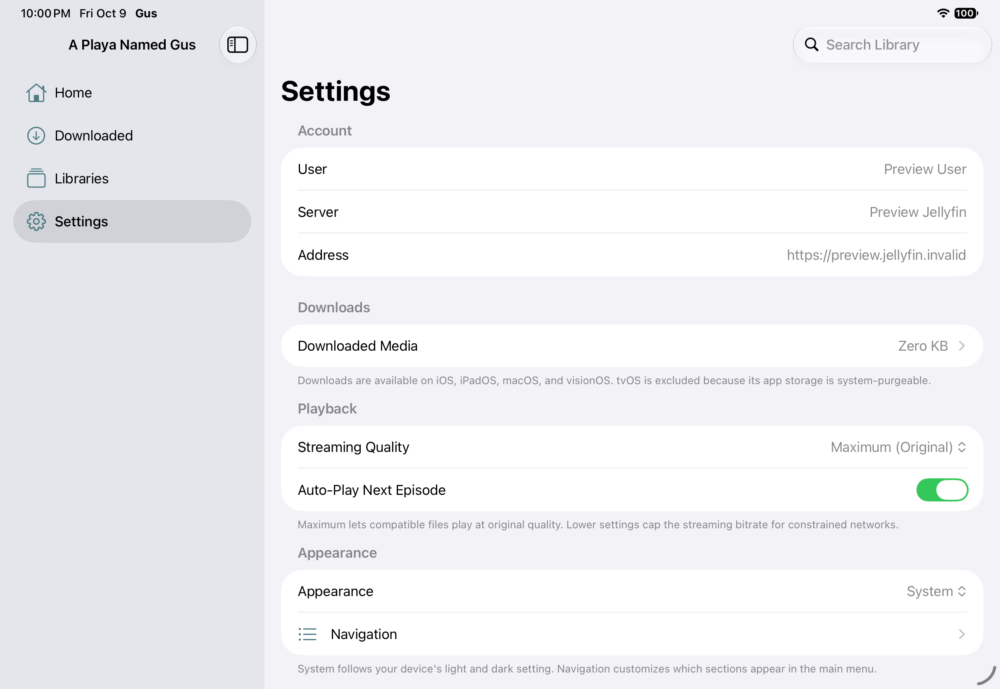 |

Additional inspected landscape captures: [Downloaded](evidence/ipad-direct/preview-downloaded-landscape.png), [Downloads after rotation](evidence/ipad-direct/preview-manage-downloads-after-rotation.png). Invalid-input recovery is visible on [iPad](evidence/ipad-direct/invalid-address.png) and [iPhone](evidence/standard/invalid-address.png).

## Coverage and remaining acceptance work

| Surface/check | Status | Evidence or limitation |
|---|---|---|
| Debug simulator build and launch | Checked | Successful build log and live app captures |
| Connect, standard light, phone portrait and landscape left/right | Checked with findings | Captures, accessibility tree, GUS-UI-007/017 |
| Connect, standard light, iPad portrait and landscape left/right | Checked with findings | Direct captures and iPad harness log |
| Connect, phone AX5 dark/increased contrast, portrait and both landscape directions | Checked with findings | Settled direct captures; title truncation and unconfirmed contrast warnings |
| Invalid-address validation | Checked | Inline error captured on phone and iPad |
| Connection cancellation | Failed usability check | No visible cancellation; eventual timeout not measured |
| Successful discovery/connect/login/session restoration | Blocked | No running test Jellyfin server/account |
| Settings and empty Downloads, phone/iPad portrait and landscape | Checked with findings | Preview session only; small target finding |
| Downloads navigation survives tested rotation | Checked | Phone and iPad assertion true; does not prove size-class transitions |
| Populated Home, library, search and details | Blocked runtime; source reviewed | Requires representative media and a test account |
| Audio/video/book/photo playback and dismissal | Blocked runtime; source reviewed | GUS-UI-001–004 and 016 require media-backed reproduction |
| Active/paused/failed/completed download operations | Blocked runtime; source reviewed | Empty stores only; no downloads created or deleted |
| Settings AX5 portrait/landscape; subsequent Downloads traversal | Partial / harness blocked | Settings captured; off-screen row query failed before download screens |
| VoiceOver spoken output and focus | Not checked | AX tree and audit are not substitutes |
| Software keyboard, hardware-keyboard-only navigation | Not checked | Hardware text entry alone succeeded |
| Reduce Motion / Reduce Transparency / Differentiate Without Color | Not checked at runtime | Limited source inspection only |
| Small iPhone, minimum iOS 18, iPad split-window resizing | Not checked | Current phone/tablet iOS 27 only |
| Localization, RTL, long real metadata | Not checked at runtime | English fixture and source constraints only |
| Physical device, touch ergonomics, interruptions, external playback | Not checked | Simulator evidence only |
| tvOS/macOS product UI | Not applicable to this requested iOS audit | Shared source noted where relevant |
| Figma fidelity / App Store readiness | Not assessed | No design comparison or release audit requested |

### Prioritized remediation and retest

1. **First: make playback escapable and failures actionable** (001, 002, 004). Exercise slow/offline/missing-file paths and dismissal before and after preparation.
2. **Then: adapt media screens to height and Dynamic Type** (003, 008–010). Validate compact landscape, long titles, AX5 and scrolling without shrinking user-selected text.
3. **Protect continuity and completeness** (005, 006, 013, 014, 016). Test regular/compact transitions, out-of-order requests and large mixed libraries with page boundaries.
4. **Finish localized accessibility/recovery** (007, 011, 012, 015, 017, 018), then triage contrast candidates (019) with actual measurements and VoiceOver.

The next runtime pass needs a non-production Jellyfin account with movies, series, music/albums, a chaptered audiobook, a book, photos, long metadata, missing artwork, and enough mixed items to cross paging boundaries. Capture each detail/player screen in both orientations, rotate during presentation, and exercise loading/error/retry/back paths. Use a small phone, a device that crosses compact/regular width, iPad split windows, and the minimum supported OS. This remaining evidence is required before claiming the application's full portrait/landscape experience is acceptable.

### Harness results and test limitations

The standard phone Connect/validation run passed 2 tests; the phone preview/direct run passed 1; the iPad run passed all 3. The settled AX5/dark repeat passed the 2 Connect/validation tests and failed the preview traversal when its `StaticText` query could not locate the off-screen Downloaded Media row. The runner also reported an automation element-type mismatch. This is an unresolved harness/coverage limitation, not proof that the row is unreachable by a user. AX5 Settings portrait/landscape screenshots were inspected, but AX5 download screens were not reached. The earlier AX5 Connect run also passed 2 tests. All accessibility issues were collected without failing the test; no accessibility-clean result is claimed.

AX5 evidence: [run log](evidence/large-direct.log), [Settings portrait](evidence/large-direct/preview-settings-portrait.png), [Settings landscape](evidence/large-direct/preview-settings-landscape.png). Settings reflows account label/value pairs vertically at this size. Manual scrolling and traversal of lower sections remain necessary.

### Evidence handling

The [external harness](evidence/harness/project.yml) and its [UI tests](evidence/harness/Tests/Preview.swift) are retained for reproduction. The [direct screenshot watcher](evidence/harness/watch-captures.py) captures after rotation settles, because XCTest attachment images were sometimes incorrectly transformed. Rejected landscape attachment files remain in raw exports for traceability and are not used as visual findings. The [phone](evidence/phone-direct.log) and [iPad](evidence/ipad.log) run logs retain assertions and accessibility warnings. Tool/desktop access failures are environment limitations, not Gus defects. No application source fixes, commits, distribution uploads or production-server mutations were performed.

Reviewed source SHA-256 fingerprints matched at completion, and Git status matched the recorded baseline. Review artifacts are saved under this report directory; the existing application changes were preserved.
