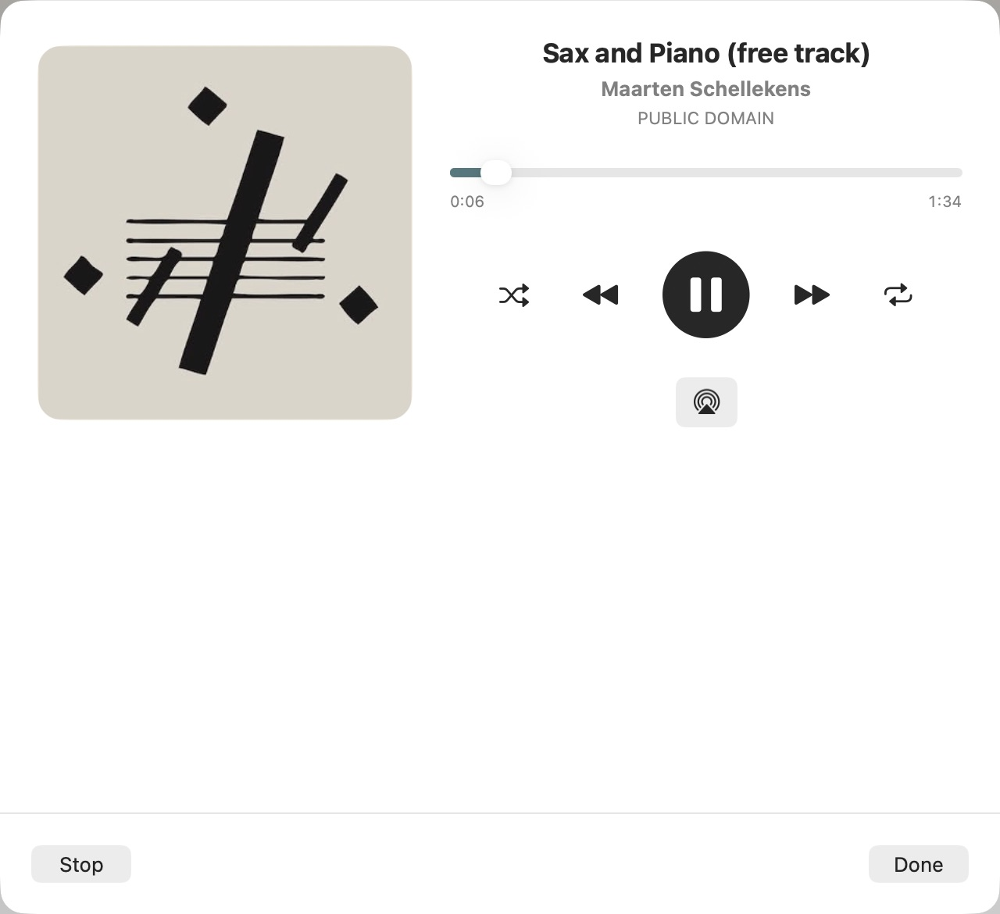
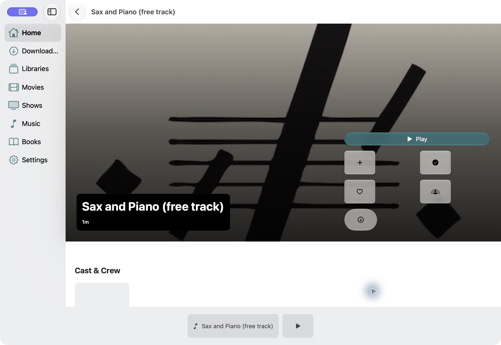
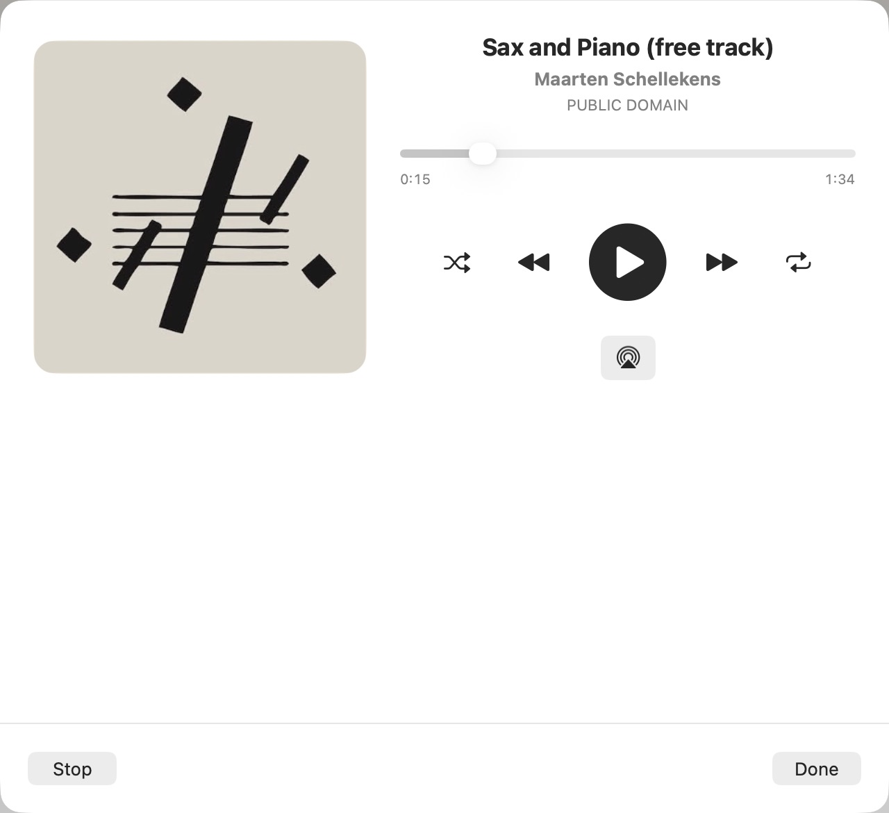
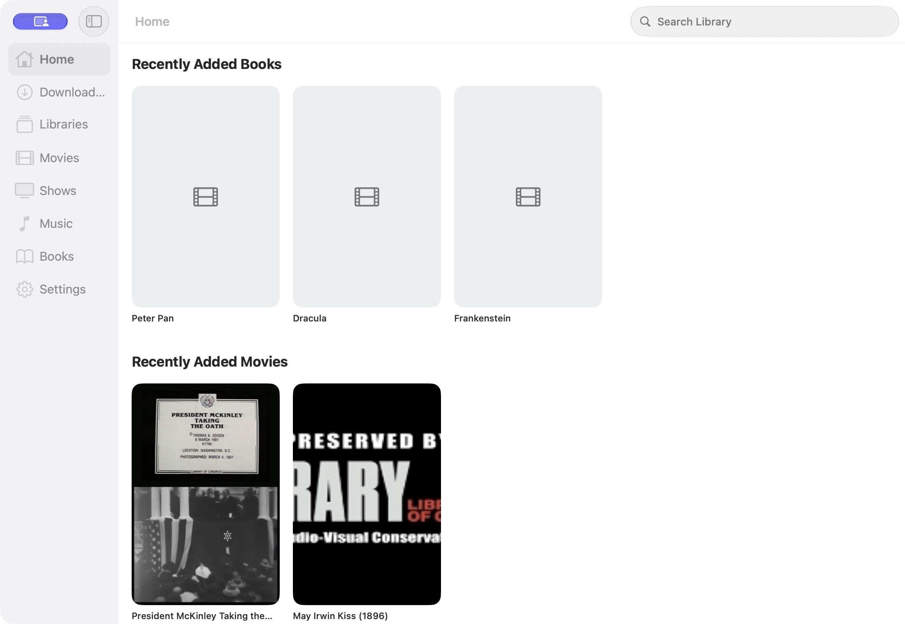

# Authentication and device repair verification — October 11, 2026

## Scope and baseline

User authorized repairs and requested physical iPhone automation first. Baseline `423bfa021ac1b05146ae660b611585f99c5cd556` already includes the original GUS-UI-001–024 remediation. This follow-up repairs the subsequently reproduced Mac authentication defect and issues exposed during native acceptance. Existing October 9–11 audit edits/evidence are preserved. The user authorized completing these local edits and publishing them directly on `main`. Publication and remote build outcomes are recorded in the linked [Cloud report](../../AppStore/xcode-cloud-dependency-onboarding.md).

Native Mac: macOS 27.0.1, Xcode 27.0, scheme `A Playa Named Gus`, local repository demo Jellyfin and rights-cleared sample library. Physical device: iPhone 18 Pro Max, iOS 27.0.1, existing signed-in account/downloads retained. No app uninstall or account reset.

## Findings and repairs

| ID | Reproduced issue | Repair and verification |
|---|---|---|
| GUS-UI-025 | Unicode Mac computer name makes the SDK's unquoted Authorization header invalid; valid login fails and incorrectly blames credentials. Demo shortcut fails silently. | Percent-escape unsafe device-name bytes before SDK serialization. Preserve transport/server errors; only authentication rejection suggests credentials. Demo shortcut displays failure text. Native demo sign-in and restored session succeeded without renaming the Mac. Encoded Unicode, non-Latin and delimiter names returned HTTP 200 in the isolated local-server harness. |
| GUS-UI-026 | Mac audio sheet collapses to its toolbar; Done provides no reachable Now Playing return control. | Give the native sheet a usable minimum size and attach the return control to the stable split-view root. Live playback advanced, Pause worked, Done exposed the return control, reopen retained paused playback, and Stop removed the session control. |
| GUS-UI-027 | Reopening paused audio resets the scrubber/accessible value to zero although elapsed time remains nonzero. | Initialize scrubber state from the current player time when the view appears. Live reopen retained both displayed and accessible 0:15 position. |
| GUS-UI-028 | Mac Home stays on its initial spinner until navigating away and back. | Read the observable Home store reference before constructing the escaping search-content closure. Fresh native launch now renders loaded Home immediately without sidebar navigation. |
| GUS-UI-029 | Mac Local Servers immediately fails with SDK discovery error 1 even though UDP replies reach the Mac. | Added the explicitly approved Mac network.server sandbox entitlement. Rebuilt signed app now lists jellyfin-server at https://stream.ericslutz.dev. Sandbox remains enabled. |

Sources: `DeviceIdentity`, `JellyfinClientFactory`, `AppModel`, `ConnectServerView`, `RootContainer`, `SessionPlayerHost`, `AudioPlayerView`. Regression tests cover header escaping and sign-in error classification. These initial authentication repairs introduced no new localized strings; the subsequent download controls add String Catalog entries.

## Local discovery verification

A read-only UDP probe received a reply from 192.168.60.40 on the Mac’s current network. The local demo container was stopped. The native app failed before the entitlement repair ([before](evidence/discovery/mac-before.png)) and listed the real server after rebuilding ([after](evidence/discovery/mac-fixed.png), [AX tree](evidence/discovery/mac-fixed-tree.txt), [probe](evidence/discovery/probe.json)). This verifies the current discovery path to this Mac, not every client/VLAN or which firewall rule enabled it. The advertised address is the server’s HTTPS hostname, which is valid for a locally discovered server. No firewall settings or server accounts were changed.

Apple documents that receiving UDP traffic requires the [network.server entitlement](https://developer.apple.com/documentation/bundleresources/entitlements/com.apple.security.network.server). The Jellyfin SDK binds an ephemeral UDP socket for discovery replies. The user explicitly approved this additional incoming-network capability after automatic review requested specific authorization. The rebuilt code signature contains both network entitlements and app-sandbox=true.

## Native flow evidence

1. Demo sign-in → restored Home → Libraries → movie detail → native video playback: successful. [Libraries](evidence/mac/libraries.png), [movie detail](evidence/mac/movie-detail.png), [video frame](evidence/mac/video.png).
2. Before repair, audio showed only the toolbar: [collapsed sheet](evidence/mac/audio.png); closing left no return control: [detail](evidence/mac/audio-closed-before.png).
3. After repair, all audio controls fit, Done exposes the session return control, and paused reopen retains its position:

4. Fresh Home launch renders content without switching sections:

## Physical testing — unlocked-device follow-up

The baseline follow-up used **1.0.0 (5)** on iPhone 18 Pro Max / iOS 27.0.1. Existing authentication and both downloaded titles were preserved. Initial authorization ran before repairs; after the user unlocked the device, the real-device suite executed.

| Flow | Current evidence and result |
|---|---|
| Continue Watching | Correctly spaced cards in the [actual Home portrait capture](evidence/physical/home-portrait.png); no overlap in this sample. [Landscape Home](evidence/physical/home-landscape.png) also has bounded, separated cards. |
| Libraries | Inspected [portrait](evidence/physical/libraries-portrait.png) and [landscape](evidence/physical/libraries-landscape.png); tiles/text stay within their columns. |
| Movie detail | Inspected [portrait](evidence/physical/movie-detail-portrait.png) and [landscape](evidence/physical/movie-detail-landscape.png); hero and Play remain inside the viewport. Play remains hittable after rotating back. The hero synopsis is a summary, with full text available further down the detail screen. |
| Downloaded library / manager | [Downloaded landscape](evidence/physical/downloads-landscape.png), [manager portrait](evidence/physical/download-manager-portrait.png), and [manager landscape](evidence/physical/download-manager-landscape.png) inspected. Manager presentation survives rotation; no deletion/new download performed. |
| Downloaded video | Test assertions passed for paused state before/after rotation and Close. Accepted [landscape player](evidence/physical/downloaded-paused-landscape.png) and [closed library](evidence/physical/downloaded-closed.png). The initial portrait capture was excluded after an unrelated interruption; the resumed test passed and produced an unobscured [portrait player](evidence/physical/downloaded-paused-portrait.png). This is local-file playback with network still connected, not an airplane-mode test. |
| Streamed video | [Portrait paused](evidence/physical/streamed-paused-portrait.png), [landscape paused](evidence/physical/streamed-paused-landscape.png), and [closed detail](evidence/physical/streamed-closed.png) inspected. Both pause assertions and Close passed. |
| Settings / Navigation | Corrected navigation run passed: [Settings portrait](evidence/physical/settings-portrait.png), [Settings landscape](evidence/physical/settings-landscape.png), [Navigation portrait](evidence/physical/navigation-portrait.png), [Navigation landscape](evidence/physical/navigation-landscape.png). No duplicate headings or clipped rows in this sample. Initial test used a launch-route argument that only applies to demo startup, so it remained on Downloaded and failed to locate Navigation. This was a harness error, not a reproduced product failure. |

The initial run finished **3 passed / 1 failed** ([summary](evidence/physical/initial-test-summary.json)). The passing combined Home/library/detail test did not actually open Home: that mislabeled capture is excluded; library/detail assertions and captures are valid. A focused follow-up completed the download-manager test and captured actual Home portrait before being intentionally stopped following an unrelated device alert. No passing result is claimed for interrupted tests. Private unrelated screenshots/recordings are excluded from this report and its evidence directory.

XCTest repeatedly waited 60 seconds for an animation-completion notification after some rotations, then continued. The sampled controls remained operable and tests completed; this does not establish a 60-second user-visible freeze. No app crash or new confirmed Gus defect was found in the accepted device captures. [Focused external harness](evidence/physical/Followup.swift) and the original harness in `evidence/Physical.swift` preserve reproducibility.

## Validation and limits

- Initial macOS unit suite: 281 tests in 47 suites passed, including the new identity/error cases. The final download candidate passes 284 tests in 47 suites.
- Final native Mac, physical iOS, and iOS/tvOS/visionOS/watchOS simulator builds all passed. Details are recorded in `evidence/validation.txt`.
- Website support tests passed. Project generation and cloud project/pin checks passed.
- Native visual/AX inspection establishes the sampled flows above, not VoiceOver speech/rotor acceptance. Full Mac window-size/keyboard matrix, alternate appearance and assistive-technology review remain unverified.
- Apple TV, iPad, Vision Pro and Watch runtime evidence from earlier reports remains historical; this pass does not relabel a compile as a simulator UI test.
- After the user cleared the interruption, the remaining Home/Settings/Navigation suite passed 3/3 ([summary](evidence/physical/remaining-test-summary.json)); the downloaded-player retest passed 1/1 ([summary](evidence/physical/download-retest-summary.json)). Temporary logs/results/harness are under `/tmp/gus-device-repair`; durable evidence is linked here.

The captured images linked above were reopened and visually inspected. These baseline playback tests were stopped when complete. The later download/layout retest on installed build 8 passed; see the final physical acceptance section below.

## Additional download work requested

| ID | Issue and requested behavior | Current implementation |
|---|---|---|
| GUS-UI-030 | Downloaded titles show placeholders instead of saved thumbnails. Existing/failed artwork downloads are never backfilled. | Foreground repair fetches missing/invalid artwork into the account’s persistent download directory, validates image decoding, and rejects stale writes after deletion/replacement. Local display remains file-only. |
| GUS-UI-031 | Storage management has playback buttons, no bulk selection/confirmation, no automatic cleanup; Downloaded lacks swipe deletion. | Completed management rows now show only Delete. Select/Select All/Delete Selected/Delete All confirm before removal. Done remains enabled after deleting the final selected record. Current-account and generation checks protect replacements. Downloaded uses immediate native swipe deletion, as agreed with the user. Delete After Finishing defaults off, handles natural video/audio completion and reader-close at PDF/EPUB end, and retains repeat-audio files until playback stops. External-reader completion is unavailable. |
| GUS-UI-032 | Detail download button is larger than peer actions, and the five icon actions wrap into two rows. User-supplied phone screenshot confirms this. | Shared icon-label dimensions/control size and a single equally distributed action row; Play remains the separate primary action. |
| GUS-UI-033 | Wide landscape sidebar consumes excessive content width and uses a long navigation title inconsistent with the app icon. | Native column width is bounded to 180–260 points, ideal 220; navigation title becomes Gus. Full brand name remains in About/store identity. |

Physical build 6 confirmed thumbnail backfill for both existing downloads and equal action-button width/height/alignment (within 2 points). [Downloaded artwork](evidence/download-layout/downloads-artwork-portrait.png), [management rows](evidence/download-layout/management-portrait.png), [single-row detail actions](evidence/download-layout/detail-actions-portrait.png). No personal downloads were deleted. The original confirmation popover omitted its Cancel action on this OS; build 7 uses a native alert with explicit Cancel. The final candidate, **1.0.0 (8)**, is installed with sign-in and downloads preserved ([installed metadata](evidence/download-layout/installed-app.json)). Its phone retest subsequently passed 2/2 after unlock and a fresh automation session; see final physical acceptance below.

284 unit tests in 47 suites passed. Isolated simulator tests passed selected deletion/cancel, native swipe deletion, delete-all/cancel, and final-page PDF cleanup. The first run passed 4/6 flows; its video assertion preceded the 29-second fixture’s actual end, and the audio harness needed corrected fixture duration, a longer completion wait, and a row-scoped assertion. The corrected video/audio completion retest passed 2/2, with independent file-store inspection confirming both records were removed. Evidence: [confirmation with Cancel](evidence/download-layout/selected-confirmation.png), [swipe removal](evidence/download-layout/swipe-deleted.png), [PDF final page](evidence/download-layout/book-final-page.png), [all deleted](evidence/download-layout/all-deleted.png), [video completion](evidence/download-layout/video-completion-cleanup.png), [audio finished](evidence/download-layout/audio-finished.png), [completion test summary](evidence/download-layout/completion-summary.json), and [file-store check](evidence/download-layout/completion-file-check.txt). Only disposable simulator fixtures were deleted. The subsequent EPUB and Repeat One runtime tests both passed: closing at the first chapter retained the EPUB, closing at its final page removed it, and repeated audio remained available across multiple loops and sheet dismissal before Stop removed it. A multi-track Repeat All queue remains outside this sample. External reader completion cannot be observed. Earlier physical screenshots document build 5, before these requested download/layout changes.

Final iOS, tvOS, visionOS, and watchOS simulator builds passed; native Mac built with the passing unit suite, and the physical iOS build passed. Formatting (0/193 files), String Catalog parsing, website tests, project/pin checks, and whitespace checks passed. Final build and formatting logs are retained in `evidence/download-layout/`.

The iPad Pro 11-inch (M5), iOS 27 simulator passed the layout flow. Inspected [portrait sidebar](evidence/download-layout/ipad-home-portrait.png), [landscape sidebar](evidence/download-layout/ipad-home-landscape.png), [portrait actions](evidence/download-layout/ipad-actions-portrait.png), and [landscape actions](evidence/download-layout/ipad-actions-landscape.png): the narrower Gus sidebar and all five equal secondary actions fit their available space. Demo books without server artwork retain placeholders; these are separate from the repaired persistent thumbnails on the phone.

### Resumed completion verification

The remaining EPUB and Repeat One simulator tests passed **2/2** ([summary](evidence/download-layout/final-completion-summary.json), [harness](evidence/download-layout/FinalCompletion.swift)). The original two-chapter EPUB fixture displayed the [beginning](evidence/download-layout/epub-beginning.png), remained downloaded after early close, then displayed the [final chapter](evidence/download-layout/epub-final-page.png) and was [removed after closing](evidence/download-layout/epub-completion-cleanup.png). An eight-second audio fixture continued in [Repeat One](evidence/download-layout/audio-repeat-retained.png) for over twenty seconds, remained downloaded after Done, and was [removed after reopening and Stop](evidence/download-layout/audio-repeat-stop-cleanup.png). All five saved images were inspected. Independent file-store inspection confirmed neither fixture record remained. No additional application code repair was needed.

A separate gesture test passed **1/1**, exercising both paths independently ([summary](evidence/download-layout/swipe-variants-summary.json), [harness](evidence/download-layout/SwipeVariants.swift)). [Partial swipe](evidence/download-layout/partial-swipe-reveals-delete.png) left the item present and revealed a tappable trash action; tapping it deleted without a prompt. [Full swipe](evidence/download-layout/full-swipe-deletes-immediately.png) deleted the second fixture directly with no prompt. Both images were inspected. The temporary demo server was stopped after testing. Final build 8 phone verification subsequently passed after unlock, as recorded below.

## Final physical acceptance — build 1.0.0 (8)

On October 11 at 12:05 EDT, the fresh physical iPhone 18 Pro Max run passed **2/2 tests** ([summary](evidence/physical-build8/summary.json), [harness](evidence/physical-build8/DownloadRepairs.swift)). The formerly queued run had failed 0/2 after an unrelated app interruption and lost UI-testing authorization; it is not counted as passing. A clean restart completed normally.

- [Portrait detail actions](evidence/physical-build8/detail-actions-portrait.png): all five secondary controls are in one row; Download and Favorite frame width, height, and vertical alignment match within 2 points.
- [Landscape Home](evidence/physical-build8/home-sidebar-landscape.png): narrower Gus sidebar and separated Continue Watching cards. The native bottom search bar overlays part of the initial rail text; this capture alone does not establish that text remains unobstructed throughout scrolling.
- [Downloaded artwork](evidence/physical-build8/downloads-artwork-portrait.png): both existing titles retain thumbnails after app relaunch.
- [Management portrait](evidence/physical-build8/management-portrait.png): completed rows display artwork and Delete only; Delete After Finishing remains off.
- [Individual confirmation](evidence/physical-build8/delete-confirmation.png) and [selected-item confirmation](evidence/physical-build8/selected-delete-confirmation.png): explicit Cancel is visible and was exercised. Existing media was retained; no personal downloads were removed or automatic-deletion preference changed.
- Landscape [detail](evidence/physical-build8/detail-actions-landscape.png) and [management](evidence/physical-build8/management-landscape.png) initial viewports render correctly, with lower controls requiring scrolling. A focused reachability follow-up checks those controls below.

All eight saved screenshots were visually inspected. Sign-in and the two downloads were preserved. These checks cover the selected UI flows, not airplane-mode networking or VoiceOver speech/rotor acceptance.

The supplemental landscape-scroll test is currently queued at Xcode’s device-unlock preflight after the phone auto-locked between runs. It has not executed and is not included in the 2/2 pass count. Portrait controls and the iPad portrait/landscape action row are verified; physical landscape below-fold reachability remains pending this check.

## GUS-UI-034 — landscape hero artwork stops short of the pane edge

The user observed a trailing gap beside the landscape hero. The build 8 physical screenshot confirms the backdrop ends at the horizontal safe-area boundary; source inspection also found the entire detail stack, including artwork, capped at the text-content maximum width. The repair keeps the foreground content bounded, moves the page-width cap to the metadata sections, and allows only the hero background to extend through horizontal container safe areas. Text and controls retain safe-area protection.

Build 1.0.0 (9) compiled and installed over the existing phone app. Physical hero and action-row acceptance is now established by the inspected captures below; the combined test later failed when the device locked during management scrolling. The prior supplemental build 8 scrolling run was intentionally stopped at the user's request; its partial action assertions are not a completed test pass.

The repaired layout passes all platform builds (physical iOS, iOS/tvOS/visionOS/watchOS simulators, and native Mac), focused formatting, and whitespace checks. Installed phone metadata confirms **1.0.0 (9)** ([metadata](evidence/hero-width/installed-app.json)). The simulator portrait/landscape flow passed 1/1 ([summary](evidence/hero-width/simulator-summary.json)); inspected [portrait](evidence/hero-width/hero-simulator-actions-portrait.png) and [landscape](evidence/hero-width/hero-simulator-actions-landscape.png) show edge-filling artwork with inset foreground controls.

A separate split-pane test passed 1/1 after correcting an overlong scroll gesture in the harness ([summary](evidence/hero-width/split-summary.json), [harness](evidence/hero-width/HeroLayout.swift)). The initial test flung past the action row and failed its hittability check; no additional product change was needed. Inspected [split-pane hero](evidence/hero-width/hero-split-landscape.png) shows the background reaching the right edge, and [after a controlled scroll](evidence/hero-width/hero-split-landscape-scrolled.png) shows all five aligned action buttons fully visible and Download hittable. This closes simulator visual acceptance of GUS-UI-034. The build 9 physical follow-up subsequently captured and verified the hero repair before a later lock interruption; see the scoped result below.

### Build 9 physical hero acceptance and remaining limit

The unlocked iPhone executed the hero portion on October 11 at 12:42 EDT. Inspected [portrait](evidence/hero-width/physical/hero-width-portrait.png) and [landscape](evidence/hero-width/physical/hero-width-landscape.png) captures confirm the repaired backdrop fills the detail pane through its right edge while foreground content remains inset. After scrolling, [all five secondary actions are fully visible](evidence/hero-width/physical/detail-actions-landscape-scrolled.png); Download and Favorite passed hittability and equal width/height/alignment assertions within 2 points. These saved screenshots establish physical visual acceptance of GUS-UI-034 and the landscape action row.

The **combined test did not pass** ([summary](evidence/hero-width/physical/summary.json), [harness](evidence/hero-width/physical/DownloadRepairs.swift)). It subsequently entered Downloads management, waited twice for Xcode's animation-idle notification, and failed when iOS reported the device locked. Thus the supplemental management below-fold scrolling check remains unverified on the phone. Prior build 8 management/confirmation checks passed 2/2; they are not replaced by a false pass here. No downloads were deleted or preferences changed. The test process has exited; no phone automation remains running or queued.

## GUS-UI-035 — Play stretches across wide detail panes

The user identified an overly wide primary Play control in landscape. The previous label requested all available width, so the stacked hero layout stretched the button across the pane. The repair caps the styled Play button at 320 points while permitting narrower proposals. This matches the existing side-by-side action-column width, preserves native large control styling and content-driven height, and applies consistently to iPhone, iPad, Mac, Apple TV, and Vision Pro. Foreground secondary actions remain a single equal-width row; the hero artwork stays full-bleed. Watch uses separate native list actions and compact transport controls, not this shared hero.

Verified on October 11 with the local demo Jellyfin server. The exact saved screenshots below were inspected.

| Platform | Play size (points) | Result |
| --- | --- | --- |
| iPhone 18 Pro Max simulator, portrait and landscape | 320 × 50.33 | 1/1 test passed; [portrait](evidence/play-size/iphone-play-default.png), [landscape](evidence/play-size/iphone-play-landscape.png) |
| iPad Pro 11-inch M5 simulator, portrait and landscape | 320 × 50.5 | 1/1 corrected-capture test passed; [landscape](evidence/play-size/ipad-retry-play-landscape.png) |
| Apple TV 4K simulator | 320 × 85 | 1/1 test passed; [screenshot](evidence/play-size/tv-play-default.png) |
| Vision Pro simulator | 320 × 52 | Width assertions passed; XCTest screenshot unsupported. Separate simctl [capture](evidence/play-size/vision-native.png) visually verified. Overall XCTest run failed at screenshot capture, not sizing. |
| Native Mac | Bounded width visually verified | External XCTest runner stalled and was interrupted. Freshly launched rebuilt app verified through native UI; [screenshot](evidence/play-size/mac-native.png). No automated numeric Mac result claimed. |
| Watch | Separate native list/transport controls | Source reviewed and simulator build passed; no shared hero or new Watch runtime test. |

The first iPad landscape `app.screenshot()` attachment was malformed; it is retained only as capture-failure evidence. The retry uses `XCUIScreen.main.screenshot()` and supersedes that image. [Harness](evidence/play-size/PlaySize.swift) and per-platform summary/metric files are saved alongside screenshots. The iPhone landscape screenshot verifies the Play control; secondary actions extend below this short viewport and require scrolling, covered separately in GUS-UI-034.

All platform builds passed (iOS, tvOS, visionOS, macOS, watchOS). Targeted SwiftFormat lint and `git diff --check` passed. Phone build **1.0.0 (10)** was installed and its bundle version independently confirmed with CoreDevice; this cap has not been physically retested. No phone automation is queued. The earlier supplemental physical management-scrolling gap remains as documented above.

## GUS-UI-036 — secondary actions stretch across the Mac detail pane

The user's screenshot exposed a remaining defect in the secondary row: equal-width labels expanded without a row maximum, and macOS supplied rectangular borders. The hero now applies the native capsule border shape to every secondary action, including Download, and caps the left-aligned cluster per platform (Mac 280, iPhone/iPad 320, Vision Pro 360, TV 440 points). Narrow containers can shrink naturally; native control styling and minimum 44-point interaction heights remain. Play is capped at the lesser of 320 points and the secondary-row maximum, so it cannot extend beyond the group beneath it (280 points on Mac). The full-width artwork is unchanged.

The rebuilt native Mac app was opened with the local demo server and the exact [final saved screenshot](evidence/play-size/compact-mac-final.png) was inspected: all five actions are uniformly rounded and occupy a compact group beneath Play; Play ends at the same right edge as the row. This supersedes the overly broad secondary row visible in GUS-UI-035's Mac screenshot. Final simulator checks passed 1/1 each on [Apple TV](evidence/play-size/compact-tv-final-summary.json), [Vision Pro](evidence/play-size/compact-vision-summary.json), [iPhone](evidence/play-size/compact-iphone-summary.json), and [iPad](evidence/play-size/compact-ipad-final-summary.json). iPhone/iPad tests cover portrait and landscape. Inspected screenshots: [TV](evidence/play-size/compact-tv-final-play-default.png), [Vision](evidence/play-size/compact-vision-native.png), [iPhone portrait](evidence/play-size/compact-iphone-play-default.png), [iPhone landscape](evidence/play-size/compact-iphone-play-landscape.png), [iPad portrait](evidence/play-size/compact-ipad-final-play-default.png), [iPad landscape](evidence/play-size/compact-ipad-final-play-landscape.png). Short iPhone landscape still needs scrolling to expose the lower row; it is not an all-controls-visible-at-once claim.

The initial iPad run failed an incorrect harness assumption that the visible capsule bounds must equal the outer layout's 44-point frame; XCTest reports the native visible button at 42 points. The corrected test checks bounded nonzero control geometry. It does not independently prove hit-testing outside the visible capsule. The first compact TV run used the preceding binary while the build completed and is superseded by `compact-tv-final`.

All platform builds, targeted format lint, and diff whitespace checks passed. Watch remains on its separate unchanged controls. The final Mac-only Play alignment adjustment was rebuilt and visually verified; other platforms retain their previously checked 320-point Play cap. These latest compact-row changes are **not installed on the physical phone**, which retains build 10. No physical automation was started.

## GUS-UI-037 — icon actions overlap at accessibility XXXL

**Medium, verified defect.** At the largest accessibility Dynamic Type category, the hero's icon-only buttons grow beyond their equal-width cells and overlap in portrait and landscape. The native accessibility audit reports only the system Done button's partial scaling and navigation-title truncation; it misses this visual defect. Evidence: [largest-text portrait](evidence/remaining-tests/remaining-accessibility-retry-large-Light-portrait.png). Reproduced on iPhone 18 Pro Max simulator, iOS 27, demo Sneeze detail. Source: `CinematicDetailHero.actionStack`.

The repair bounds Dynamic Type only for the icon-only action cluster, preserving spoken labels, native controls, and full text scaling in the hero and surrounding content. Retest must inspect nonoverlapping controls at XXXL in both orientations, including a narrow phone, and retain ordinary-size alignment. The prior harness pass establishes reachability, not visual acceptance.

## Remaining-test execution — October 11, build 11

- **Physical Downloads management: passed.** The landscape list scrolls to the lower download and opens its confirmation; Cancel preserved the existing file. [Reachable controls](evidence/remaining-tests/phone11-remaining-phone11-management-landscape-reachable.png) and [confirmation](evidence/remaining-tests/phone11-remaining-phone11-management-landscape-confirmation.png) were inspected. Build 1.0.0 (11) was installed and its metadata independently checked. This supersedes earlier management-scroll and build-10 deployment gaps.
- **Physical compact actions: portrait verified, landscape incomplete.** Portrait equal-width/alignment assertions passed and the saved screenshot was inspected. The combined run then failed when the phone auto-locked; Home scrolling could not launch. The overall phone run is 1/3 passed, not a full pass. No personal media was deleted.
- **Two-track Repeat All cleanup: passed.** On the iPad simulator, two original eight-second test audio files remained present after both tracks had time to complete with Repeat All enabled. Stop cleared both records, and a separate filesystem check confirmed both files were absent. [Result](evidence/remaining-tests/repeat-all-final-summary.json), [file checks](evidence/remaining-tests/repeat-all-files.txt). The looping screenshot caught a loading transition; the following accessibility tree shows track 2, Pause, and Repeat All. This is functional cleanup evidence, not clean visual acceptance of every transition.
- **Large Dynamic Type:** the initial native audit missed visible icon overlap, now tracked as GUS-UI-037 above. Its test names included Dark, but the initial launch argument did not force the app's appearance; those images do not establish dark-mode coverage. The corrected harness uses the app's actual appearance preference.
- **Release/environment gates remain:** installed simulator runtimes do not match the exact minimum deployment versions (iOS/tvOS 18, visionOS 2, watchOS 11); native Mac runs on the host OS rather than macOS 15. No signed TestFlight candidate was distributed or installed by this task. Native accessibility audits and element trees do not replace actual VoiceOver speech, rotor, and focus-order acceptance.

### Final physical and accessibility results

The unlocked physical retry passed **2/2** ([summary](evidence/remaining-tests/phone11-final-summary.json)). Its inspected [landscape detail](evidence/remaining-tests/phone11-final-phone11-actions-landscape.png) confirms Play ends at the secondary-row edge, all five controls are visible and uniformly sized, and the hero fills its pane. Together with the separate management pass, the three requested phone flows executed. However, the Home screenshots reveal the unresolved issue below; test completion is not blanket visual acceptance. The first Home capture caught rotation mid-transition and is not valid layout evidence.

GUS-UI-037's repaired icons are visually separated in the [large-phone dark portrait](evidence/remaining-tests/accessibility-fixed-large-Dark-actions.png) and [landscape](evidence/remaining-tests/accessibility-fixed-large-Dark-landscape.png) captures. That run failed during teardown and the following launch; its overall 0/2 result remains recorded. A separate isolated 375-point-wide iPhone SE simulator passed **2/2** in actual light/dark appearance at accessibility XXXL. Portrait screenshots show the fixed row with fully scaling title and Play text. Its first landscape captures show partially visible lower controls, so a focused capture correction checks full bounds before accepting that view. Native audits still report system Done partial scaling and navigation-title truncation (the title is repeated in full in the scrollable hero); no clean VoiceOver result is claimed.

The physical phone retains **build 11**, which includes the compact alignment repairs but predates the new GUS-UI-037 Dynamic Type fix. No later phone deployment is claimed. Manual VoiceOver speech/rotor/focus checks, true iPad multitasking/narrow-window interaction, exact minimum-OS runs, and signed TestFlight installation remain outside completed acceptance.

## GUS-UI-038 — Home search field obscures landscape rail captions

**Medium, unresolved visual concern.** Build 11 physical iPhone landscape shows the native bottom Search Library field over Continue Watching captions. Both attempted vertical gestures produced the same visible rail position, so the test does not establish that obscured captions can be scrolled clear. [After first gesture](evidence/remaining-tests/phone11-final-phone11-home-landscape-scrolled.png), [after second gesture](evidence/remaining-tests/phone11-final-phone11-home-landscape-lower.png). The automated flow passed because it captured screens without asserting caption clearance. Investigate outer vertical-scroll reachability separately from the nested horizontal rail and bottom search placement before choosing an inset/layout repair; a screenshot alone does not establish which mechanism is responsible. No speculative layout change was made.

### Final verification limits

All five platform builds pass after GUS-UI-037 (iOS, macOS, tvOS, visionOS, watchOS), with focused formatting and whitespace checks passing; [build record](evidence/remaining-tests/builds.txt). The stricter narrow-screen capture follow-up completed dark mode but failed light mode's scroll-to-button assertion, **1/2**, after the earlier reachability run passed 2/2. Preserve that failure: it limits full-viewport light-landscape acceptance and is not a demonstrated product regression. The repaired row's nonoverlap is established by inspected large-phone portrait/landscape and narrow-phone portrait captures. No physical test or deployment of this final Dynamic Type-only change occurred.

Phone automation has exited. Existing phone sign-in and downloads were preserved. The remaining Home caption issue and the listed manual/environment gates are still open; this report does not claim release readiness.

The final narrow capture runner stalled after logging its 1-pass/1-failure outcome and was stopped. Its raw [execution log](evidence/remaining-tests/accessibility-narrow-final.log) is retained; no finalized xcresult or new screenshot acceptance is claimed for that attempt. The earlier completed narrow run remains separately available. The disposable demo server and isolated narrow simulator were stopped.

## Requested follow-up — landscape repair, narrow acceptance, minimum OS, Duo

### GUS-UI-038 repaired and simulator-verified

On iOS 26 and later, compact-height layouts now place the system search control in the top toolbar. Regular-height layouts retain automatic placement, and older iOS retains its native search behavior. This removes the floating search field from the short content viewport without fixed content insets or a custom search control. Source: `CompactHeightSearchPlacement` in `Sources/Platform/PlatformModifiers.swift`.

The corrected Home/search/rotation test passed **1/1**: [summary](evidence/remaining-tests/home-search-final-summary.json), [Home landscape](evidence/remaining-tests/home-search-final-home-search-landscape.png), [search results](evidence/remaining-tests/home-search-final-home-search-results.png), [query retained after portrait rotation](evidence/remaining-tests/home-search-final-home-search-preserved-portrait.png). All three saved screenshots were inspected. The demo Home sample uses the same media-rail component with recent books; its captions remain unobscured. Book cover placeholders reflect missing fixture artwork. This is simulator acceptance; the phone remains untouched on build 11. The first test failed because it expected a Search button rather than the visible native field and is superseded.

### Narrow portrait/landscape acceptance completed

The 375-point-wide iPhone SE simulator passed **2/2**, actual light/dark appearance at accessibility XXXL, including assertions that the complete Download bounds lie inside the visible viewport after scrolling. Inspected [dark landscape](evidence/remaining-tests/narrow-complete-large-Dark-landscape.png), [light landscape](evidence/remaining-tests/narrow-complete-large-Light-landscape.png), and [light portrait](evidence/remaining-tests/narrow-complete-large-Light-actions.png) show all five separated controls. [Summary](evidence/remaining-tests/narrow-complete-summary.json). The harness now waits for rotation and scrolls in either direction according to actual button bounds; this supersedes the incomplete capture attempt. No additional app repair was necessary beyond GUS-UI-037.

### Exact minimum OS remains blocked by runtime availability

The configured minimum versions remain iOS/tvOS 18.0, watchOS 11.0, visionOS 2.0, macOS 15.0. Apple `xcodebuild -downloadPlatform` rejected each exact minimum runtime as unavailable. Both universal and arm64 iOS requests failed, as did the supplementary iOS 18.5 request. `xcodes` listed historical catalog entries but its install operation also failed through Apple's downloader for all four platforms. The logs are retained in `evidence/remaining-tests/min-*` and `xcodes-*`. The host is not macOS 15 and no macOS 15 VM is available. Building with these deployment targets verifies API availability checks, not execution on those OS versions. Required unblock: compatible runtime packages imported through Xcode, plus a macOS 15 host/VM.

### iPhone Duo initial SDK gate — superseded by the RC checks below

Apple documents iPhone Duo and provides Xcode 27.1 RC for its SDK and device simulator. Sources: [preparation guide](https://developer.apple.com/documentation/technologyoverviews/preparing-your-app-for-iphone-duo), [adaptive layouts](https://developer.apple.com/videos/play/tech-talks/111463/), [tooling](https://developer.apple.com/iphone-duo/), checked October 11, 2026. Duo requires testing closed, flat-open, partially folded, rotation, vertical bars, and hinge/camera reserved regions. Ordinary phone/iPad resizing does not establish fold-specific acceptance.

At the initial check, the installed SDK was Xcode 27.0. The iOS 27.1 runtime downloaded and installed, but the Duo device profile and new SwiftUI arrangement/reserved-region APIs are absent from this SDK. Downloading Xcode 27.1 RC stopped at Apple Developer authentication; a local SDK package was requested from the user. No speculative unavailable-API code was added.

Source audit: the main navigation uses native TabView/NavigationSplitView and size classes; session-owned navigation/search/player state survives container changes. No device-model or screen-dimension layout branching was found. Detail and audio sheet Done/Stop toolbar actions now supply native icons plus titles for vertical-bar eligibility. This is preparatory work, not Duo certification. Next SDK-backed work: verify fold-safe hero/actions and audio artwork/transport arrangement, camera occlusion, native video, sheets, and state continuity across displays. Preserve iOS 18 fallbacks when adopting 27.1-only APIs.

The installed iOS 27.1 runtime exposes no supported device types under Xcode 27.0; creating a normal iPhone 18 Pro Max against it was rejected as incompatible. Installing the runtime alone does not unblock Duo testing.

The final native toolbar additions compile successfully for iOS, tvOS, visionOS, macOS, and watchOS; [build record](evidence/remaining-tests/followup-builds.txt). All physical automation remains stopped, and no changes from this follow-up were installed on the phone.

The final toolbar smoke test passed 1/1: detail Done retained its spoken label and dismissed the sheet; audio Stop remained hittable and stopped playback. [Summary](evidence/remaining-tests/toolbar-adaptation-summary.json), [audio toolbar](evidence/remaining-tests/toolbar-adaptation-home-search-audio-toolbar.png). The demo server and isolated narrow simulator were stopped after testing.

## Final local app completion and Cloud validation — October 11

The user requested completion of the remaining local app repairs before publication to `origin/main`. The following additional source-supported defects were repaired:

- Vision Pro’s hover shape overrode the capsule shape on detail actions. Primary Play and secondary actions now use the same capsule hover shape; the incremental visionOS build passed.
- Video teardown could leave an asynchronous preparation or queued next-episode task able to recreate playback after dismissal. Teardown now invalidates the generation; callbacks and next-up results reject obsolete generations. Regression tests cover uncanceled late preparation and queued autoplay after teardown.
- Download artwork backfill previously ran before offline progress reconciliation. Several slow or unavailable image endpoints could delay resume-position syncing. The two operations now use independent view-scoped tasks with foreground and account cancellation.

Duo’s closed, flat-open, and partially folded simulator flows each passed earlier. A subsequent native Device Hub check passed scoped audio continuity through closed → open → partially open → closed, followed by Pause, resume, and Stop. The initial short-track boundary failure and timed-out control attempts remain historical failures; the later check has [separate evidence](evidence/duo-transitions/acceptance.json). The exact minimum-OS runtime and manual VoiceOver acceptance limits remain open. No further automation has been started on the physical phone.

Xcode Cloud onboarding succeeded against the existing app and repository using a disposable local copy to bypass the erroneous public-package connection step. The real project retains its dependencies. Gus Multiplatform Validation is manual-only, with iOS/macOS/tvOS/visionOS BUILD actions, Xcode 27.1 RC, a compatible macOS host, and no distribution. See [Cloud diagnosis](../../AppStore/xcode-cloud-dependency-onboarding.md) for evidence and final build status.

### GUS-UI-039 — EPUB chapter navigation and reader input

**Medium, verified defects; repaired and accepted on the isolated iOS 27 simulator.** The Chapters menu displayed only top-level EPUB links. Dracula's 27 chapters are children of its book-title entry and could not be selected; the inspected [before menu](evidence/epub-chapters/chapters-before.png) and [accessibility tree](evidence/epub-chapters/chapters-before-tree.txt) show no chapter I. The reader also omitted Readium's supported directional input adapter. It now retains and binds that adapter for reader navigation. A first nested-menu implementation exposed an unexpected software keyboard in the iOS 27 simulator, so the final chapter browser uses a native sheet, list, and recursive disclosure groups. Group expansion and parent-link navigation are separate; targetless grouping headings have no misleading Open action. The reader ends editing in its own window before presenting Chapters and restores navigator focus after dismissal. Opening Chapters does not trigger the reader's completion-deletion path; that guard received source review.

The committed Dracula acceptance test passed **1/1, zero skipped**, using Xcode 27.1 RC, ARM-only compilation, and the isolated iPhone 18 Pro Max simulator on iOS 27.0. Individually inspected original screenshots verify the clean [chapter browser](evidence/epub-chapters/chapters-after.png), [expanded nested list](evidence/epub-chapters/nested-chapters-after.png), readable [portrait prose](evidence/epub-chapters/chapter-portrait.png), [landscape opener](evidence/epub-chapters/chapter-landscape.png), actual [forward page](evidence/epub-chapters/page-forward-landscape.png), [backward page](evidence/epub-chapters/page-back-landscape.png), and [return to book details](evidence/epub-chapters/reader-dismissed-landscape.png). Keyboard-absence and eventual dismissal assertions passed. [Acceptance summary](evidence/epub-chapters/accepted-summary.json), [test trace](evidence/epub-chapters/accepted-test.log), [attachment manifest](evidence/epub-chapters/accepted-manifest.json). Hardware-key navigation and automatic deletion specifically while opening Chapters at the final page were reviewed in source, rather than exercised in this runtime method. No physical-phone test or deployment was started.

The adapter-free Readium reader did render the [book half-title](evidence/epub-chapters/reader-before.png); removing the deprecated HTTP-server adapter is not established as a rendering defect. The original short text wait was premature under host contention; the existing test now queries nested WebKit static text and allows 75 seconds. Later harness failures came from guessed chapter labels, unsupported hit-testing of paginated prose, and querying a web view immediately after a transition. The final method waits for chapter-sheet dismissal, uses actual landscape window geometry, and waits for a hittable Read button plus an absent reader Done button. Actual screenshots establish page changes; full-chapter accessibility text alone does not. No blank-page or application-crash defect is claimed from those failed probes.

Final source review also corrected Downloads management's Done button enablement after the last selected record is deleted: Done remains enabled while selection mode is active. This was a focused source condition change; no additional runtime test is claimed for it.

### Host memory pressure during final checks

Before interpreting slow simulator startup as app performance, the host was measured with 16 GB RAM and 34.5 GB swap in use. Three idle Xcode UI build services each held 21–22 GB. Own builds/tests were paused, own Duo/EPUB simulators were shut down, and those oversized services were terminated. The unrelated active command-line build and simulator were preserved. Swap fell to 5.8 GB; small replacement build services started normally. The idle Device Hub frontend was also stopped. Tests resume serially with two build jobs. [Sanitized measurements](evidence/memory-pressure/cleanup.json). This is a host-resource issue; the observation does not establish a Gus app memory leak.

An idle Xcode 27.0 UI service grew back to 7 GB after restarting. The idle parent UI process was therefore suspended without discarding documents, and its oversized service terminated again. Xcode 27.1 and the active unrelated command-line build were preserved. The suspended Xcode window can be resumed and quit normally after macOS is unlocked; it is not an uninstall or source reset.

At 19:30 local, after the serial reader check, swap was 9.6 GiB and CPU had 64% idle time; one-minute load was 6.7, down from the initially saturated host. macOS `memory_pressure -Q` reported 37% system-wide memory free. The retained swap pages do not alone establish current paging pressure. The three idle indexing services remain paused, parent Xcode windows are running, and normal save/quit is still blocked by the locked Mac. Protected endpoint software and unrelated work were preserved.

### Duo SDK-backed per-state acceptance

Xcode 27.1 RC is installed. The audio surface now uses native `ArrangementView` split placement when a division reserved region intersects it, while the playback/scrubbing state remains owned outside adaptive view replacement. iOS 18 fallbacks remain. The local SDK builds for iOS, Mac, Apple TV, Vision Pro, and Watch passed before the final playback/chapter edits. The real Duo simulator passed one combined Home/detail/audio portrait/landscape flow in each of [closed](evidence/duo/closed-final-summary.json), [flat-open](evidence/duo/open-summary.json), and [partially folded](evidence/duo/folded-summary.json) states. XCTest screenshots can capture the inactive display and are not used alone as visual evidence. The subsequent live audio display-transition check below closes that sampled continuity/control gate.

### Duo live audio display-transition acceptance

On the owned iOS 27.1 Duo simulator, native Device Hub controls changed the same running audio player through closed → open → partially open → closed. The demo title, **02 - Whispers of the Glen**, remained selected with Repeat One intentionally enabled. Accessibility snapshots show Pause and Stop in every settled state and progressing playback: closed 0:58, open 2:38, open before the partial transition 0:59, partially open 1:12, and closed again 2:12. The wraps are expected repeats of the 2:42 track, not a claim of globally monotonic elapsed time. Pause then displayed Play at 2:29; resume restored Pause at 2:32; Stop returned to the same item's detail screen with `Detail.play` and no playback-position, Pause, or Stop controls. [Acceptance metadata and exact capture list](evidence/duo-transitions/acceptance.json).

The initial [open capture](evidence/duo-transitions/open-playing.png) was transient and blank; the later [settled open capture](evidence/duo-transitions/open-settled.png) shows the player. The inspected [closed return](evidence/duo-transitions/closed-return.png) and [stopped result](evidence/duo-transitions/closed-stopped.png) support the final controls and return flow. These sampled screenshots and element trees do not measure audible gaps or black-frame duration, or establish transition acceptance for native video, every navigation/sheet flow, or physical Duo hardware.

This check reused the RC-built arm64 simulator app last linked after the final EPUB source edit and used by the accepted EPUB test. At that accepted candidate, app source, configuration, resources, and shared project matched the published `755ff09`/Cloud-verified `084a470` app source; the binary has no embedded commit identifier. The subsequent GUS-UI-040 decorative placeholder edit below is not included in this saved simulator acceptance. Native Mac window/keyboard checks, exact minimum-OS execution, manual VoiceOver, later physical-phone acceptance, signed archives, and TestFlight remain separate gates. The Mac was unlocked for this later Device Hub check, superseding the earlier locked-Mac interaction blocker without changing the recorded host-resource measurements.

### Audio replay lifecycle — source-supported defect

At natural queue completion, the old audio path removed its observers and Now Playing/report state, yet Play only changed the ended AVPlayer’s rate. The controls could claim playback without restarting the file or restoring completion tracking. The targeted regression uses a muted, valid 400 ms WAV and tests two actual natural completions separated by Play. A second regression verifies that replay after opt-in deletion respects local-only playback and never requests a stream. Repair and final test outcome are recorded below when complete.

The other idle UI/background services also grew back to several GB. All three idle parent processes were temporarily suspended and their oversized support services released, preserving unsaved documents. At the next measurement swap was 7.4 GB and CPU had 35% idle time, compared with the original saturated host. A two-second sample places the RC service in target dependency-graph computation with a 4.2 GB footprint; this does not establish which project or Apple implementation caused the growth. The active unrelated CLI build remained untouched. Native save/quit and Duo transition interaction still require the locked Mac to be unlocked.

The paused parent windows subsequently blocked CLI project opening in `NSFileCoordinator`. Resuming all three parents released that wait, and the existing test command advanced to its dependency graph. The mitigation now pauses only their idle indexing support services; the parent windows and active CLI build service remain running. This avoids leaving the application windows suspended while preventing the measured idle indexing growth. Native save/quit is still pending the Mac unlock.

A [static graph audit](evidence/memory-pressure/source-graph-audit.json) found no explicit self/cyclic/duplicate native target edges, duplicate package identities, duplicate source references, or build/evidence directories included in the project. The captured service was also checking platform suitability for indexing and retaining a settings cache. Indexing is supported as the observed activity; a particular leak, dependency defect, or connection to Cloud onboarding remains unproven. No package or app architecture changes were made solely to reduce this host pressure.

### Final playback regression results

The original queue replay failed both tests after actual natural completion of a muted 400 ms PCM WAV. The repaired path releases the finished player and prepares a fresh item from zero when Play is pressed, restoring completion/reporting observers. Generation checks prevent obsolete queued work from restarting playback after Stop. Replay after opt-in deletion still reports a missing local file and makes no stream request. The repaired combined run passed **23/23**, zero skipped: two audio replay checks and 21 UI regressions including all three video cancellation/teardown/autoplay cases. [Red summary](evidence/audio-replay/audio-replay-red-summary.json), [green summary](evidence/audio-replay/audio-replay-green-summary.json), [executed tests](evidence/audio-replay/audio-replay-green-tests.json). Full source/test lint passes for all 193 files and the shared 12-scheme/16-pin project matches XcodeGen.

At 19:39 local, after the accepted EPUB run and shutdown of its simulator/demo server, swap fell to 8.2 GiB. macOS reported 40% system-wide memory free, CPU had 76% idle time, and the sampled one-second interval showed 12 swap-in pages and no swap-out pages. These are point-in-time host readings, not a guarantee against recurrence. The three idle indexing services remain temporarily paused until normal native save/quit can be completed on the unlocked Mac.

At 19:51 local, while validation ran remotely, swap held at 8.1 GiB, CPU had 60% idle time, and the one-second sample had 24 swap-in pages and no swap-out pages. The local heavy Gus jobs remained stopped; the three idle Xcode indexing services were still paused because macOS remained locked.

At 20:08 local, swap was 8.8 GiB, memory-pressure reporting showed 44% system-wide memory free, and CPU had 77% idle time. The one-second sample recorded four swap-in pages and zero swap-out pages. Retained swap remains above zero, but this interval does not show active swap-out pressure. Idle Xcode services remain temporarily paused; native cleanup still needs the Mac unlocked.

At 20:30 local, swap fell to 7.7 GiB (7,915 MiB), memory-pressure reporting showed 41% system-wide memory free, and CPU had 78% idle time. The one-second sample recorded zero swap-in and zero swap-out pages, with one-minute load 3.65. The three paused services were verified by executable and parent identity; all parent Xcode processes were running. Native cleanup remains blocked by the locked Mac. Heavy Gus validation continues remotely.

The 20:41 local follow-up held at 7.7 GiB swap (7,867 MiB), with 87% CPU idle, one-minute load 2.46, and zero interval swap-ins/swap-outs. Memory-pressure reporting showed 39% system-wide memory free. This confirms sustained relief over the observed interval while hosted testing ran; the temporary idle-service mitigation still requires normal native cleanup.

At 21:15 local, swap was 7.5 GiB (7,698 MiB), with zero interval swap-ins/swap-outs. CPU was 40% idle in that sample, one-minute load was 3.87, and memory-pressure reporting showed 32% system-wide memory free. All three paused service executable/parent identities were reverified; parent Xcode processes were running. These are point-in-time host observations, not a guarantee of future pressure or an app memory-leak diagnosis. The normal native cleanup remains pending.

### Final main publication and Xcode Cloud validation

The completed app/download/adaptive-UI/playback/chapter repairs and evidence were
published directly on `origin/main` as `755ff09`. The first Cloud run exposed a
bootstrap comparison between the Cloud account UUID and Developer signing Team ID.
The focused repair, retaining the wrong-account guard and original signing identity,
passed nine bootstrap tests and was published as `084a470`.

Cloud Build 2 is `COMPLETE/SUCCEEDED` against exact source SHA
`084a470683a78256e939bd63b416bc2fb0150bb2`, with **4/4** required BUILD actions passed
for iOS, macOS, tvOS, and visionOS. It fetched all 16 pinned package repositories.
The current reader UI test also compiled the embedded Watch module; its local Watch
compile/sign/validation evidence is retained in the [scoped build excerpt](evidence/epub-chapters/watch-build-excerpt.log).
This is compilation evidence, not another Watch runtime test. The final playback regressions
remain 23/23 and native EPUB acceptance 1/1. Later documentation/evidence and CI
configuration changes through CI candidate `edd06e` contain no app source changes;
the later GUS-UI-040 edit is recorded separately below.

[Cloud result and diagnostic report](../../AppStore/xcode-cloud-dependency-onboarding.md)
records zero errors, six iOS/one macOS pre-existing SDK migration warnings, and the
build-only scope. The sampled live Duo audio transition/control check now has
[separate runtime evidence](evidence/duo-transitions/acceptance.json). Minimum-OS
runtime, manual VoiceOver, broader Duo flows, signed archives and TestFlight remain
unverified. The physical phone remains released.

### GitHub CI SDK mismatch

The separate post-publication GitHub iOS/iPadOS build jobs selected Xcode 27.0 and
failed on `ArrangementView` and `GeometryProxy.reservedRegions`, which require the
27.1 SDK. CI is updated to select the hosted 27.1 toolchain and explicitly reject
an older iOS simulator SDK. Its subsequent full matrix result remains a separate
acceptance check; the all-platform Cloud RC build result above stands. The
[Cloud diagnostic report](../../AppStore/xcode-cloud-dependency-onboarding.md)
records the runner manifest, toolchain versions, and scope.

The hosted iOS/iPadOS builds and iPhone unit tests passed with Xcode 27.1 at `e43afc5`.
The iPadOS log confirms `SessionPlayerHost.swift` compiled, closing the missing-SDK
symbol defect. The iPhone run passed 288 Swift Testing tests in 48 suites plus
three XCTest tests. The separate Mac unit runner still failed before assertions. Its
ad-hoc test host carries restricted production capabilities without provisioned
signing; the local passing runs used development signing. A focused Mac-unit-only
temporary entitlement fixture retains sandbox/client/server access while keeping
production and Cloud configuration intact. The launch error is not classified as
an app assertion failure. The focused configuration passed in hosted run `38187673465`
at exact commit `aaebc323be81f391f9e9436b00f6c86d21a7b10e`: fixture preparation,
test-host launch, **288 Swift Testing cases in 48 suites**, and **three separate
XCTest performance cases** all passed. [Mac evidence](../../AppStore/cloud-onboarding-evidence/github-ci/run-38187673465-macos-test-success.json).
Interactive Mac UI and production signing remain separate gates.

Hosted run `38187673465` completed **12/13 jobs** successfully: all six builds,
Mac/iPad/tvOS/visionOS unit lanes, lint and documentation checks. The iPhone lane
ran all 288 Swift Testing cases and three XCTest performance cases, but recorded
one real completion-wait failure at `AudioPlaybackTests.swift:242`.
[Exact failure](../../AppStore/cloud-onboarding-evidence/github-ci/run-38187673465-iphone-test-failure.json).
Compilation and launch succeeded; native audio overload messages do not prove its
cause. Simulator diagnostic collection then timed out after 600 seconds.

The stateful playback tests activate/deactivate one process-wide audio session
from independently scheduled suites. They are now grouped under a common native
serialized suite, preserving real WAV completion assertions and adding bounded
failure diagnostics. This repairs a test isolation hazard; it does not establish
that the observed CI failure was a product defect or prove its precise cause.
No app source or production signing changes are made for this test repair. The
test identifiers now include `PlaybackIntegrationTests`; future focused selectors
must use that parent. Formatting, syntax and shared-project checks pass. The
isolation run's result and subsequent final hosted acceptance are recorded below.

Hosted isolation run `38190182036` at exact commit
`deeedcac0136fa538e4985b2b0b765643c491020` finished **12/13 jobs** successfully.
All six builds, Mac/iPad/tvOS/visionOS unit tests, lint and documentation checks passed.
The iPhone again failed its first natural-completion wait: the added diagnostic
reported `state=loaded`, `isPlaying=true`, native item status ready, native time-control
status playing, rate 1.0 and item time 0.4 seconds. The following local-only deletion
replay test passed. Each lane executed 288 Swift Testing cases in 49 suites and three
separate XCTest performance cases; only the iPhone lane recorded an issue.
[Run summary](../../AppStore/cloud-onboarding-evidence/github-ci/run-38190182036-summary.json),
[exact failure](../../AppStore/cloud-onboarding-evidence/github-ci/run-38190182036-iphone-test-failure.json).

Serialization did not resolve this outcome. The observer is registered before playback
with the exact item and generation, and the native player still reported playing at
its fixture endpoint. These observations do not establish a lost app callback or prove
a simulator-only cause. Native log buffering prevents subtracting CI arrival timestamps
to reconstruct an exact startup/deadline duration. The next focused investigation uses
a valid one-second 48 kHz PCM fixture with matching metadata and records actual native
end/failed-end notifications. It retains the eight-second completion deadline, real
playback and replay/deletion assertions; no synthetic completion or app workaround is
introduced. The subsequent final hosted acceptance is recorded below.

After the user unlocked macOS, all three paused service identities/parents were
reverified and resumed. Both idle GUI Xcode sessions (27.0 and 27.1 RC) were quit
normally; process verification confirms both GUI PIDs and their two support services
exited. No save/discard prompt appeared, and no document was force-killed. The small
running background tool service remains preserved. No services remain intentionally
paused; the normal native memory-cleanup gate is complete.

### Final hosted CI acceptance

[GitHub run 38192282611](https://github.com/eslutz/A-Playa-Named-Gus/actions/runs/38192282611) at exact commit `edd06e6636cd32b877622dbcb4ccb34524a1b3c1` completed **13/13 jobs successfully**: all six iOS/iPadOS/macOS/tvOS/visionOS/watchOS builds, all five iPhone/iPad/macOS/tvOS/visionOS unit lanes, lint, and docs. Each test lane passed **288 Swift Testing cases in 49 suites** and **three separate XCTest performance measurements**, with no failures or observed skipped test-case lines. These repeated platform executions are not additional unique tests; no individual assertion total is reported. [Run summary](../../AppStore/cloud-onboarding-evidence/github-ci/run-38192282611-summary.json), [per-lane evidence](../../AppStore/cloud-onboarding-evidence/github-ci/run-38192282611-test-lanes.json), [log excerpts](../../AppStore/cloud-onboarding-evidence/github-ci/run-38192282611-test-lanes.txt).

The iPhone's strengthened native replay case passed in **4.338 seconds** and its automatic-deletion/local-only no-stream case in **1.303 seconds**. Passed expectations establish exactly one actual native end notification and zero failed-end notifications per original/replayed/deleted item, item replacement on replay, two provider resolutions for replay, and zero server resolutions after the downloaded file's deletion. The other four lanes also passed both cases. [iPhone evidence](../../AppStore/cloud-onboarding-evidence/github-ci/run-38192282611-iphone-native-replay-success.json), [native cases across lanes](../../AppStore/cloud-onboarding-evidence/github-ci/run-38192282611-native-audio-cases.json). These are enforced assertions proven by passing test cases, not separately printed raw success telemetry. The test-only one-second 48 kHz PCM fixture retained actual natural playback and the eight-second deadline; no synthetic completion, skipped case, longer timeout, or production workaround was introduced. The cause of the earlier 400 ms/8 kHz fixture failure remains unresolved. That tested production app source/configuration matches successful Cloud `084a470`; the later GUS-UI-040 source edit awaits hosted compilation. Full interactive Mac, physical later-source, minimum-OS, manual VoiceOver, broader Duo and signed Release/TestFlight gates remain separate.

### GUS-UI-040 — decorative artwork uses incorrect media fallback

**Low impact; source-fixed, hosted compilation pending.** Source review found that the hero backdrop and About poster selected `tv` only for series and otherwise selected `film`, so book/audio placeholders could show a movie symbol and expose an irrelevant decorative symbol label. A media-type helper now returns `book` for books/audiobooks, `music.note` for audio/albums/artists/playlists, `tv` for series/seasons/episodes, and `photo` for photos, preserving `film` for video/default types. Only these two existing artwork calls use the helper. Both artwork wrappers are hidden from accessibility; adjacent title, metadata and controls remain available. The existing audio player already hides its decorative artwork.

Changed sources: [media display helper](../../../Sources/Providers/MediaItem+Display.swift), [hero](../../../Sources/SharedUI/CinematicDetailHero.swift), [About cards](../../../Sources/SharedUI/AboutCardsView.swift). Focused SwiftFormat lint and Swift syntax parsing passed, with no local build/runtime retest or mirrored implementation test added. The saved Cloud `084a470`, CI `edd06e` 13/13, and Duo captures establish the preceding source candidate. They do not validate this subsequent glyph/accessibility edit; the next hosted compile is pending. Manual VoiceOver acceptance remains open.

### Final host-resource sample and cleanup

At **21:51 local**, after native cleanup and the scoped Duo check, swap use was **7.65 GiB** and `memory_pressure` reported **43% free**; that metric is not unused physical RAM. The one-second sample recorded 94 swap-in pages and zero swap-out pages. Both GUI Xcode sessions had exited normally and the owned Device Hub frontend had exited; the owned Duo simulator and demo server were stopped, and no service remained intentionally paused. The largest observed resident process was about 1 GiB; the preserved small background indexing service used 2,032 KiB RSS. The unrelated active simulator/test runner and protected endpoint software were preserved. CPU idle was **15.82%** with a one-minute load of **129.68**, so this sample does not establish low CPU load or restored responsiveness. The reduced swap/idle-service footprints and absence of sampled swap-out do not alone identify a Gus memory leak or prove absence of all memory pressure. Historical measurements above remain recorded. [Final cleanup measurements](evidence/memory-pressure/cleanup.json).
