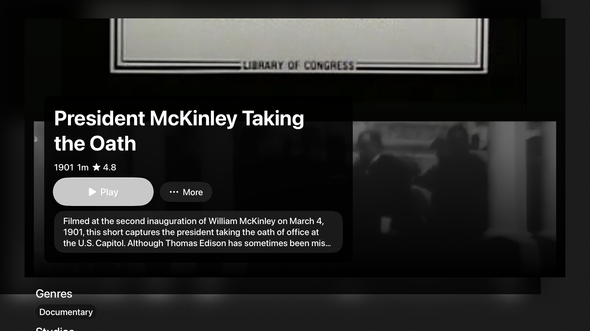
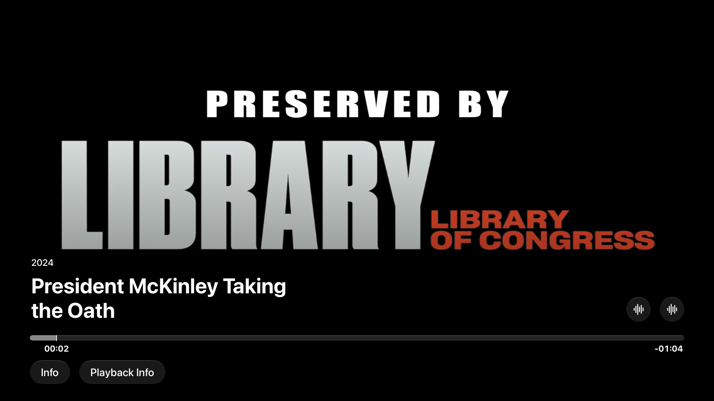

# tvOS 27 / Jellyfin 12.2 runtime follow-up

2026-10-13. Local validation of `feature/tvos-cinematic-native` in `/tmp/gus-tvos-cinematic-native`; no publication, release export, signing/account settings or production server changes.

## Environment and fixture

Eric explicitly authorized the official compatible-runtime installation and requested the latest Jellyfin 12.2 for testing. Apple's `xcodebuild -downloadPlatform tvOS -buildVersion 27.0 -architectureVariant arm64` installed **tvOS 27.0 (24J360), arm64** through the official runtime download mechanism. No target was lowered, agreement bypassed or unrelated runtime/simulator deleted. Xcode 27.1 RC is selected per command; the global developer directory is unchanged.

The dedicated **Gus TV 27 Validation** simulator is Apple TV 4K (3rd generation), 1080p, UUID `D0F81C88-4FA3-4C10-BA10-C561BBCEF7B3`. The runtime is installed for subsequent use. Initial live Connect capture is [01-connect.png](evidence/runtime/01-connect.png).

The official portable server from [Jellyfin's macOS latest-stable arm64 repository](https://repo.jellyfin.org/files/server/macos/latest-stable/arm64/) runs locally at **127.0.0.1:8096** with separate configuration/data/cache/logs in `/tmp/gus-tv-native-demo`. Its real `/System/Info/Public` response confirms **12.2.0**. [Sanitized fixture metadata and archive checksum](evidence/runtime/jellyfin-fixture.json) record the exact downloaded binary URL. This is an actual Jellyfin server, not mocked responses or a preview session. Existing Docker/OrbStack daemons were stopped, so the isolated portable server avoids starting shared container services. The older 10.11.11 portable executable was unsigned and rejected by macOS; it was not re-signed or used as a security workaround.

The repository's rights-cleared `sample_media` was copied into the task-owned fixture. Two test users (`gus`, `bob`) and Movies/Shows/Music/Photos/Books libraries were configured. Only fixture movie progress is reset between repeated runs. The unchanged server resume configuration is 5% / 90% with a 300-second minimum duration; the archival movie clips are shorter. Their removal from the unwatched rail after a short playback is consistent with this server policy, rather than proof of a Gus completion-policy regression. Long-movie resume requires additional media coverage. Live access tokens and task-owned authentication files stay outside the repository. The reproducible test harness uses the repository’s public local-demo credentials. The tests authenticate through Gus's existing debug demo-server entry point, using the current Jellyfin API. The temporary fixture setup was adjusted for 12.2's create-user JSON body and MediaBrowser Authorization token attribute. The existing `--gus-route home` option normalizes the selected tab; the harness explicitly navigates to the movie rail because Jellyfin recent-library ordering changed after restart. No production API or server configuration was changed.

The unsigned UI lane uses the existing `--gus-disable-cloud-sync` debug argument. Without it, CloudKit initialization traps because this build has no signed CloudKit entitlement. This flag was already in repository UI tests; the implementation does not change sync, entitlement, signing or security behavior. Signed private-iCloud acceptance remains separate.

## Runtime findings and corrections

1. The native large Home navigation title overlapped the cinematic header. The TV-only helper now leaves Home's native title empty while other platforms retain their Home title. The focused media supplies the cinematic title; native sidebar and Account remain available.
2. A visible native toolbar Account menu was difficult to reach from the remote's content rail. The same menu now lives in a TV safe-area header with a native focus section. Up from the rail reaches it. No custom chooser, focus router, confirmation or PIN was added.
3. The detail More menu displayed text but exposed an unlabeled button in the runtime accessibility tree. It now has an explicit localized label and stable test identifier.
4. Returning after the played movie disappears from Home's unwatched rail initially selected the first card/rail rather than the clamped neighbor. Instrumentation confirmed that Home is retained and its appearance task does not run on pop; observers inside that suspended view also miss intermediate navigation depths. The repair captures the parent focus frame in the existing navigation-state path observer. On return, the first automatic fallback cannot replace that frame; it issues a per-context request that reruns the native `@FocusState` link after the parent becomes focusable. The ordinary remote regression now restores May Irwin Kiss after the played President McKinley item disappears. A subsequent different focus choice cancels the old request rather than repeatedly stealing focus. No timer, custom remote handler, router, decoder, namespace experiment or shared-binding experiment is retained. The new navigation-state test was observed failing before the change and passing afterward.

The presentation and focus repairs compile on TV and iOS. Source formatting and whitespace checks pass; diagnostic instrumentation and unsuccessful focus experiments were removed. Shared provider, Next Up builder, playlist/collection ownership, account identity, private-sync boundaries and native player policy remain intact.

## Evidence and acceptance

The full unit lane actually ran on tvOS 27: **409 Swift Testing cases in 64 suites**, plus **three XCTest measurements**, passed. The earlier matrix also passed Mac tests and iOS/iPadOS, visionOS and Watch builds. The final iOS regression build after the focus repair passed. The existing test-only Sendable warning is unchanged; no app-source warning appeared in the accepted TV builds.

Remote UI acceptance is run with `XCUIRemote` against the actual signed-in app and server. The reproducible standalone harness is saved with the evidence. Native Menu focus appears on child elements/cells, so the harness checks those descendants and allows animations to settle. Back is checked in stages: native playback controls, player, detail, parent screen. A failed fixed-count Back expectation was corrected rather than altering AVKit's native navigation. Repeated playback changes server state, so the fixture reset and removed-item neighboring-focus expectation are explicit.

**All three final UI cases passed together**, with ordinary assertions and **zero expected failures**:

- `testAccessibilityAudit`: loaded movie browsing and detail, contrast/element detection/sufficient description, no reported issues.
- `testAccountAndRemote`: native Account menu, saved users grouped by server, two missing-token re-authentication cycles cancelled with Back, Gus remains active.
- `testDetailPlaybackAndSidebar`: explicit movie-rail navigation, intact-card Back, cancelled More and full synopsis, real AVKit video, stable paused timeline, staged Back through controls/player/detail, removed-card neighboring focus, sidebar and movie grid.

Final result: `/tmp/gus-tv-acceptance-verified.xcresult`; [accepted UI excerpt](evidence/runtime/ui-final.log). No `XCTExpectFailure` or skipped assertion remains in [the reproducible harness](evidence/runtime/TVRuntimeAcceptance.swift). The full Mac suite also passed **408 cases / 64 suites plus three XCTest measurements** after the repair ([excerpt](evidence/runtime/mac-final.log)). TV has the additional platform-specific retained-parent test, bringing it to **409**. Earlier failed runs are diagnostic history, not accepted results.

Current visual references (captured from the real tvOS 27 app, inspected locally):

| Surface | Reference |
|---|---|
| Cinematic Home / first focused card | [Home](evidence/runtime/home.png) |
| Grouped native saved-account menu | [Accounts](evidence/runtime/accounts.png) |
| Missing-token re-authentication / explicit Cancel | [Sign-in](evidence/runtime/reauthentication.png), [cancelled](evidence/runtime/reauthCancelled.png) |
| TV movie detail / focused Play | [Detail](evidence/runtime/detail.png) |
| Native More / full synopsis | [More](evidence/runtime/more.png), [synopsis](evidence/runtime/synopsis.png) |
| Native AVKit playback controls and custom Info tab | [Player](evidence/runtime/player.png), [paused](evidence/runtime/pausedPlayer.png) |
| Verified neighboring card after played-item removal | [Restored focus](evidence/runtime/restored.png) |
| Native sidebar / spacious movie grid with watched badge | [Sidebar](evidence/runtime/sidebar.png), [library](evidence/runtime/moviesLibrary.png) |

The automated accessibility audit covers **contrast, element detection and sufficient element description**, on the loaded browsing and detail states. It does not prove VoiceOver speech, reading order across every screen, announcements, accessibility settings or physical couch readability. Screenshots use rights-cleared fixture artwork, including archival title cards and missing-art fallbacks; they validate geometry/focus and are not a branded cinematic-art showcase.

## Signed account boundary and remaining work

The native Account menu opens, groups saved users, shows the active user and correctly routes Bob's missing credential to re-authentication. Repeated Back cancellation must leave Gus active. **Saved-token direct switching cannot be accepted in this unsigned lane.** Simulator logs record Keychain read/update **`-34018`** ([sanitized evidence](evidence/runtime/keychain-limitation.log)); no token fallback, re-signing, keychain-policy change or profile/security workaround was added. Actual same-server and different-server saved-token switching, rapid switches, outgoing playback teardown, token expiry and Apple TV system-profile isolation remain signed-device checks.

When Books is the first recent section, the native initial-card focus can scroll the long fallback hero title above the viewport; [Home](evidence/runtime/home.png) records that real state. The movie and account flows remain usable, but long mixed-media hero composition needs further visual refinement rather than an assertion that every Home variant is polished.

The captured AVKit chrome displays an embedded 2024 date for the archival movie whose Jellyfin detail year is 1901. Gus currently supplies external title/description rather than an authoritative release-year override; metadata enrichment needs follow-up, and the screenshot must not be read as verified release metadata.

Also open: complete Search/keyboard flows; large-library paging/filter restoration; populated Next Up/playlist recovery permutations; real playlist/collection edits and cursors across multiple accounts on Jellyfin 12.2; track changes across direct/remux/transcode formats; Next Episode, chapters, background during preparation/rebuild; physical 4K, display matching, HDR/Dolby Vision/audio receiver output; actual VoiceOver/Reduce Motion/contrast settings; signed private-iCloud cross-device acceptance. The small fixture does not establish large-library performance, codec coverage or release readiness. The separate merged-main distribution/export investigation was not taken over.

The runtime is installed and reusable. The fixture is task-owned; its credentials and server data remain outside version control. Original app/wiki/website checkouts, unrelated simulators, signing settings and publication boundaries are preserved.
